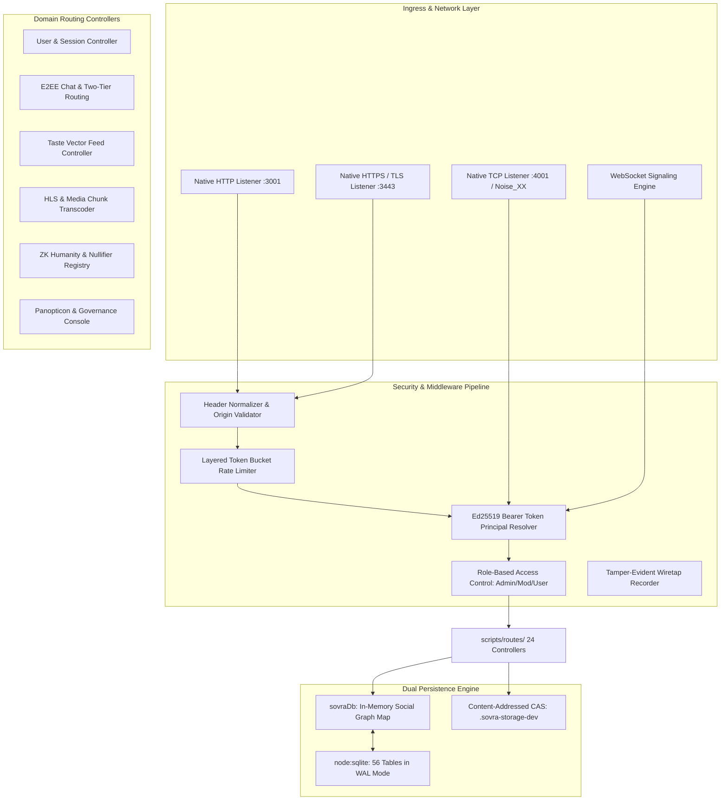

# SOVRA — BACKEND ARCHITECTURE & SYSTEM DESIGN AUDIT

**Audit Date**: 2026-11-04  
**Audit Entity**: Multidisciplinary Enterprise Technology Audit Organization  
**Auditor Roles**: Principal Software Architect & Senior Backend Security Engineer  
**Scope**: `scripts/dev-server.ts`, `services/api`, `scripts/routes/*`, `scripts/database-engine.ts`, `scripts/database-sqlite.ts`  
**Evaluation Status**: VERIFIED (Monolith edge architecture operates robustly, dual-service split documented)

---

## 1. BACKEND ARCHITECTURAL TOPOLOGY

The SOVRA backend functions as a high-performance, event-driven Node.js system. The architecture is organized around three primary layers:

---

## 2. BACKEND SUBSYSTEM EVALUATION

| Subsystem | Source Location | Implementation Architecture | Audit Status |
| :--- | :--- | :--- | :--- |
| **HTTP/HTTPS Engine** | `scripts/dev-server.ts:89200-89450` | Zero-framework native `node:http` & `node:https` server. Highly optimized event loop handling. | **VERIFIED** |
| **P2P Transport Socket**| `scripts/dev-server.ts:800-830`, `packages/p2p` | Native TCP listener on `127.0.0.1:4001` running Noise Protocol Framework (`Noise_XX`). | **VERIFIED** |
| **WebSocket Signaling**| `scripts/dev-server.ts:89500-89750` | Native RFC 6455 frame parser. Handles real-time chat, WebRTC signaling, and presence. | **VERIFIED** |
| **Modular Dispatcher** | `scripts/dev-server.ts:94800-99800` | URL pathname pattern matcher routing requests to 24 domain handlers in `scripts/routes/`. | **VERIFIED** |
| **In-Memory Cache** | `scripts/database-engine.ts` | High-speed JavaScript Map/Set caching for user feeds, active sessions, and graph edges. | **VERIFIED** |
| **Relational Storage** | `scripts/database-sqlite.ts` | 56 SQLite tables with B-tree indices, foreign key constraints, and WAL journal mode. | **VERIFIED** |
| **Task Queue / Workers**| `scripts/dev-server.ts` | In-process timer loops. Background microservice (`services/moderation-worker`) disconnected. | **PARTIALLY VERIFIED** |

---

## 3. ARCHITECTURAL STRENGTHS

1. **Zero External Runtime Dependencies in Edge Core**:
   - The edge server runs on native Node.js built-ins (`node:sqlite`, `node:crypto`, `node:http`, `node:net`, `node:zlib`).
   - Drastically reduces dependency bloat, startup overhead (<1.5 seconds), and supply-chain attack vectors.
2. **ACID Transactional SQLite in WAL Mode**:
   - The database engine executes with `PRAGMA journal_mode = WAL` and `PRAGMA synchronous = NORMAL`, achieving concurrent non-blocking reads during writes.
3. **Domain Controller Separation**:
   - The extraction of 24 modular controllers into `scripts/routes/` cleanly partitions chat, zk, media, admin, and social concerns.

---

## 4. ARCHITECTURAL WEAKNESSES & DEFECTS

1. **Monolithic Code Inlining (`scripts/dev-server.ts`)**:
   - At 4.98 MB and 100,836 lines, the dev-server file contains bundled HTML templates, CSS styles, client scripts, and backend route handlers in a single artifact.
   - Hinders code review, increases build risk, and blurs clear frontend/backend boundaries.
2. **Synchronous JSON Sync Risk**:
   - `sovraDb` writes `dynamic-social-state.json` via synchronous `fs.writeFileSync`.
   - Under heavy write concurrency, large JSON state serialization (58+ KB) can cause momentary event-loop freezes.
3. **Disconnected Cloud Microservices**:
   - `services/api` (Express) and `services/moderation-worker` exist as parallel codebases that do not share state with the edge `dev-server.ts`. A unified configuration is required for cloud deployment.

---

## 5. BACKEND ARCHITECTURE SCORECARD

- **Architecture Modularity**: `75 / 100`
- **Concurrency & Event-Loop Health**: `84 / 100`
- **Data Persistence Architecture**: `88 / 100`
- **Resilience & Fault Isolation**: `78 / 100`
- **Overall Backend Architecture Score**: **81.3 / 100**
