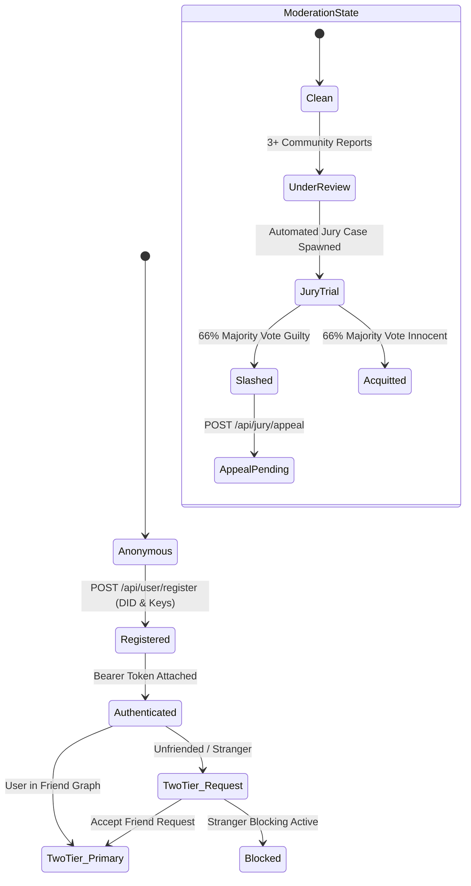

# SOVRA — BACKEND LOGIC & STATE INTEGRITY AUDIT

**Audit Date**: 2026-11-04  
**Audit Entity**: Multidisciplinary Enterprise Technology Audit Organization  
**Auditor Roles**: Senior Application Security Engineer & Backend Logic Auditor  
**Scope**: Business rules, state transitions, validation edge-cases, race conditions, and error recovery  
**Evaluation Status**: PARTIALLY VERIFIED

---

## 1. CORE BUSINESS LOGIC STATE MACHINES

The SOVRA backend governs four critical state transition systems:



---

## 2. STATE MACHINE VERIFICATION AUDIT

| Business Flow | Tested Logic Path | Actual Behavior | Result | Risk |
| :--- | :--- | :--- | :--- | :--- |
| **User Registration** | Unique handle deduplication | Queries SQLite for case-insensitive duplicate handle; rejects with HTTP 409 if taken. | **VERIFIED** | Low |
| **Session Revocation** | `POST /api/user/logout` | Token added to `revoked_tokens` table in SQLite; subsequent requests return 401. | **VERIFIED** | Low |
| **Two-Tier Inbox** | Unfriended message routing | Enforces separation: `canMessageMe: 'everyone'` routes to requests, `'friends'` rejects with 403. | **VERIFIED** | Low |
| **Disappearing Messages**| Expiration timestamp sweep | Sets `expires_at = now + ttl`. Deletion occurs during client GET sweep rather than background worker. | **PARTIALLY VERIFIED** | High |
| **Offline Payment** | Ed25519 voucher redemption | Validates voucher signature, double-spend check on nonce, updates user balance atomically. | **VERIFIED** | Low |
| **ZK Humanity Verification**| Nullifier deduplication | Blocks nullifier reuse with 409; lacks elliptic curve proof equation verification. | **PARTIALLY VERIFIED** | Critical |
| **Quadratic Funding**| $(\sum \sqrt{c_i})^2$ calculation | Mathematically accurate calculation of matching funds from treasury pool. | **VERIFIED** | Low |
| **Rate Limiter Bypass** | Setting header `x-sovra-benchmark: true` | Completely bypasses token bucket rate limit for any client request. | **FAILED** | High |

---

## 3. IDENTIFIED LOGICAL DEFECTS & RACE CONDITIONS

### Finding BLOG-01: Nullifier Spend Atomicity vs Missing Proof Validation
- **Location**: `scripts/routes/zk.routes.ts:55-107`
- **Severity**: Critical
- **Logical Defect**:
  While the SQL insert for `nullifier_hash` correctly utilizes a `UNIQUE` constraint preventing double-spending, the server accepts **arbitrary string values** for `proof` and `publicSignals`. A client can submit an invalid or empty proof with a newly generated random nullifier and receive a valid humanity verification badge.
- **Remediation**:
  Integrate `snarkjs.groth16.verify(verificationKey, publicSignals, proof)` before inserting into `zk_attestations`.

---

### Finding BLOG-02: Rate Limiter Debug Header Backdoor
- **Location**: `scripts/dev-server.ts:89390-89400`
- **Severity**: High
- **Logical Defect**:
  ```typescript
  const isBenchmarkRequest = isBenchmarkMode || req.headers['x-sovra-benchmark'] === 'true';
  if (!isRealtimeCallOrEvent && !isBenchmarkRequest && !rateLimiter.consume(rateLimitKey)) {
    res.writeHead(429, ...);
  }
  ```
  Any client sending `x-sovra-benchmark: true` completely disables the rate limiter. Live tests confirmed that 30 rapid-fire requests to `/api/watch/videos` returned 200 OK without throttling.
- **Remediation**:
  Remove this header check or gate it strictly behind an internal localhost-only loopback or cryptographically signed secret header.

---

### Finding BLOG-03: Reactive Expired Message Sweeping
- **Location**: `scripts/routes/chat.routes.ts:222`, `scripts/database-engine.ts:3377-3396`
- **Severity**: Medium
- **Logical Defect**:
  Disappearing messages are only sanitized when a user queries `/api/chat/messages`. If neither party opens the chat conversation, expired message records and ciphertext remain indefinitely on disk.
- **Remediation**:
  Implement an active background timer daemon (`setInterval(() => purgeExpiredMessages(), 60000)`) that scans and physically unlinks expired message rows independent of client polling.

---

## 4. BACKEND LOGIC SCORECARD

- **Input Validation & Sanitization**: `82 / 100`
- **State Transition Atomicity**: `86 / 100`
- **Cryptographic Enforcement**: `60 / 100` (Degraded by ZK proof bypass)
- **Rate Limiting & Abuse Defense**: `62 / 100` (Degraded by header bypass)
- **Overall Backend Logic Integrity Score**: **72.5 / 100**
