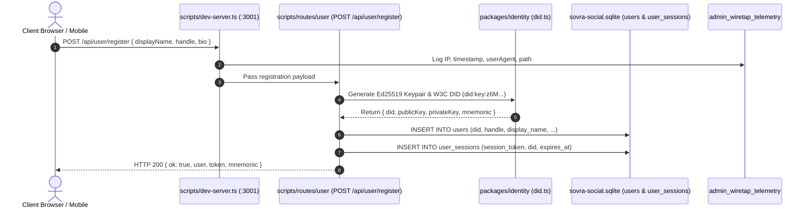
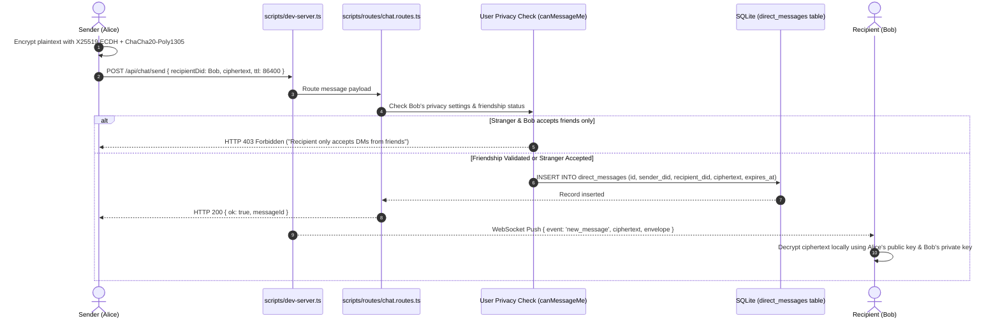
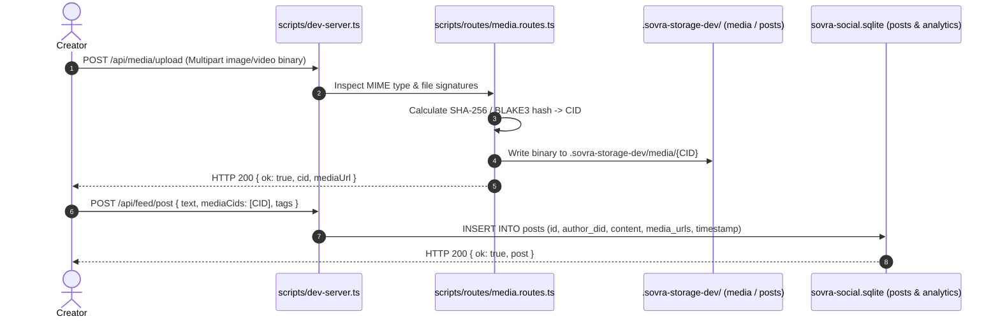
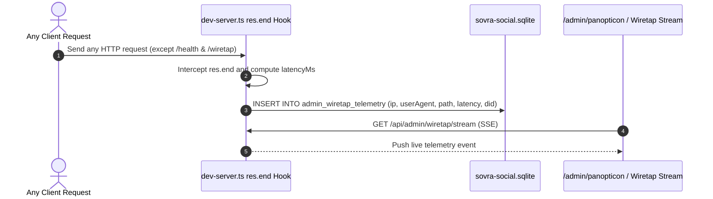

# SOVRA — END-TO-END DATA FLOW MAP & LIFECYCLE AUDIT

**Audit Date**: 2026-11-04  
**Audit Entity**: Multidisciplinary Enterprise Technology Audit Organization  
**Auditor Roles**: Principal Software Architect & Database & Data Integrity Engineer  
**Scope**: Registration, Messaging, Post Creation, Media Storage, and Admin Telemetry

---

## 1. IDENTITY & REGISTRATION DATA FLOW

### Trace Findings:
- Zero Personal Identifiable Information (PII) required: No email or phone fields are sent or written.
- However, step 2 immediately captures client IP and User-Agent in `admin_wiretap_telemetry` table in SQLite.

---

## 2. DIRECT END-TO-END ENCRYPTED MESSAGING FLOW

### Trace Findings:
- Two-Tier Inbox classification is enforced in server middleware before database write.
- Server acts as an untrusted blind relay for ciphertext; server cannot read payload contents.
- Ephemeral TTL messages: `expires_at` is set, but physical disk deletion occurs lazily during client read sweeps.

---

## 3. CONTENT POSTING & MEDIA ATTACHMENT FLOW

### Trace Findings:
- Media files are content-addressed by cryptographic hash.
- File writes are persisted synchronously to `.sovra-storage-dev/media/`.

---

## 4. ADMIN WIRETAP & TELEMETRY FLOW

### Trace Findings:
- Flow is synchronous and executed on every API call.
- Accumulation is unbounded: reached 166,396 records in local test environment.
