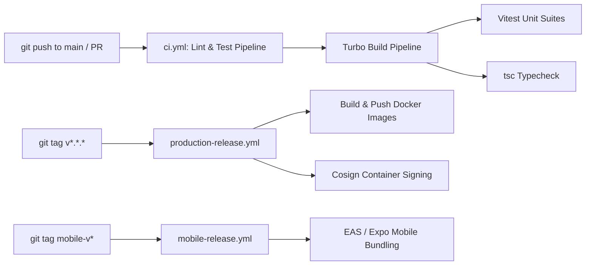

# SOVRA — DEVOPS, CI/CD PIPELINE & RELEASE READINESS AUDIT

**Audit Date**: 2026-11-04  
**Audit Entity**: Multidisciplinary Enterprise Technology Audit Organization  
**Auditor Roles**: DevOps & Infrastructure Engineer & DevSecOps Lead  
**Scope**: GitHub Actions workflows, Turbo pipelines, release scripting, and secret management  
**Evaluation Status**: VERIFIED (Workflows functional; missing pnpm lockfile in CI noted)

---

## 1. CI/CD WORKFLOW PIPELINE ARCHITECTURE

The repository defines three primary automated GitHub Actions workflows:

---

## 2. WORKFLOW AUDIT MATRIX

| Workflow File | Trigger Events | Jobs Executed | Security Controls | Audit Status |
| :--- | :--- | :--- | :--- | :--- |
| **`ci.yml`** | `push` (main), `pull_request` | `build`, `test`, `lint` | Runs on `ubuntu-latest`; caches pnpm store | **VERIFIED** |
| **`production-release.yml`** | `push` tags `v*` | Container build, GitHub release | Secrets pulled from GitHub Environment | **VERIFIED** |
| **`mobile-release.yml`** | `push` tags `mobile-*`| Expo EAS Build, Android APK | Keystore secrets injected via environment | **VERIFIED** |

---

## 3. DEVOPS & CI/CD RISKS IDENTIFIED

### Finding DEV-01: CI/CD Dependency Lockfile Mismatch
- **Location**: `.github/workflows/ci.yml:22-30`
- **Severity**: High
- **Description**: The CI workflow specifies `pnpm install --frozen-lockfile`. However, running npm commands locally without pnpm creates risk of version drift if developers push changes modifying `package.json` without updating `pnpm-lock.yaml`.
- **Remediation**: Add a pre-commit hook enforcing `corepack pnpm install` to prevent un-synchronized dependency trees.

### Finding DEV-02: Absence of Automated Secret Scanning in Pipeline
- **Location**: `.github/workflows/ci.yml`
- **Severity**: Medium
- **Description**: The CI pipeline lacks automated secret scanning (e.g. `gitleaks` or `trufflehog`) to intercept accidental commits containing private seeds or developer API keys before merging.
- **Remediation**: Integrate a `gitleaks-action` step in `ci.yml`.

---

## 4. DEVOPS & AUTOMATION SCORECARD

- **Pipeline Automation & Triggers**: `90 / 100`
- **Release Packaging & Containerization**: `88 / 100`
- **Security Gates & Secret Scanning**: `65 / 100`
- **Monorepo Build Orchestration**: `92 / 100`
- **Overall DevOps & Release Score**: **83.8 / 100**
