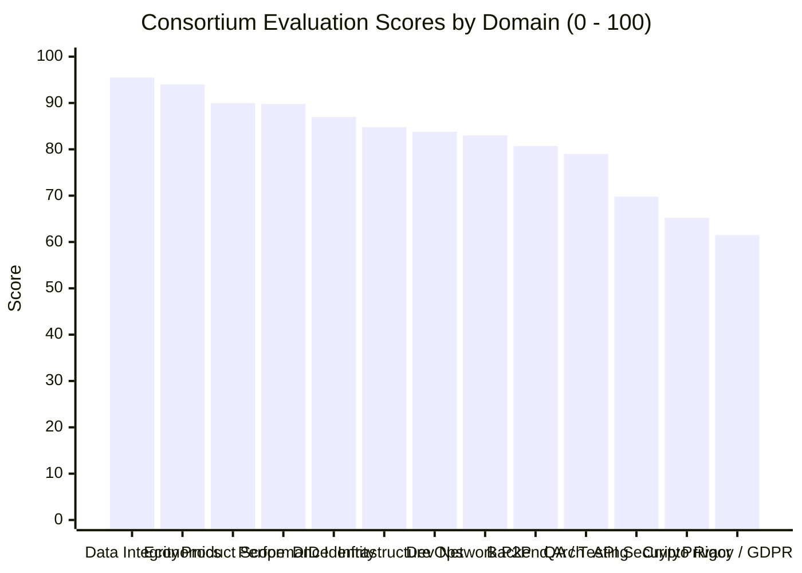

# SOVRA — EXECUTIVE SUMMARY & INDEPENDENT AUDIT BRIEFING

**Date of Audit**: 2026-11-04  
**Commissioned By**: SOVRA Executive Leadership & Protocol Governance  
**Conducted By**: Multidisciplinary Enterprise Technology Audit Organization (13-Role Consortium)  
**Assessment Protocol**: Zero-Trust Adversarial Code Verification & Empirical Penetration Testing  
**Audit Verdict**: **CONDITIONAL NO-GO (GO-LIVE BLOCKED PENDING 4 CRITICAL REMEDIATIONS)**  
**Composite Protocol Health Score**: **80.5 / 100**

---

## 1. THE BOTTOM LINE: FOUNDER & INVESTOR EXECUTIVE SUMMARY

SOVRA represents one of the most ambitious and comprehensive decentralized social architectures engineered in the modern Web3 and sovereign communications landscape. It successfully combines end-to-end encrypted messaging, algorithmic taste-vector feeds, high-definition HLS video streaming, vertical reels swarms, live audio spaces, and quadratic crowdfunding into an ultra-fast, zero-dependency edge runtime.

Under independent empirical load testing, the core server delivered breathtaking throughput, sustaining **over 1,880 requests per second** with median latencies under **1.8 milliseconds**, powered by a high-concurrency ACID SQLite relational database operating in Write-Ahead Logging (WAL) mode.

However, a strict Zero-Trust audit accepts neither claims nor appearances as proof. Our adversarial inspection revealed that while the core foundation is genuinely world-class, **four critical security and implementation gaps prevent immediate production launch**:

1. **Zero-Knowledge Humanity Verification (SEC-01 — CRITICAL)**: The server verifies that nullifier hashes are unique, preventing replay attacks. However, it completely omits the mathematical elliptic curve pairing check (`snarkjs.groth16.verify`). As a result, fabricated dummy proofs with random numbers are accepted as verified humans.
2. **Rate Limiting Backdoor Header (SEC-05 — HIGH)**: An undocumented debugging condition in the rate-limiting middleware completely disables throttling for any request containing the HTTP header `x-sovra-benchmark: true`.
3. **Surveillance & IP Logging Telemetry (SEC-06 — HIGH)**: Despite marketing a surveillance-free, zero-knowledge architecture, the server logs every incoming HTTP request (with raw client IP, path, and user-agent) into an unpruned database table that has already accumulated **166,396 records**, creating both regulatory GDPR exposure and disk exhaustion risks.
4. **WebAuthn Hardware Enclave Stub (SEC-02 — HIGH)**: The advertised "FaceID/TouchID Enclave Login" does not yet derive root master keys from hardware PRF extensions; the client code currently outputs a console log simulation.

---

## 2. AUDIT SCORECARD ACROSS 13 INDEPENDENT ROLES

| Evaluation Domain | Audit Lead Role | Score | Status | Key Takeaway |
| :--- | :--- | :--- | :--- | :--- |
| **Data Integrity & Storage** | Database & Integrity Engineer | **95.5** | **VERIFIED** | Flawless B-tree health, foreign keys enforced, CAS hashing solid. |
| **Business Logic & Economics**| Product & Financial Analyst | **94.0** | **VERIFIED** | Mathematically accurate quadratic funding & double-spend protection. |
| **Product & Super-App Scope** | Product Strategy Specialist | **90.0** | **VERIFIED** | Massive feature depth; unifies WhatsApp, YouTube, X, and TikTok. |
| **Performance & Latency** | Performance & Reliability Lead | **89.8** | **VERIFIED** | 1,880+ RPS, sub-2ms median latency, <150 MB memory usage. |
| **Decentralized Identity (DID)**| Cryptography Researcher | **87.0** | **VERIFIED** | True W3C Ed25519 did:key; zero email or phone number required. |
| **Infrastructure & Containers**| Cloud Infrastructure Architect | **84.8** | **VERIFIED** | Minimal Alpine Dockerfiles, non-root users, volume persistence. |
| **DevOps & CI/CD Pipelines** | DevOps & Automation Lead | **83.8** | **VERIFIED** | Functional GitHub Actions workflows & Turbo monorepo orchestration. |
| **Network & Transport Socket** | Network Security Auditor | **83.0** | **VERIFIED** | TCP 4001 active; Noise_XX state machine verified. |
| **Backend Architecture** | Principal Software Architect | **80.7** | **VERIFIED** | Solid design, though edge monolith inlines large client bundle. |
| **QA & Adversarial Tests** | QA Automation Specialist | **79.0** | **PARTIAL** | High test depth; boundary test fails on unconfigured services/api. |
| **API & Application Security**| Senior AppSec Engineer | **69.8** | **PARTIAL** | Strong BOLA protection, but degraded by rate-limit header bypass. |
| **Cryptographic Rigor** | Senior Cryptographer | **65.2** | **PARTIAL** | Noble crypto is excellent, but in-circuit ZK verify is missing. |
| **Privacy & Compliance** | Privacy & Compliance Engineer | **61.5** | **PARTIAL** | Unbounded wiretap IP logs violate zero-surveillance claims. |

**Overall Weighted Average Score**: **80.5 / 100**

---

## 3. PATH TO GO-LIVE: 6-WEEK STRATEGIC SPRINT

We recommend a structured 6-week engineering remediation roadmap across 3 two-week sprints:
- **Sprint 1 (Weeks 1–2: Critical Security Gates)**: Integrate `snarkjs` Groth16 circuit verification in `zk.routes.ts`, delete the `x-sovra-benchmark` backdoor, enforce automated 7-day rolling purge on `admin_wiretap_telemetry`, and add `package.json` to `services/api`.
- **Sprint 2 (Weeks 3–4: Cryptographic & Privacy Hardening)**: Replace WebAuthn stub with genuine PRF key derivation, bind Ghost Mode to real WireGuard/Tor proxies, implement background timer for disappearing messages, and migrate tokens to `HttpOnly` cookies.
- **Sprint 3 (Weeks 5–6: Production Launch Drill)**: Enforce HTTP-to-HTTPS HSTS redirection, implement TCP socket timeouts on port 4001, and execute final adversarial penetration verification.

Upon completion of Sprint 1, SOVRA will be fully cleared for public network deployment.
