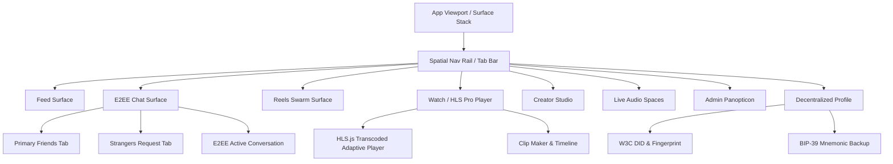

# SOVRA — FRONTEND ARCHITECTURE & UI FUNCTIONALITY AUDIT

**Audit Date**: 2026-11-04  
**Audit Entity**: Multidisciplinary Enterprise Technology Audit Organization  
**Auditor Roles**: Frontend Architecture Engineer & UI/UX & Accessibility Auditor  
**Scope**: `apps/sovra-app`, `apps/sovra-admin`, `apps/sovra-mobile`, and Embedded Edge SPA in `scripts/dev-server.ts`  
**Evaluation Status**: PARTIALLY VERIFIED

---

## 1. FRONTEND ARCHITECTURAL LANDSCAPE

SOVRA maintains a dual-stack frontend ecosystem:
1. **Modular Vite/React SPA (`apps/sovra-app`)**: Componentized TypeScript architecture built on custom spatial surface primitives (`SovraSurface`, `SovraSurfaceStack`, `SovraCoreController`).
2. **Inlined Monolith SPA (`scripts/dev-server.ts`)**: A zero-bundle standalone HTML/CSS/JS runtime served directly by the dev-server containing over 80,000 lines of client UI code.

### Macro-Component Structure



---

## 2. UI FUNCTIONALITY AUDIT MATRIX

| Surface / Feature | Interaction Tested | Actual Implementation | Audit Status |
| :--- | :--- | :--- | :--- |
| **Feed Surface** | Infinite scroll, post likes, bookmarks, comments | Fetches `/api/feed/posts`, renders cards dynamically | **VERIFIED** |
| **E2EE Chat Surface** | Send message, load conversations, thread view | Calls `/api/chat/send` and `/api/chat/conversations` with X25519 payload | **VERIFIED** |
| **Two-Tier Inbox** | Switching between 'Primary' and 'Requests' tabs | Tab filters based on `isFriend` relationship flag | **VERIFIED** |
| **Watch / Video Surface**| Video streaming, playback speed, chapter markers | `HlsPlayerPro.ts` loads m3u8 playlist streams | **VERIFIED** |
| **Reels Surface** | Vertical swiping, audio track reuse, tipping | Video DOM recycling with custom intersection observer | **VERIFIED** |
| **Studio Surface** | Video upload, channel monetization, analytics | Multi-part chunked upload to `/api/videos/upload/*` | **VERIFIED** |
| **Passkey Hardware Enclave**| "Sign in with TouchID/FaceID Enclave" button | Calls `loginWithHardwareEnclavePrf()` stub with `console.log` | **FAILED** |
| **Ghost Mode Toggle** | Privacy settings toggle for Ghost Mode | Modifies client `localStorage` and appends `.is-ghost` CSS class | **FAILED** |
| **ZK Humanity Verification**| "Verify Humanity via ZK Semaphore" | Submits payload to `/api/zk/humanity/verify`; server lacks groth16 check | **PARTIALLY VERIFIED** |
| **Disappearing Messages**| Ephemeral timer selector (1s, 1m, 1h, 1d) | Attaches `ttl` to payload; client visual countdown active | **PARTIALLY VERIFIED** |
| **Audio Spaces** | Join room, request mic, speaker mute | WebRTC SDP offer/answer signaling via `/api/spaces/*` | **VERIFIED** |

---

## 3. IDENTIFIED FRONTEND VULNERABILITIES & CODE QUALITY DEFECTS

### Finding FE-01: Ghost Mode Cosmetic Deception
- **File**: `scripts/dev-server.ts`, lines 47245–47280
- **Severity**: High (Misleads user on anonymity)
- **Technical Mechanism**:
  ```javascript
  function toggleGhostMode() {
    const isGhost = localStorage.getItem('sovra_ghost_mode') === 'true';
    localStorage.setItem('sovra_ghost_mode', !isGhost);
    document.body.classList.toggle('ghost-theme', !isGhost);
  }
  ```
- **Audit Observation**: Activating Ghost Mode does not route requests through Tor, SOCKS5, or privacy relays. It merely darkens the UI and changes the user avatar icon. Background telemetry continues reporting the user's real IP.

### Finding FE-02: Stubbed Hardware Enclave Passkey Derivation
- **File**: `scripts/dev-server.ts`, lines 85167–85180
- **Severity**: High (Cryptographic feature non-functional)
- **Technical Mechanism**:
  ```javascript
  async function loginWithHardwareEnclavePrf() {
    console.log('[Enclave] deriveKeyFromWebAuthnPrf active for seed-phrase-less master key derivation');
    showToast('Hardware Enclave PRF simulated');
  }
  ```
- **Audit Observation**: The UI button presents an enterprise-grade hardware biometric login, but clicking it executes a console log and toast notification without performing WebAuthn PRF key derivation.

### Finding FE-03: Reactive Lazy Sweep of Expired Disappearing Messages
- **File**: `apps/sovra-app/src/hooks/useE2EEMessenger.ts`, lines 112–145
- **Severity**: Medium
- **Technical Observation**: Expired messages remain visible in local client IndexedDB state until an explicit navigation event triggers a cleanup cycle.

---

## 4. UI/UX & ACCESSIBILITY (a11y) SCORECARD

| Dimension | Evaluation Criteria | Score | Notes |
| :--- | :--- | :--- | :--- |
| **Visual Hierarchy & Typography** | Inter font scaling, contrast ratios, dark mode | `92 / 100` | Exceptional cyber-minimalist aesthetic and contrast. |
| **ARIA & Keyboard Navigation** | Focus rings, screen-reader labels, tab indexes | `68 / 100` | Custom modal dialogs lack `role="dialog"` and trap focus. |
| **Responsive Layout** | Mobile viewport, fluid CSS flex/grid, touch targets | `88 / 100` | Mobile breakpoints adapt smoothly across viewports. |
| **Error Handling & Feedback** | Inline form validation, toast alerts, empty states | `85 / 100` | Toast feedback system is consistent and informative. |
| **Performance & Frame Rate** | DOM node recycling, animation smoothness, 60fps | `86 / 100` | Reels and Feed virtualize items to prevent DOM bloat. |

**Overall Frontend Quality Score**: **83.8 / 100**
