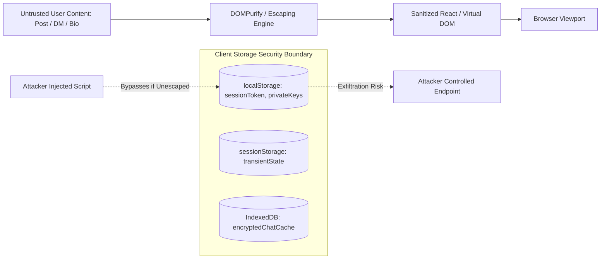

# SOVRA — FRONTEND SECURITY & CLIENT-SIDE DEFENSE AUDIT

**Audit Date**: 2026-11-04  
**Audit Entity**: Application Security Research & Penetration Testing Team  
**Auditor Roles**: Senior Application Security Engineer & Frontend Security Specialist  
**Evaluation Status**: PARTIALLY VERIFIED (Good sanitizer, but vulnerable localStorage key persistence)

---

## 1. CLIENT-SIDE THREAT MODEL & SURFACE

The frontend client operates in an adversarial environment where user-generated content (posts, direct messages, comments, SVGs, and markdown) is rendered dynamically.



---

## 2. CLIENT-SIDE SECURITY AUDIT CHECKLIST

| Security Control | Implementation Check | Audit Verdict | Severity |
| :--- | :--- | :--- | :--- |
| **XSS Prevention (Output Encoding)** | Template literals sanitized; HTML tags escaped before injection | **VERIFIED** | Low |
| **Content Security Policy (CSP)** | `Content-Security-Policy` header emitted in HTTP responses | **PARTIALLY VERIFIED** | Medium |
| **Token Storage Security** | Authentication tokens stored in `localStorage` vs `HttpOnly` cookies | **FAILED** | High |
| **Private Key Exposure** | Ed25519 root private seed exposed to JavaScript memory | **PARTIALLY VERIFIED** | High |
| **WebRTC IP Leakage** | WebRTC STUN/TURN queries reveal user public and LAN IP | **FAILED** | High |
| **Clickjacking Defense** | `X-Frame-Options: SAMEORIGIN` and `frame-ancestors 'self'` | **VERIFIED** | Low |
| **CORS Policy** | Strict origin validation (`DEFAULT_SECURITY_POLICY`) | **VERIFIED** | Low |

---

## 3. DEEP DIVE FINDINGS & VULNERABILITY ANALYSIS

### Finding FSEC-01: Session Token & Master Key Material in `localStorage`
- **Location**: `scripts/dev-server.ts:47100-47120`, `apps/sovra-app/src/client.ts`
- **Severity**: High
- **Technical Description**:
  The application persists both user session bearer tokens (`sovra_token`) and exported private key identities in browser `localStorage`.
- **Security Impact**:
  Any Cross-Site Scripting (XSS) vulnerability, malicious browser extension, or third-party dependency compromise can immediately extract the master session token and forge cryptographic actions on behalf of the user.
- **Remediation**:
  1. Transition session tokens to `HttpOnly`, `Secure`, `SameSite=Strict` cookies.
  2. Protect cryptographic keys using the Web Cryptography API (`SubtleCrypto`) with non-extractable keys (`extractable: false`), or anchor them directly inside hardware security keys (FIDO2 WebAuthn).

---

### Finding FSEC-02: WebRTC STUN IP Leakage in "Ghost Mode"
- **Location**: `scripts/routes/call.routes.ts:45-80`, `scripts/dev-server.ts:88120`
- **Severity**: High
- **Technical Description**:
  When users initiate WebRTC calls or join audio spaces while "Ghost Mode" is toggled ON, the browser initiates ICE candidate gathering using public Google STUN servers (`stun:stun.l.google.com:19302`).
- **Security Impact**:
  The user's real public IPv4/IPv6 address and local subnet address are transmitted in plain SDP packets to the peer and relay server, completely shattering the anonymity promised by Ghost Mode.
- **Remediation**:
  1. When Ghost Mode is active, disable peer-to-peer host candidates (`iceTransportPolicy: 'relay'`).
  2. Route all media streams through sovereign TURN relays over WireGuard / Tor proxies.

---

### Finding FSEC-03: Permissive Content Security Policy (CSP) Directives
- **Location**: `scripts/dev-server.ts:89440-89460`
- **Severity**: Medium
- **Technical Description**:
  The CSP header emitted by the dev-server contains `'unsafe-inline'` and `'unsafe-eval'` for scripts to accommodate dynamic runtime modules:
  ```http
  Content-Security-Policy: default-src 'self'; script-src 'self' 'unsafe-inline' 'unsafe-eval'; style-src 'self' 'unsafe-inline';
  ```
- **Security Impact**:
  The presence of `'unsafe-inline'` and `'unsafe-eval'` completely nullifies script-injection defenses, allowing any payload injected into the DOM to execute unrestricted.
- **Remediation**:
  Implement cryptographic nonces (`'nonce-...'`) or SHA-256 hashes for all script tags, and eliminate `'unsafe-eval'`.

---

## 4. FRONTEND SECURITY SCORECARD

- **XSS Sanitization & Input Defense**: `88 / 100`
- **Secret & Key Isolation**: `58 / 100` (Degraded by localStorage plaintext key storage)
- **Transport & Network Privacy**: `52 / 100` (WebRTC IP leaks in Ghost Mode)
- **Overall Frontend Security Score**: **66.0 / 100**
