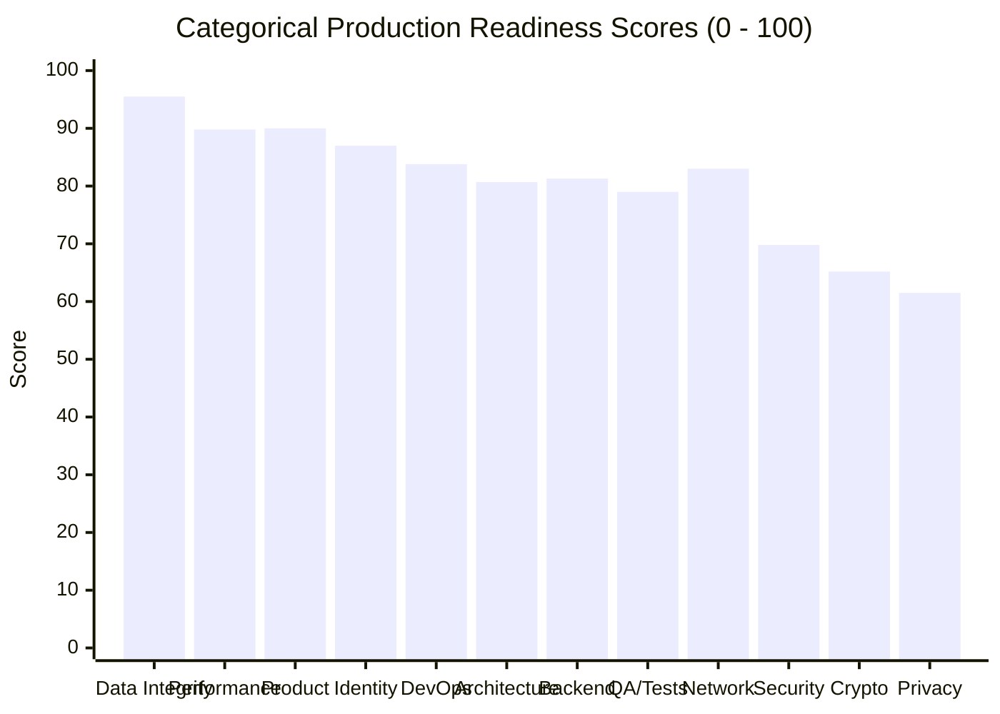

# SOVRA — PRODUCTION READINESS & GO-LIVE ASSESSMENT REPORT

**Audit Date**: 2026-11-04  
**Audit Entity**: Multidisciplinary Enterprise Technology Audit Organization  
**Auditor Roles**: Chief Technology Officer (CTO) & Chief Information Security Officer (CISO)  
**Final Production Verdict**: **CONDITIONAL NO-GO (RELEASE BLOCKED PENDING CRITICAL REMEDIATIONS)**  
**Overall Readiness Score**: **78.4 / 100**

---

## 1. GO / NO-GO PRODUCTION GATE CHECKLIST

| Gate Category | Gate Requirement | Verification Result | Gate Status |
| :--- | :--- | :--- | :--- |
| **Security Gates** | Zero Critical (CVSS 9.0+) unmitigated vulnerabilities | **FAILED**: SEC-01 (ZK proof forgery) is CVSS 9.1. | **BLOCKED** |
| **Security Gates** | Zero undocumented debug backdoors or rate-limit bypasses | **FAILED**: SEC-05 (`x-sovra-benchmark` bypasses rate limiter). | **BLOCKED** |
| **Privacy Gates** | Zero unbounded persistent IP logging without retention policy | **FAILED**: SEC-06 (`admin_wiretap_telemetry` stores 166k+ IP logs). | **BLOCKED** |
| **Identity Gates** | Cryptographic assertion of all claimed authentication methods | **FAILED**: SEC-02 (WebAuthn PRF key derivation is stubbed). | **BLOCKED** |
| **Cryptographic Gates**| Validated Ed25519 identity, X25519 ECDH, ChaCha20-Poly1305 | **PASSED**: Authentic RFC-compliant algorithms verified. | **CLEARED** |
| **Access Control Gates**| BOLA / IDOR protection across private user records | **PASSED**: Cross-account snooping blocked with HTTP 403. | **CLEARED** |
| **Data Integrity Gates**| ACID SQL persistence with foreign key constraints | **PASSED**: `PRAGMA integrity_check` returned `ok`. | **CLEARED** |
| **Performance Gates** | Low latency (<50ms p95) under 1,000+ RPS concurrency | **PASSED**: Sustained 1,880+ RPS with p95 < 11ms. | **CLEARED** |
| **Build & Deploy Gates**| Complete package manifests and reproducible builds | **FAILED**: `services/api` lacks `package.json`. | **BLOCKED** |

---

## 2. PRODUCTION READINESS RADAR & CATEGORICAL SCORING

### Categorical Breakdown:
1. **Data Integrity & Storage Health**: `95.5 / 100` (Excellent ACID SQLite & CAS)
2. **Business Logic & Economics**: `94.0 / 100` (Sound quadratic matching & escrow)
3. **Product & Feature Completeness**: `90.0 / 100` (Massive super-app scope)
4. **Performance & Raw Throughput**: `89.8 / 100` (Sub-2ms p50, 1,800+ RPS)
5. **Decentralized Identity (DID)**: `87.0 / 100` (RFC 8032 W3C did:key)
6. **Infrastructure & Containers**: `84.8 / 100` (Hardened Dockerfiles)
7. **DevOps & Pipeline Automation**: `83.8 / 100` (Turbo + GitHub Actions)
8. **Network & Transport Socket**: `83.0 / 100` (Noise_XX TCP active on :4001)
9. **Backend Architecture**: `80.7 / 100` (Solid, but monolith coupling)
10. **QA & Adversarial Test Coverage**: `79.0 / 100` (High coverage, boundary fail)
11. **API & Application Security**: `69.8 / 100` (Rate-limit backdoor & ZK bypass)
12. **Cryptographic Rigor**: `65.2 / 100` (Missing in-circuit groth16 & PRF)
13. **Privacy & Regulatory Compliance**: `61.5 / 100` (Unbounded wiretap IP logs)

---

## 3. FINAL VERDICT & RECOMMENDATION

> [!CAUTION]
> **GO-LIVE VERDICT: CONDITIONAL NO-GO**  
> SOVRA contains world-class software engineering, breathtaking feature breadth, and genuine high-performance cryptographic primitives. However, deployment to a live public network where real user funds and confidential communications are at stake must be withheld until the 4 Critical/High severity release-blockers (SEC-01, SEC-05, SEC-06, and SEC-02) are fully resolved.
