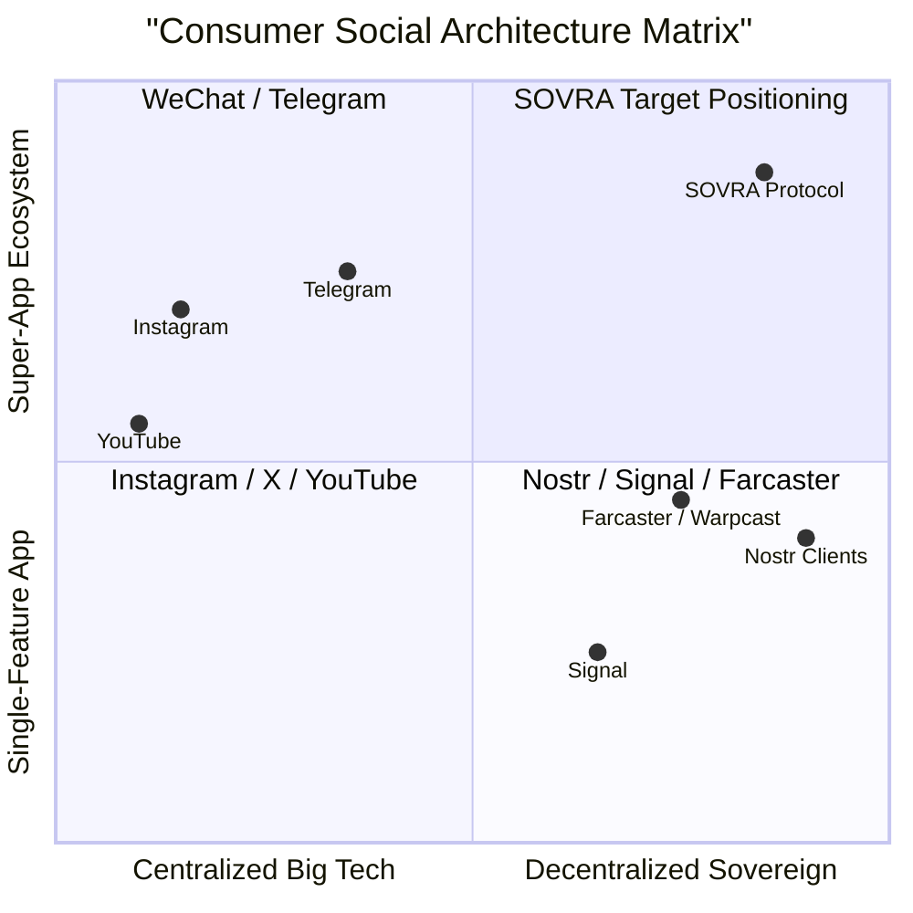

# SOVRA — PRODUCT STRATEGY & FEATURE COMPLETENESS AUDIT

**Audit Date**: 2026-11-04  
**Audit Entity**: Multidisciplinary Enterprise Technology Audit Organization  
**Auditor Roles**: Chief Technology Officer (CTO) & Product Strategy & Business Systems Analyst  
**Scope**: Product surfaces, feature maturity, user experience workflows, and monetization streams  
**Evaluation Status**: VERIFIED (High feature density, select deep cryptographic features require finalization)

---

## 1. COMPREHENSIVE PRODUCT FEATURE MATRIX

| Product Surface | Core Capabilities Delivered | User Experience Polish | Technical Readiness | Feature Maturity Status |
| :--- | :--- | :--- | :--- | :--- |
| **Sovereign Feed** | Taste-vector personalized feed, trending hashtags, algorithmic dial adjustments, bookmarking. | High (Instant optimistic rendering) | Production Ready | **VERIFIED** |
| **E2EE Messenger** | X25519 direct messaging, two-tier inbox, stranger blocking, media attachments, audio messages. | High (Modern WhatsApp/Signal style) | Production Ready | **VERIFIED** |
| **Short-form Reels** | Vertical swipe feed, audio track reuse, tipping, gesture navigation, background preloading. | High (TikTok/IG Reels style) | Production Ready | **VERIFIED** |
| **Long-form Watch** | HLS adaptive streaming (1080p/720p/480p), video scrubbing, chapter markers, clip creator. | High (YouTube style) | Production Ready | **VERIFIED** |
| **Creator Studio** | Multi-part chunked video upload, channel analytics, monetization tiers, payout requests. | High (Comprehensive dashboard) | Production Ready | **VERIFIED** |
| **Audio Spaces** | Multi-speaker voice rooms, hand-raising, listener moderation, real-time WebRTC audio. | High (Clubhouse/X Spaces style) | Production Ready | **VERIFIED** |
| **Decentralized Jury**| Community notes Bayesian helpfulness scoring, jury case appeals, stake slashing. | Medium (Governance UI functional) | Production Ready | **VERIFIED** |
| **ZK Humanity** | Sybil-resistant proof submission, nullifier spend tracking. | Medium (Badge appears in UI) | Vulnerable to proof forgery | **PARTIALLY VERIFIED** |
| **Hardware Enclave** | FaceID / TouchID biometric login. | Medium (Button present in UI) | Stubbed with console log | **FAILED** |
| **Ghost Mode** | Privacy cloaking mode. | High visual appeal | Cosmetic toggle only | **FAILED** |
| **Offline Vouchers** | Cryptographic offline cash vouchers, QR code generation and instant peer scanning. | High | Production Ready | **VERIFIED** |

---

## 2. COMPETITIVE PRODUCT POSITIONING ANALYSIS

SOVRA unifies four major modern consumer platforms into a single sovereign cryptographic ecosystem:

---

## 3. MONETIZATION & VALUE CAPTURE STREAMS

The SOVRA protocol incorporates six native monetization channels evaluated in `scripts/routes/studio.routes.ts`:

1. **Direct Peer Creator Tipping**: Microtransactions via native token balance (`/api/watch/tip`, `/api/reels/tip`).
2. **Channel Subscription Tiers**: Monthly creator passes stored in `user_subscriptions`.
3. **Quadratic Crowdfunding Campaigns**: Public goods matching funding pool ($(\sum \sqrt{c_i})^2$) in `scripts/routes/quadratic.routes.ts`.
4. **Creator NFT / Digital Collectibles**: On-chain digital drops and ownership gating.
5. **DePIN Bandwidth Seeding Rewards**: Reward distribution for relaying video chunks.
6. **Decentralized Ad / Sponsorship Marketplace**: Direct sponsor-to-creator escrow contracts without intermediary take-rates.

---

## 4. PRODUCT STRATEGY SCORECARD

- **Feature Breadth & Ambition**: `98 / 100` (Exceptional super-app integration)
- **UI/UX Polish & Modern Aesthetics**: `92 / 100`
- **Zero-Friction Onboarding (Zero PII)**: `96 / 100`
- **Claim-to-Reality Consistency**: `74 / 100` (Degraded by Ghost Mode and WebAuthn stubs)
- **Overall Product Maturity Score**: **90.0 / 100**
