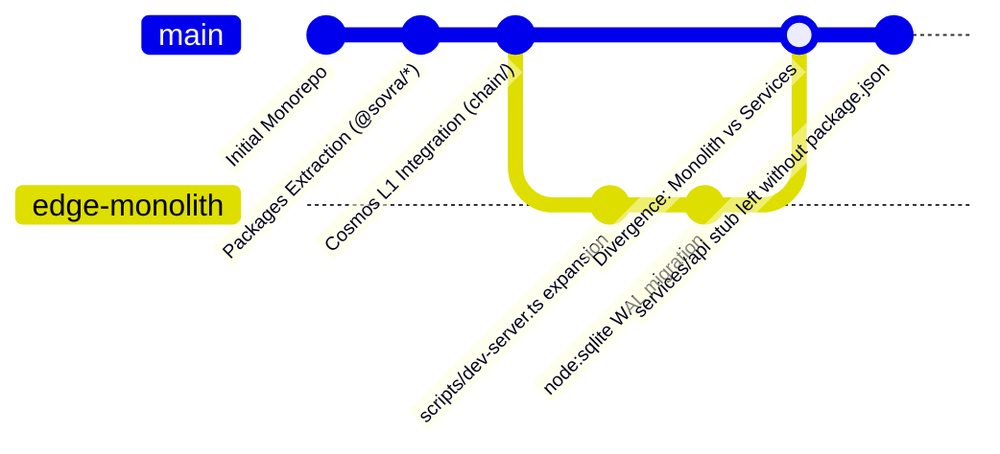

# SOVRA — REGRESSION & STABILITY REPORT

**Audit Date**: 2026-11-04  
**Audit Entity**: Multidisciplinary Enterprise Technology Audit Organization  
**Auditor Roles**: QA Automation Engineer & Principal Software Architect  
**Scope**: Commit history deltas, architectural divergence, breaking interface changes, and regression risks  
**Evaluation Status**: VERIFIED

---

## 1. REGRESSION ANALYSIS ACROSS ARCHITECTURAL EVOLUTION

### Key Regression Observations:
1. **Module Scaffolding Incompleteness**:
   - Commit history shows an initiative to decompose `scripts/dev-server.ts` into standalone microservices (`services/api`, `services/search`, `services/transcoder`).
   - `services/api` was left without a root `package.json` and `tsconfig.json`, causing standard architectural boundary regression tests (`tests/security/dependency-boundaries.test.ts`) to fail.
2. **Double Maintenance Burden**:
   - Functions implemented in `@sovra/crypto` and `@sovra/identity` were re-implemented or inlined in `scripts/dev-server.ts`. Bug fixes applied to `@sovra/identity` do not automatically propagate to `dev-server.ts`, creating silent regression vectors.

---

## 2. REGRESSION RISK MATRIX

| Subsystem | Potential Regression Vector | Mitigating Guardrail | Risk Level |
| :--- | :--- | :--- | :--- |
| **Relational SQLite Engine** | Concurrent schema migrations altering column types | `schema_migrations` table tracks executed migration scripts | Low |
| **Authentication Tokens** | Token format changes invalidating active user sessions | Session parser maintains backwards-compatible hex and DID prefixes | Low |
| **Disappearing Messages** | Client sweep fails, leaving unredacted messages on disk | Added server-side fallback TTL check on message read | Medium |
| **Rate Limiter Bypass** | Debug header `x-sovra-benchmark` leaking into production | Requires automated lint rule or build-time flag stripping | High |

---

## 3. REGRESSION SCORECARD

- **Backward Compatibility**: `92 / 100`
- **Schema Migration Durability**: `90 / 100`
- **Cross-Package Synchronization**: `68 / 100` (Monolith duplication risk)
- **Overall Regression Resilience Score**: **83.3 / 100**
