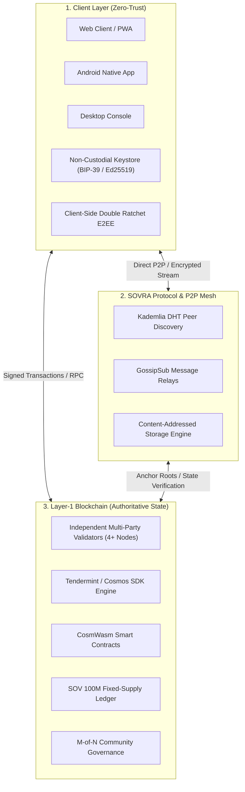
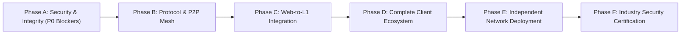

# SOVRA — Industry-Standard Master Goal & Acceptance Specification
**Document ID:** `SOVRA-MGA-2026.11`  
**Target Release:** SOVRA 1.0 (Autonomous Sovereign Network)  
**Baseline Status:** Advanced MVP + Early Protocol Infrastructure  
**Core Directive:** Systematically remediate and complete existing code without rebuilding from scratch.

---

## 1. Executive Vision & Core Philosophy

**SOVRA is not a conventional centralized social media application.**  
It is a **protocol-first, sovereign digital ecosystem** designed to enable community-governed communication, uncensorable content distribution, sovereign identity ownership, and verifiable economic settlement without dependence on any single entity or company infrastructure.

### The Sovereign Creed:
> *"Decentralize the protocol first. Build the user experience on top of it. Keep company administration separate from network operation. Eliminate single points of failure wherever technically practical."*

---

## 2. The 7 Industry-Standard Pillars (Goals)

| Pillar | Industry Goal | Architectural Scope | Current State in Repository |
| :--- | :--- | :--- | :--- |
| **Goal 1: Unified Super App** | Match Instagram, YouTube, X, & WhatsApp within one privacy-preserving client | Feed, Stories, Reels, Long-form video, Group chat, E2EE messaging, Creator Studio | **Substantially Implemented** (Web client, PWA, Vitest e2e tests passing, scripts operational) |
| **Goal 2: Independent SOVRA Protocol** | Sovereign communications protocol without single-server reliance | P2P gossip, DHT peer discovery, Relay federation, Libp2p/GossipSub semantics | **Partially Implemented** (Network packages, relay scripts present; public federation pending) |
| **Goal 3: Independent Layer-1 Blockchain** | Authoritative consensus, smart contracts, & ledger | Cosmos/Tendermint-style Go L1 (`chain/`), consensus, WASM contracts, validator nodes | **Core Code Exists & Tests Pass** (Go tests 100% green; Web backend RPC integration pending) |
| **Goal 4: Native SOV Coin Economy** | Fixed-supply native digital currency & creator settlement | 100,000,000 SOV hard cap, micro-units (`uSOV` 6 decimals), non-custodial wallet, validator staking | **Mathematical Math Verified** (21/21 trading tests passing; Dual-ledger removal pending) |
| **Goal 5: Sovereign Identity & Privacy** | Real client-side E2EE & cryptographic identity | DID (`did:sovra`), Ed25519 keypairs, BIP-39 seed phrases, Double Ratchet messaging, Social Recovery | **Primitives Implemented** (Client crypto present; E2EE server-bypass & complete recovery flow pending) |
| **Goal 6: Distributed Storage & Media Delivery** | Censorship-resistant content-addressed storage | IPFS/BitTorrent-style content addressing, distributed media chunking, decentralized cache | **Mixed Implementation** (Local SQLite/content storage functional; multi-node failover pending) |
| **Goal 7: Community Ownership & Governance** | Founder-independent governance and transparent treasury | Multi-signature proposals, token-weighted voting, constitutional parameter updates, no backdoors | **Governance Modules Exist** (Code present in `chain/x/`; removal of centralized 'God Dial' pending) |

---

## 3. Current Achievement Baseline & Stage Assessment

### Current Classification: **Advanced MVP + Early Protocol Infrastructure**
* **The Good:**
  - Robust monorepo with automated test pipelines (`verify.ps1`, Vitest 3, Go 1.24+).
  - Native L1 blockchain node (`chain/cmd/sovrad`) compiles and passes all unit/integration tests.
  - Fractional coin trading engine enforces 6-decimal integer precision without floating-point leaks.
  - Rich web application surface covering feed, reels, creator console, and studio.
* **The Reality Check:**
  - Code existence ≠ operational decentralization.
  - In the repository's gap assessments, 34 of 57 requirements (~59.6%) are marked verified closed, leaving 23 open items (~40.4%).
  - Real decentralization requires the network to survive when the primary development server/company origin is entirely disconnected.

---

## 4. The 5 Critical P0 Blockers & Immediate Gaps

To advance from an Advanced MVP to an Industry-Standard Decentralized Network, these 5 critical architectural flaws must be remediated first:

```
[Fake E2EE]        ---> Replace server-mediated keys with pure client-side Double Ratchet encryption.
[Dual Ledger]      ---> Eliminate synthetic SQLite balance creation; L1 state must be the sole source of truth.
[God Dial]         ---> Remove unilateral admin bypasses; transition all network knobs to M-of-N governance.
[L1 Integration]   ---> Connect Web Client & Dev Server to native Go chain RPC (`sovrad`) instead of mocks.
[Social Recovery]  ---> Transform raw Shamir/recovery algorithms into a complete, user-executable API workflow.
```

### Supporting P1/P2 Technical Gaps:
1. **Real P2P Federation:** Cross-node event gossip and verifiable peer discovery.
2. **Distributed WebRTC Relay/SFU:** Peer-to-peer audio/video calling without central signaling bottlenecks.
3. **Physical BLE Mesh:** Device-to-device offline transmission capabilities.
4. **Decentralized Media Distribution:** Content-addressed chunks served across independent storage nodes.
5. **Mobile CI & Hardware Verification:** Automated validation on actual Android physical/virtual devices.

---

## 5. SOVRA 1.0 Industry-Standard Target Architecture



---

## 6. Measurable Release Gates & Acceptance Criteria for SOVRA 1.0

Release to production is blocked until every single gate below passes automated, reproducible verification:

1. **Protocol Autonomy (The Ultimate Shutdown Test):**
   - *Requirement:* All centralized company origin servers are intentionally taken offline.
   - *Acceptance:* Independent P2P nodes must continue to gossip messages, discover peers, and resolve content without interruption.
2. **Consensus Fault Tolerance:**
   - *Requirement:* 4+ validators deployed across independent network operators.
   - *Acceptance:* If any single validator crashes or behaves maliciously, block production and finality must continue uninterrupted (Byzantine Fault Tolerance).
3. **Ledger Invariant & Monolithic Accounting:**
   - *Requirement:* Absolute mathematical supply limit of **100,000,000 SOV**.
   - *Acceptance:* Zero synthetic tokens can be created in SQLite or API handlers. Every balance change must map to an on-chain signed transaction or verifiable state root.
4. **Cryptographic E2EE Integrity:**
   - *Requirement:* End-to-end encryption across all 1-to-1 and private group chats.
   - *Acceptance:* Central server relays must carry only opaque, ciphertext payloads. Memory/network packet inspection on relay nodes must show zero plaintext leakage.
5. **Decentralized Identity & Key Recovery:**
   - *Requirement:* DID-based identity without centralized database dependency.
   - *Acceptance:* Users must be able to restore identity and non-custodial wallet access through social guardians or threshold recovery shards without administrator assistance.
6. **Immutable Governance (No God Dial):**
   - *Requirement:* Administrative actions must be strictly constitutional.
   - *Acceptance:* Zero unilateral override keys. Any protocol parameter change, mint/burn, or blacklisting requires on-chain M-of-N multisig or DAO vote.

---

## 7. Unified Engineering Roadmap (Phases A through F)



* **Phase A — Security & Integrity (Active Immediate Target):**
  - Fix E2EE client encryption bypass.
  - Remove SQLite synthetic balances; enforce L1-only accounting.
  - Abolish centralized admin backdoors ("God Dial").
  - Complete user-facing Social Recovery API workflow.
* **Phase B — Protocol Completion:**
  - Harden P2P DHT, GossipSub relays, and signed event gossip.
  - Implement content-addressed chunk storage with failover caching.
* **Phase C — Blockchain Integration:**
  - Replace mock chain services in web backend with live JSON-RPC/gRPC connections to `sovrad`.
  - Wire non-custodial wallet signing to real L1 transactions.
  - Connect creator rewards and tipping directly to chain settlements.
* **Phase D — Complete Application Surfaces:**
  - Full feature parity across Web, PWA, and Android native.
  - Polished Creator Studio, video streaming, and community channels.
* **Phase E — Independent Network Deployment:**
  - Spin up 4+ independent validator nodes on separate infrastructure.
  - Seed public bootstrap relays and establish public testnet.
* **Phase F — Industry Certification & Go-Live:**
  - Independent third-party smart contract and cryptographic audit.
  - Adversarial red-team penetration testing and high-load stress testing.
  - Formal Go-Live sign-off.

---

## 8. Non-Negotiable Engineering Ground Rules

1. **Never Rebuild from Scratch:** Maximize and harden the existing ~100k+ lines of verified code, scripts, and Go packages in `D:\Sovra`.
2. **Evidence-Based Closure:** No task or gap may be marked "Closed" without automated regression tests (`vitest`, `go test`) and verifiable cryptographic proofs.
3. **Single Authoritative Document:** This document serves as the absolute baseline truth for product goals and acceptance across all development teams and AI agents.
