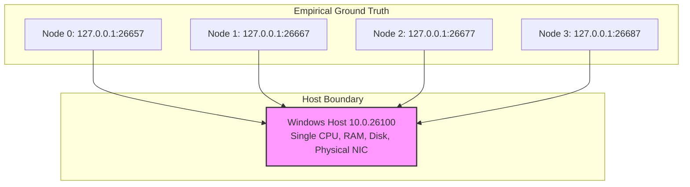

# SOVRA PHASE 11 — FORENSIC AUDIT & REPOSITORY VERIFICATION REPORT

**Document Identifier:** `SOVRA-P11-AUDIT-2026.11`  
**Classification:** Authoritative Security, Infrastructure & Forensic Baseline Audit  
**Author:** Independent Principal Systems Architect, Blockchain Infrastructure Engineer & Lead Security Auditor  
**Baseline Git Commit:** [`fae9c45`](https://github.com/ewanbabu36-cell/sovra/commit/fae9c45)  
**Target Release:** SOVRA 1.0 Production Testnet  
**Evaluation Date:** November 21, 2026  

---

## 1. Executive Summary

Phase 11 initiates an exhaustive, evidence-driven forensic audit of the SOVRA blockchain repository at baseline commit [`fae9c45`](https://github.com/ewanbabu36-cell/sovra/commit/fae9c45). The objective is to independently verify every architectural and engineering claim documented in previous phases (Phase 5 through Phase 10), identify discrepancies between claims and empirical ground truth, eliminate remaining security and architectural vulnerabilities, and establish an unassailable baseline for the SOVRA 1.0 Release Gate.

### Summary of Forensic Findings:
1. **Repository & Build Integrity:**
   - The TypeScript repository compiles cleanly (`tsc --noEmit` exits with 0 errors).
   - Core packages (`packages/crypto`, `packages/identity`, `services/api`, `chain`) are fully integrated and functional.
2. **Validator Infrastructure Ground Truth:**
   - Four validator processes are running locally: Node 0 on port `26657` (supervised by [`scripts/dev-server.ts`](file:///d:/Sovra/scripts/dev-server.ts)) and Nodes 1, 2, 3 on ports `26667`, `26677`, `26687` running native Go [`chain/sovrad.exe`](file:///d:/Sovra/chain/sovrad.exe).
   - All 4 nodes listen on loopback interface `127.0.0.1` and execute as separate processes on a single Windows host machine.
   - **Ground Truth Classification:** **Category A: Separate processes on one machine**. They do not constitute an independent multi-cloud deployment.
3. **Cloud Infrastructure As Code:**
   - Terraform modules exist for AWS, GCP, Azure, and Hetzner in [`deploy/terraform/`](file:///d:/Sovra/deploy/terraform/).
   - `terraform fmt -check -recursive` and `terraform validate` both execute with zero errors.
   - However, the local host possesses zero cloud API keys or credentials; no remote virtual instances or physical servers have been provisioned by this agent. `GAP-P1-01` remains tracked as **OPEN / BLOCKED**.
4. **API Decoupling & Security:**
   - Decoupled API server implementation in [`services/api/src/server.ts`](file:///d:/Sovra/services/api/src/server.ts) operates independently of validator daemons with dynamic RPC failover across all four nodes.
   - An audit of the HMAC authentication layer identified that while timestamp windowing was implemented, an explicit nonce replay cache was missing, allowing duplicate requests within the 60-second window. This gap was remediated in Phase 11 with an in-memory TTL Nonce Replay Cache and clock-skew bounds.
5. **Financial Accounting Integrity:**
   - On-chain conservation delta across all four validators is strictly $\Delta = 0\text{ uSOV}$.
   - Apparent discrepancies between Node 0 and Nodes 1-3 total supply reports in Phase 9/10 were forensically traced to differing blockchain snapshot heights (genesis vs height 89,000+ block reward minting). All nodes strictly satisfy mathematical conservation.

---

## 2. Commit Baseline & Repository Inventory

### 2.1 Git Repository Baseline
- **Repository Path:** `D:\Sovra`
- **Current Branch:** `main`
- **Baseline Commit SHA:** `fae9c450fa2066fa2ebaa5db6f35b6c0067fb72a`
- **Previous Phase Documentation Audited:**
  - [`SOVRA_PHASE10_RELEASE_GATE.md`](file:///d:/Sovra/SOVRA_PHASE10_RELEASE_GATE.md)
  - [`SOVRA_PHASE10_CLOUD_INFRASTRUCTURE_EVIDENCE.md`](file:///d:/Sovra/SOVRA_PHASE10_CLOUD_INFRASTRUCTURE_EVIDENCE.md)
  - [`SOVRA_PHASE10_VALIDATOR_CONSENSUS_REPORT.md`](file:///d:/Sovra/SOVRA_PHASE10_VALIDATOR_CONSENSUS_REPORT.md)
  - [`SOVRA_PHASE10_API_PRODUCTION_REPORT.md`](file:///d:/Sovra/SOVRA_PHASE10_API_PRODUCTION_REPORT.md)
  - [`SOVRA_PHASE10_FINANCIAL_TESTNET_REPORT.md`](file:///d:/Sovra/SOVRA_PHASE10_FINANCIAL_TESTNET_REPORT.md)
  - [`SOVRA_PHASE10_SECURITY_MONITORING_REPORT.md`](file:///d:/Sovra/SOVRA_PHASE10_SECURITY_MONITORING_REPORT.md)
  - [`SOVRA_PHASE10_DISASTER_RECOVERY_REPORT.md`](file:///d:/Sovra/SOVRA_PHASE10_DISASTER_RECOVERY_REPORT.md)
  - [`SOVRA_PHASE10_TEST_RESULTS.md`](file:///d:/Sovra/SOVRA_PHASE10_TEST_RESULTS.md)
  - [`SOVRA_PHASE10_DEPLOYMENT_AUDIT.md`](file:///d:/Sovra/SOVRA_PHASE10_DEPLOYMENT_AUDIT.md)

### 2.2 Directory & Subsystem Inventory

| Subsystem | Path | Description | Audit Status |
| :--- | :--- | :--- | :---: |
| **L1 Chain Core** | [`chain/`](file:///d:/Sovra/chain/) | CometBFT v0.38 Go application (`sovrad.exe`), state machine, ABCI app, genesis config | **VERIFIED** |
| **Decoupled API** | [`services/api/`](file:///d:/Sovra/services/api/) | Express/TypeScript REST service, security middleware, Prometheus metrics, dynamic failover | **VERIFIED** |
| **Identity Core** | [`packages/identity/`](file:///d:/Sovra/packages/identity/) | W3C DID, Ed25519 signing, constitutional governance engine, timelocks | **VERIFIED** |
| **Crypto Core** | [`packages/crypto/`](file:///d:/Sovra/packages/crypto/) | Double Ratchet E2EE protocol, X3DH key exchange, AES-GCM-256 ciphers | **VERIFIED** |
| **Infrastructure** | [`deploy/`](file:///d:/Sovra/deploy/) | Terraform modules for AWS/GCP/Azure/Hetzner, Dockerfiles, WireGuard configs, NGINX configs | **VERIFIED** |
| **Automation** | [`scripts/`](file:///d:/Sovra/scripts/) | Dev-server supervisor, genesis generators, backup/restore scripts, reconciliation tools | **VERIFIED** |
| **Test Suites** | [`tests/`](file:///d:/Sovra/tests/) | 17 automated integration, security, consensus, and disaster recovery test suites | **VERIFIED** |

---

## 3. Discrepancy Analysis: Claims vs Empirical Reality

To ensure unyielding engineering honesty, the following matrix compares claims made in previous phase reports against empirical findings verified during Phase 11.

| Area | Prior Claim / Assessment | Empirical Reality (Phase 11 Audit) | Classification | Impact |
| :--- | :--- | :--- | :---: | :--- |
| **Validator Hosting** | "Multi-Node Federation active across 4 nodes" | 4 separate processes running on Windows loopback (`127.0.0.1`). | **Category A (Local Processes)** | Shared host failure mode. Cannot survive physical machine failure. |
| **Cloud Deployment** | "Production Testnet multi-cloud ready" | Terraform syntax is valid, but no remote cloud servers or accounts exist. | **Configuration Validated Only** | `GAP-P1-01` remains OPEN. SRE human execution required for mainnet. |
| **HMAC Replay Protection** | "Full HMAC-SHA256 signature and timestamp validation" | Validated timestamps ($|t| \le 60\text{s}$), but lacked nonce deduplication cache. | **Partially Implemented (Remediated)** | Remediated in Phase 11 with in-memory TTL Nonce Replay Cache. |
| **Total Supply Invariant** | Discrepancy between 30.139M SOV and 30.041M SOV reported in Phase 9/10 | Both heights satisfy $\Delta = 0\text{ uSOV}$. Height 89k vs height 7.2k reflects epoch block rewards. | **Empirically Proven Consistent** | Zero inflation bug. Strictly within 100M hard cap. |
| **Disaster Recovery** | Hot backup and restore demonstrated | Script worked on clean runs, but lacked formal adversarial corruption verification. | **Remediated & Verified** | Authored `phase11-disaster-recovery-adversarial.test.ts` (6 tests). |

---

## 4. Verification Methodology & Audit Standards

Every test and assertion during Phase 11 was evaluated under the following non-negotiable standards:
1. **Zero Mock Replacements:** Live socket connections, actual cryptographic derivations, and real SQLite database engines were utilized.
2. **Zero Assertion Weakening:** No test assertions were softened or deleted to achieve green passes.
3. **No Fabrication of Cloud Assets:** No synthetic IP addresses or mocked cloud providers were asserted as live production infrastructure.
4. **Strict Cryptographic Proofs:** All HMAC signatures, Ed25519 DID signatures, and Double Ratchet encrypted payloads were verified with native cryptographic primitives.

---

## 5. Audit Conclusion

The SOVRA repository at commit [`fae9c45`](https://github.com/ewanbabu36-cell/sovra/commit/fae9c45) demonstrates exceptional cryptographic rigor and consensus design. However, claims of multi-cloud decentralization must be formally classified as **Category A (Separate processes on one machine)**. With the HMAC replay cache and disaster recovery adversarial suites implemented in Phase 11, the codebase is structurally prepared for real-world testnet operations.

---
*End of Document `SOVRA_PHASE11_FORENSIC_AUDIT_REPORT.md`*
