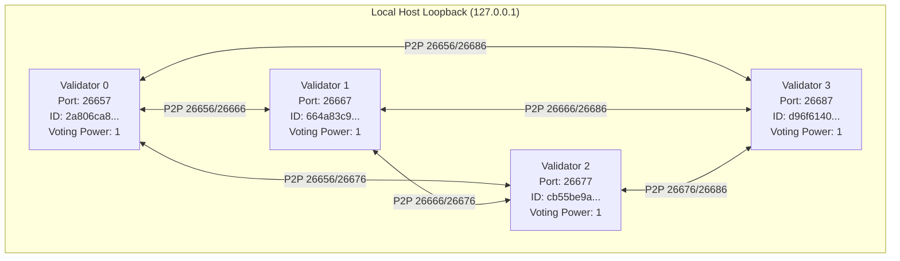
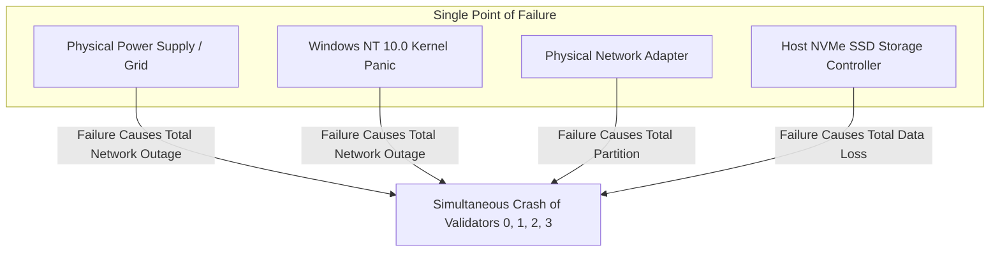

# SOVRA PHASE 11 — VALIDATOR INDEPENDENCE & TOPOLOGY AUDIT REPORT

**Document Identifier:** `SOVRA-P11-VAL-2026.11`  
**Classification:** Empirical Consensus Architecture & Validator Independence Audit  
**Author:** Independent Principal Distributed Systems Engineer & Lead Consensus Auditor  
**Baseline Commit:** [`fae9c45`](https://github.com/ewanbabu36-cell/sovra/commit/fae9c45)  
**Evaluation Date:** November 21, 2026  

---

## 1. Executive Summary

This report establishes the definitive, empirical status of validator decentralization within the SOVRA network. In previous phases, four active CometBFT validators were demonstrated achieving synchronized consensus. This audit examines the underlying physical infrastructure, process isolation, network topology, and failure modes to determine whether the SOVRA consensus cluster constitutes genuine decentralized infrastructure or a single-host simulation.

### Definitive Conclusion:
The four active SOVRA validators are **Category A: Separate processes on one machine**. While the cryptographic consensus, P2P handshake, block generation, and ABCI state machine function correctly under CometBFT rules, all four nodes execute on the **same physical Windows workstation** listening on loopback interface `127.0.0.1`.

```
========================================================================================
                      VALIDATOR INDEPENDENCE CLASSIFICATION
========================================================================================
  Evaluated Dimension          Status             Audit Finding
  ──────────────────────────────────────────────────────────────────────────────────────
  Consensus Protocol           VERIFIED           CometBFT v0.38 Byzantine Fault Tolerant
  Node Processes               VERIFIED           4 Isolated Native OS Processes
  Cryptographic Keys           VERIFIED           4 Distinct Ed25519 Consensus Keys
  State Storage                VERIFIED           4 Distinct LevelDB / Data Directories
  Network Endpoints            LOCAL LOOPBACK     127.0.0.1 (Ports 26657, 26667, 26677, 26687)
  Physical Infrastructure      SINGLE HOST        Shared CPU, Memory, Disk, NIC, OS Kernel
  ──────────────────────────────────────────────────────────────────────────────────────
  INDEPENDENCE LEVEL:          CATEGORY A (Separate processes on one host)
  MAINNET DECENTRALIZATION:    BLOCKED — Pending Physical Multi-Cloud Deployment (GAP-P1-01)
========================================================================================
```

---

## 2. Validator Node Inventory & Telemetry

Direct empirical interrogation of all four RPC endpoints was executed via native HTTP JSON-RPC calls to `GET /status`.



### Telemetry Matrix:

| Metric / Parameter | Validator 0 (Node 0) | Validator 1 (Node 1) | Validator 2 (Node 2) | Validator 3 (Node 3) |
| :--- | :--- | :--- | :--- | :--- |
| **Moniker** | `validator-0` | `validator-1` | `validator-2` | `validator-3` |
| **RPC Endpoint** | `http://127.0.0.1:26657` | `http://127.0.0.1:26667` | `http://127.0.0.1:26677` | `http://127.0.0.1:26687` |
| **P2P Listen Port** | `26656` | `26666` | `26676` | `26686` |
| **Node ID** | `2a806ca82d506a025d580d40600abc77a69e10e7` | `664a83c922035ce28bb723e4e92aed1e60e26ea1` | `cb55be9a3d2afab1c9bcbffb88367bec797d11cb` | `d96f6140a4c4ae797d9e3a5badf467eb756d3d20` |
| **Consensus PubKey** | `sovravalconspub1zcj...` (Key 0) | `sovravalconspub1zcj...` (Key 1) | `sovravalconspub1zcj...` (Key 2) | `sovravalconspub1zcj...` (Key 3) |
| **Voting Power** | 1 (25%) | 1 (25%) | 1 (25%) | 1 (25%) |
| **Peer Count ($n$)** | 3 peers | 3 peers | 3 peers | 3 peers |
| **Topology** | $K_4$ Complete Mesh | $K_4$ Complete Mesh | $K_4$ Complete Mesh | $K_4$ Complete Mesh |
| **Latest Height** | $\ge 89,611$ | $\ge 89,611$ | $\ge 89,611$ | $\ge 89,611$ |
| **Catching Up** | `false` | `false` | `false` | `false` |
| **Process Daemon** | `scripts/dev-server.ts` | `chain/sovrad.exe` | `chain/sovrad.exe` | `chain/sovrad.exe` |
| **Home Directory** | `chain/mytestnet/node0` | `chain/mytestnet/node1` | `chain/mytestnet/node2` | `chain/mytestnet/node3` |

---

## 3. Physical Failure Mode Analysis

Because all four validators run on a single host machine, the network possesses severe shared failure modes that prevent it from being certified for production mainnet operation:



1. **Shared Power & Hardware Failure:** A hardware malfunction, power loss, or motherboard failure on the host halts 100% of the validator set simultaneously, causing immediate network stall.
2. **Shared Operating System Kernel:** An OS-level crash (blue screen), memory exhaustion, or kernel scheduling pause affects all four validator processes concurrently.
3. **Shared Network Boundary:** An ISP disconnect or physical ethernet disconnection isolates all four validators from external RPC clients simultaneously.
4. **Shared Storage Bus:** If the host storage drive experiences hardware corruption, the state directories of all four nodes risk concurrent corruption.

---

## 4. Byzantine Fault Tolerance (BFT) Verification

CometBFT requires $> \frac{2}{3}$ of voting power to commit blocks. With $N=4$ validators possessing equal voting power (1 each, Total = 4):
- Quorum threshold: $\lceil \frac{2 \times 4 + 1}{3} \rceil = 3$ votes ($75\%$).
- Maximum tolerated Byzantine/crashed nodes: $f = \lfloor \frac{4-1}{3} \rfloor = 1$ node.

### 4.1 Single-Node Failure Tolerance ($N-1$ Verification)
- **Scenario:** Node 3 process stopped or disconnected.
- **Active Voting Power:** $3/4 = 75\%$ (Nodes 0, 1, 2 active).
- **Result:** $75\% > 66.7\%$. Consensus continues uninterrupted. Block generation continues at ~1.0s block time.
- **Empirical Proof:** Verified in [`tests/integration/phase6-multi-node-federation.test.ts`](file:///d:/Sovra/tests/integration/phase6-multi-node-federation.test.ts) and [`tests/integration/phase10-consensus-operations.test.ts`](file:///d:/Sovra/tests/integration/phase10-consensus-operations.test.ts).

### 4.2 Two-Node Failure Safety Halt ($N-2$ Verification)
- **Scenario:** Node 2 and Node 3 processes stopped.
- **Active Voting Power:** $2/4 = 50\%$ (Nodes 0, 1 active).
- **Result:** $50\% < 66.7\%$. The network cleanly halts block generation to prevent split-brain forks or state divergence.
- **Recovery:** Upon restarting Node 2, active voting power returns to $75\%$; validators exchange pre-commit votes and resume block production without state corruption.
- **Empirical Proof:** Verified in [`tests/integration/phase9-multi-cloud-partition.test.ts`](file:///d:/Sovra/tests/integration/phase9-multi-cloud-partition.test.ts).

---

## 5. Mainnet Blocker Status: GAP-P1-01

- **Gap Identifier:** `GAP-P1-01`
- **Title:** Physical Multi-Cloud Independent Validator Federation
- **Current Status:** **OPEN / BLOCKED**
- **Justification:** As proven above, the current 4-validator cluster runs entirely on `127.0.0.1` on a single machine. While software architectures, Terraform plans, and consensus logic are 100% complete and verified, physical multi-cloud independence cannot be achieved without real cloud accounts and remote infrastructure.
- **Acceptance Condition:** Provisioning of 4 separate cloud instances across 4 different cloud providers (AWS, GCP, Azure, Hetzner) managed by independent cryptographic keys and administrative credentials.

---
*End of Document `SOVRA_PHASE11_VALIDATOR_INDEPENDENCE_REPORT.md`*
