# SOVRA PHASE 13.5 — CRYPTOGRAPHIC COMMIT VERIFICATION

**Author:** Principal Blockchain Protocol Auditor & Cryptographic Security Auditor  
**Target Repository:** `D:\Sovra`  
**Git Baseline Commit:** `1899c27`  
**Implementation Commit:** `a793a44`  
**Canonical Specification:** [`SOVRA_INDUSTRY_STANDARD_MASTER_GOAL_AND_ACCEPTANCE.md`](file:///d:/Sovra/SOVRA_INDUSTRY_STANDARD_MASTER_GOAL_AND_ACCEPTANCE.md)  
**Audit Evaluation:** **PARTIALLY VERIFIED (PROPOSER SIGNATURE & TX CRYPTOGRAPHY VERIFIED; MULTI-SIG COMMIT CERTIFICATE ABSENT ON WIRE)**  
**Mainnet Status:** **STRICTLY NOT AUTHORIZED**

---

## 1. OBJECTIVE & AUDIT SCOPE

This audit rigorously evaluates the cryptographic integrity of blocks, proposals, transactions, and state commitments across the four SOVRA testnet validators.

Under strict CometBFT / BFT industry standards, every committed block must satisfy:
1. Validator Signatures ($\ge 2/3+1$ voting power).
2. Signer Identity & Public Key Authentication.
3. Accurate Voting Power Attribution.
4. Commit Round Consistency.
5. Cryptographic Block ID (SHA-256 header hash).
6. Application State Hash (`AppHash`) verification.
7. Validator Set Hash Consistency.
8. Rejection of Duplicate Signatures.
9. Rejection of Invalid Signatures.
10. Rejection of Conflicting Commits (Equivocation / Double-Signing).

---

## 2. FORENSIC AUDIT OF THE 10 CRYPTOGRAPHIC DIMENSIONS

### Dimension 1: Validator Signatures
- **Proposer Proposal Signature:** **VERIFIED.** Designated proposer signs proposal data using Ed25519 in `chain/privval/local.go`:
  ```go
  canonical := FormatCanonicalProposalBytes(chainID, proposal)
  sig, err := l.hsm.Sign(canonical)
  ```
- **Block Multi-Signature Commit Certificate:** **ABSENT ON WIRE.** The wire struct [`p2p.BlockData`](file:///d:/Sovra/chain/p2p/types.go) does not contain a `LastCommit` field with aggregated Ed25519 precommit signatures from 3 of 4 validators.

### Dimension 2: Signer Identity & Key Custody
- **VERIFIED.** Each validator maintains an independent Ed25519 keypair and moniker:
  - Validator 0: `sovra12a806ca82d506a025d580d40600abc77a69e10e7` (`validator-0`)
  - Validator 1: `sovra1664a83c922035ce28bb723e4e92aed1e60e26ea1` (`validator-1`)
  - Validator 2: `sovra1cb55be9a3d2afab1c9bcbffb88367bec797d11cb` (`validator-2`)
  - Validator 3: `sovra1d96f6140a4c4ae797d9e3a5badf467eb756d3d20` (`validator-3`)

### Dimension 3: Voting Power Attribution
- **VERIFIED.** In genesis and consensus configuration, all 4 validators hold equal voting power ($P_i = 10$, Total Power = 40).
- Supermajority threshold:
  $$\text{Quorum Threshold} = \lfloor \frac{2}{3} \times 40 \rfloor + 1 = 27 \implies 3 \text{ validators required (75\%)}$$

### Dimension 4: Commit Round Consistency
- **VERIFIED.** `currentRound` is tracked in `chain/cmd/sovrad/main.go` and resets to 0 upon block advancement. When a round timeout (4s) occurs, round advances to select fallback proposers.

### Dimension 5: Block ID & Hash
- **VERIFIED.** Block ID is calculated as the hexadecimal SHA-256 digest of the block header and AppHash.

### Dimension 6: Application Hash (`AppHash`)
- **VERIFIED.** Upon committing state, Pebble KV state root is computed as a 32-byte SHA-256 hash. Live observation confirms all 4 nodes produce matching AppHash values at identical heights.

### Dimension 7: Validator Set Hash
- **VERIFIED.** Validator set is deterministically fixed in genesis and remains invariant throughout testnet operations.

### Dimension 8: Duplicate Signature Rejection
- **VERIFIED.** `LastSignedState.CheckAndSign()` in `chain/privval/types.go` prevents signing duplicate or regressive proposals:
  ```go
  if step == l.Step {
      if l.BlockHash != "" && blockHash != l.BlockHash {
          return fmt.Errorf("%w: conflicting block hash %s != %s", ErrDoubleSigningProtection, blockHash, l.BlockHash)
      }
      return nil // Idempotent retry allowed only for identical block hash
  }
  ```

### Dimension 9: Invalid Signature Rejection
- **VERIFIED FOR TRANSACTIONS.** In `chain/cmd/sovrad/main.go` and `node/app.go`, transactions submitted to `DeliverTx` and `CheckTx` verify Ed25519 signatures against the sender public key. Invalid signatures result in immediate transaction rejection.

### Dimension 10: Conflicting Commit Rejection (Double-Signing Protection)
- **VERIFIED LOCALLY.** The signer daemon strictly rejects signing at `height < l.Height`, `round < l.Round`, or conflicting `blockHash` at the same height/round/step.

---

## 3. QUORUM VERIFICATION EVIDENCE

### Mathematical Model ($N = 4, f = 1$):
- $N = 4$ validators with equal weight.
- Fault tolerance: $f = \lfloor \frac{N-1}{3} \rfloor = \lfloor \frac{3}{3} \rfloor = 1$.
- Minimum quorum required for liveness: $N - f = 3$ validators ($75\%$).
- If 2 validators fail: Active power is $50\% \le 66.7\%$.

### Empirical Test Observation:
In [`scripts/phase13-adversarial-suite.ts`](file:///d:/Sovra/scripts/phase13-adversarial-suite.ts):
- **Scenario 1 (1 node offline):** 3 nodes remain online ($75\% \ge 66.7\%$). Block production **continued without interruption**.
- **Scenario 3 (2 nodes offline):** 2 nodes remain online ($50\% < 66.7\%$). Block production **safely halted**. No divergent blocks were produced.

---

## 4. ARCHITECTURAL GAP & RECOMMENDATION

```mermaid
flowchart TD
    subgraph Current SOVRA Implementation
        A[Proposer Turn Determination] --> B[Quorum Presence Check > 66.7%]
        B --> C[Proposer Signs Proposal locally via LastSignedState]
        C --> D[Gossip NewBlock to Peers via P2P]
        D --> E[Peers Execute ApplyBlock and Commit]
    end

    subgraph Target CometBFT Implementation
        F[Proposer Broadcasts Proposal] --> G[Peers Broadcast Prevote]
        G --> H[Peers Aggregate 2/3+ Prevotes]
        H --> I[Peers Broadcast Precommit]
        I --> J[Aggregate 2/3+ Precommits into Commit Certificate]
        J --> K[Commit Block with Multi-Signature Certificate]
    end
```



> [!WARNING]
> While the current engine enforces **turn-based proposal authorization**, **signer high-water mark protection**, and **connected peer quorum gating**, it does **not** package multi-signature commit certificates inside committed blocks. If an adversarial peer were to spoof P2P messages, receiving nodes do not cryptographically verify signatures from the other 3 validators on each block.

### Conclusion & Release Gate Verdict
- **Local Testnet Operation:** **SATISFACTORY & FUNCTIONAL FOR DEVELOPMENT TESTNET.**
- **Byzantine Commit Verification:** **PARTIAL (Gapped at Commit Certificate Layer).**
- **Mainnet Release:** **STRICTLY NOT AUTHORIZED.**
