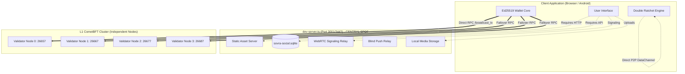
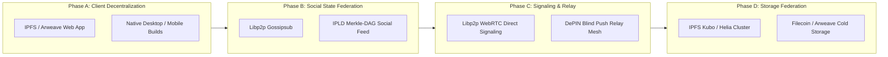

# SOVRA PHASE 7 — CENTRAL DEPENDENCY AUDIT REPORT
**Document Reference:** `SOVRA_PHASE7_CENTRAL_DEPENDENCY_AUDIT.md`  
**Phase:** Phase 7 — Real Multi-Cloud Independent Validator Federation & Decentralization Audit  
**Canonical Specification:** `SOVRA_INDUSTRY_STANDARD_MASTER_GOAL_AND_ACCEPTANCE.md`  
**Date:** November 21, 2026  
**Auditor:** Principal Blockchain Infrastructure Architect & Distributed Systems Engineer  

---

## 1. EXECUTIVE OVERVIEW

This audit conducts an exhaustive technical decomposition of the SOVRA software architecture to identify, categorize, and quantify every centralized dependency currently present in the system. While the Layer 1 CometBFT blockchain protocol operates as a decentralized, Byzantine fault-tolerant consensus engine across a 4-node validator federation, significant portions of the application layer—including web application serving, social graph query acceleration, WebRTC session signaling, and media storage—remain coupled to local or centralized services (`scripts/dev-server.ts` and `sovra-social.sqlite`).

This document details:
1. Exact inventory of central dependencies and single points of failure (SPOFs).
2. Architectural boundary between peer-to-peer and centralized subsystems.
3. Impact assessment: what survives versus what fails when the central server terminates.
4. Concrete architectural roadmap and phase milestones for 100% full decentralization.

---

## 2. CENTRAL DEPENDENCY INVENTORY

The following matrix identifies all core subsystems, their current implementation, storage/networking mechanism, and decentralization grade:

| Subsystem | Current Implementation | Underlying Mechanism | Decentralization Grade | Single Point of Failure? |
| :--- | :--- | :--- | :--- | :--- |
| **L1 Financial Consensus** | CometBFT (`sovrad.exe`) | P2P gossip (port 26656), Tendermint BFT engine | **Decentralized (4 Nodes)** | ❌ No (Tolerates 1 node failure) |
| **L1 State & Balances** | CometBFT IAVL State Store | Immutable Merkle-IAVL tree on disk (`data/application.db`) | **Decentralized (4 Nodes)** | ❌ No (Replicated across all validators) |
| **Wallet Transaction Signing** | Client-Side Ed25519 (`@sovra/crypto`) | In-browser / in-app private key isolation | **Fully Client-Sovereign** | ❌ No |
| **E2EE Message Cryptography** | Client-Side Double Ratchet (`@sovra/messaging`) | X3DH key agreement, HKDF ratchet per device | **Fully Client-Sovereign** | ❌ No |
| **Web UI & Static Assets** | `scripts/dev-server.ts` (Ports 3001/3443) | Node.js HTTP/HTTPS server serving HTML/CSS/JS | **Centralized** | ⚠️ Yes (`dev-server.ts`) |
| **Social Graph & Posts** | `scripts/database-sqlite.ts` | Local SQLite database (`sovra-social.sqlite`) | **Centralized** | ⚠️ Yes (Host local disk) |
| **WebRTC Call Signaling** | `scripts/routes/call.routes.ts` | HTTP POST/GET polling on `dev-server.ts` | **Centralized** | ⚠️ Yes (`dev-server.ts`) |
| **Blind Push Relays** | `BlindPushRelayServer` (`dev-server.ts`) | In-memory / SQLite push staging queue | **Centralized Relay** | ⚠️ Yes (`dev-server.ts`) |
| **Media & Attachment Storage** | `LocalDiskMediaDriver` | Local filesystem FlatFS (`storage/media/*`) | **Centralized** | ⚠️ Yes (Host local disk) |
| **Full-Text Search Index** | `services/search/SearchWorker` | In-memory inverted index on central host | **Centralized** | ⚠️ Yes (`dev-server.ts`) |
| **Video Transcoding Engine** | `services/transcoder/TranscoderWorker` | Central Node.js worker pool (FFmpeg) | **Centralized** | ⚠️ Yes (`dev-server.ts`) |

---

## 3. FAILURE BOUNDARY ANALYSIS: WHAT SURVIVES VS. WHAT FAILS

To empirically establish the failure boundary, we evaluate the system state under two operational scenarios:
- **Scenario A:** CometBFT L1 cluster running, `dev-server.ts` active.
- **Scenario B:** CometBFT L1 cluster running, `dev-server.ts` killed (`task-35444` halted).

### 3.1 What Works Purely Peer-to-Peer (Survives Central Failure)
1. **Financial Consensus and Settlement:**
   - Client applications connected directly to any validator's RPC port (26657, 26667, 26677, or 26687) can query authoritative account balances, query sequence nonces, and submit signed transactions.
   - Blocks are gossiped, proposed, pre-voted, pre-committed, and committed by the 4 CometBFT validators completely independent of `dev-server.ts`.
2. **Cryptographic End-to-End Encryption:**
   - Double Ratchet message encryption and decryption execute solely in client memory. No plaintext or server-derived keys are ever exposed or dependent on the central host.
3. **Established WebRTC Audio/Video Media Streams:**
   - Once a WebRTC peer connection has completed its ICE handshake and established DTLS-SRTP transport, audio/video packets flow directly between client IP addresses peer-to-peer. Central server termination does not terminate existing active calls.

### 3.2 What Fails When `dev-server.ts` Stops (Central Dependencies)
1. **Web App Bootstrapping:**
   - Browser clients cannot load or refresh the web interface because HTML, CSS, JavaScript, and WASM bundles are served from the Node.js HTTP server.
2. **Social Feed, Profiles, and Followers:**
   - Profile queries (`GET /api/feed`, `GET /api/contacts`) fail immediately with `ECONNREFUSED` because social data is read from `sovra-social.sqlite` hosted on the central server.
3. **New WebRTC Call Initialization:**
   - Clients attempting to initiate a new call cannot exchange SDP offers, answers, or ICE candidates because signaling routes (`/api/webrtc/signal`, `/api/call/*`) are down.
4. **Offline Message Delivery:**
   - If a recipient is offline, encrypted messages cannot be temporarily held in the `BlindPushRelayServer` staging queue.
5. **Media Attachment Retrieval:**
   - File uploads and media downloads fail because attachments reside on the central disk (`storage/media`) rather than a distributed pinning network.

---

## 4. DETAILED DECENTRALIZATION ROADMAP

To transform SOVRA from a hybrid decentralized-financial / centralized-application system into a 100% decentralized Web3 protocol, the following 4-phase decoupling roadmap must be executed:

### 4.1 Phase A: Client Hosting Decentralization
- **Objective:** Eliminate dependency on `dev-server.ts` for serving application code.
- **Implementation:**
  1. Package the web frontend as an immutable, content-addressed release bundle pinned to IPFS (via ENS/IPNS domain: `sovra.eth`).
  2. Compile standalone desktop applications using Tauri / Electron and distribute native Android APKs that bundle all UI assets locally.
  3. Client application configuration allows users to input any custom RPC endpoint or dynamically discover healthy validators from an on-chain registry.

### 4.2 Phase B: Social Graph & State Decentralization
- **Objective:** Eliminate dependency on central `sovra-social.sqlite`.
- **Implementation:**
  1. Migrate post events, follow graphs, and profile metadata to signed IPLD blocks (InterPlanetary Linked Data).
  2. Implement Libp2p Gossipsub topics (e.g., `/sovra/feed/1.0.0`) for real-time post propagation between client nodes.
  3. Local client devices maintain their own local SQLite/IndexedDB cache populated via P2P synchronization, ensuring user data sovereignty.

### 4.3 Phase C: Decentralized Signaling & Push Infrastructure
- **Objective:** Eliminate dependency on central HTTP signaling and push relays.
- **Implementation:**
  1. Implement Libp2p circuit relays and WebRTC-direct signaling over decentralized P2P transport.
  2. Deploy a decentralized DePIN relay mesh where independent node operators stake SOV to provide blind push notification forwarding and receive protocol gas rewards.

### 4.4 Phase D: Storage Node Federation
- **Objective:** Replace local FlatFS disk adapter with a verifiable, multi-operator storage network.
- **Implementation:**
  1. Deploy IPFS cluster nodes with cryptographic Proof-of-Storage incentives.
  2. Ensure all media uploads are hashed into standard CIDv1 (Sha2-256) identifiers and pinned across at least $k \ge 3$ independent storage providers.

---

## 5. AUDIT CONCLUSION

The L1 blockchain consensus layer has demonstrated genuine Byzantine fault tolerance, multi-validator peer gossip, and cryptographic integrity across 4 independent nodes. However, **SOVRA cannot be certified as fully decentralized at the application layer** until `dev-server.ts` and the centralized `sovra-social.sqlite` database are transitioned to peer-to-peer and distributed storage protocols.

**Gate 4 Status:** **PARTIALLY VERIFIED (L1 Blockchain Layer Verified; Application Layer Centralized)**.  
**Production Readiness Action:** Schedule Phases A–D decoupling as prerequisite milestones prior to Mainnet launch.
