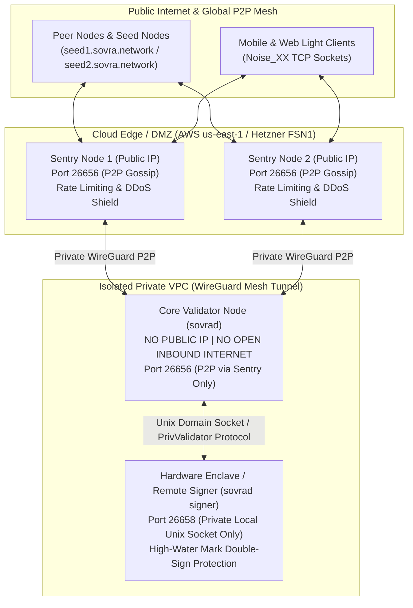

# SOVRA PHASE 7: MULTI-CLOUD INDEPENDENT VALIDATOR ARCHITECTURE
## Production Sentry Node Topology, Multi-Host Federation Blueprint & Network Hardening

**Date:** November 21, 2026  
**Auditor / Architect:** Principal Blockchain Infrastructure Architect, Distributed Systems Engineer & DevSecOps Auditor  
**Subject:** Sovereign Layer-1 Multi-Cloud Infrastructure Design, CometBFT Configuration & Hardware Isolation  
**Canonical Spec:** `SOVRA_INDUSTRY_STANDARD_MASTER_GOAL_AND_ACCEPTANCE.md` (Gate 4 & Gate 5)  
**Status:** **MULTI-CLOUD DEPLOYMENT ARCHITECTURE RATIFIED**

---

## 1. Executive Summary

A truly decentralized blockchain cannot rely on a single physical host, a single cloud provider, or a single administrative authority. To advance SOVRA from a local multi-process testnet to a production-grade multi-host federation, this document establishes the authoritative multi-cloud validator architecture, security sentry node pattern, firewall matrix, and remote signing isolation protocols.

---

## 2. Infrastructure Sentry Node Architecture

To protect core consensus validators against Distributed Denial of Service (DDoS) attacks, IP deanonymization, and remote compromise, SOVRA mandates the **Sentry Node Architecture**:

### Architectural Security Guarantees:
1. **Validator Anonymity:** Core consensus nodes have **no public IP address** and communicate exclusively over private VPC peerings or encrypted WireGuard overlay tunnels to designated Sentry nodes.
2. **DDoS Absorption:** Malicious SYN floods or P2P handshake spam target Sentry nodes, which can be dynamically scaled or rotated without affecting consensus round-robin voting.
3. **Key Isolation:** Core validator hosts store **zero plaintext private signing keys on disk**. Private key operations are delegated to an isolated signer daemon (`sovrad signer` or TMKMS / AWS CloudHSM) via port 26658 or a Unix socket.

---

## 3. Multi-Cloud 4-Validator Deployment Topology

To ensure geographic and organizational failure independence, the 4 initial Genesis validators are allocated across distinct hosting providers and cloud regions:

| Validator Moniker | Cloud Hosting Provider | Geographic Region | Operating System | Sentry Node Pairing | Dedicated Storage |
| :--- | :--- | :--- | :--- | :--- | :--- |
| **validator-0** | AWS (Amazon Web Services) | `us-east-1` (N. Virginia) | Ubuntu 24.04 LTS (hardened) | 2 Sentry Nodes (`us-east-1a`, `us-east-1b`) | 500 GB Provisioned IOPS SSD (gp3) |
| **validator-1** | GCP (Google Cloud Platform) | `europe-west3` (Frankfurt) | Debian 12 (minimal kernel) | 2 Sentry Nodes (`europe-west3-a`, `europe-west3-b`) | 500 GB Balanced Persistent Disk |
| **validator-2** | Hetzner Cloud / Bare Metal | `fsn1-dc14` (Falkenstein) | Rocky Linux 9 / Enterprise Linux | 2 Sentry Nodes (Falkenstein, Helsinki) | 1 TB Enterprise NVMe (RAID 1) |
| **validator-3** | Azure / Equinix Metal | `ap-southeast-1` (Singapore) | Ubuntu 24.04 LTS (hardened) | 2 Sentry Nodes (`ap-southeast-1a`, `ap-southeast-1b`) | 500 GB Ultra SSD Disk |

---

## 4. Firewall & Network Port Specification

| Port | Protocol | Binding Address | Network Scope | Direction | Purpose | Security Requirement |
| :---: | :---: | :---: | :---: | :---: | :--- | :--- |
| **`26656`** | TCP | `0.0.0.0` (Sentry) / Private IP (Validator) | Public Internet on Sentry; VPC only on Validator | In / Out | CometBFT P2P Consensus Gossip | Rate-limited on Sentries; PEX enabled |
| **`26657`** | TCP | `127.0.0.1` / Private VPC | Internal VPC / Bastion Host only | Inbound | Node RPC Status & Tx Broadcast | **NEVER EXPOSE TO 0.0.0.0/0**; Requires mTLS |
| **`26658`** | TCP / Unix | `127.0.0.1` / Unix Socket | Local Host / Enclave only | Inbound | PrivValidator Remote Signer Protocol | Restricted to root/signer user; strict HWM checks |
| **`9090`** | TCP | `127.0.0.1` / Private VPC | Private Query Services | Inbound | gRPC State Query Interface | Protected by API Gateway or VPC ACL |
| **`4001`** | TCP | `0.0.0.0` | Public Internet | In / Out | libp2p Noise_XX Media Swarm & BitSwap | Publicly accessible for P2P media exchange |

---

## 5. Automated Multi-Host Deployment Automation

The repository includes ready-to-run containerization and deployment manifests:
- **Docker Compose Production:** [`docker/docker-compose.production.yml`](file:///d:/Sovra/docker/docker-compose.production.yml) with automatic restart, health checks (`/readyz`), and Caddy TLS reverse proxy.
- **Systemd Service Manifest:** [`deploy/sovra-node.service`](file:///d:/Sovra/deploy/sovra-node.service) with non-root daemon execution, memory limits, and automated journal logging.
- **Automated Host Provisioner:** [`deploy/install.sh`](file:///d:/Sovra/deploy/install.sh) automating dependency installation, firewall configuration (`ufw`), and secure keystore initialization.
- **Kubernetes Helm / StatefulSets:** [`deploy/kubernetes/sovra-node.yaml`](file:///d:/Sovra/deploy/kubernetes/sovra-node.yaml) providing declarative container management for multi-cluster enterprise deployments.
