# SOVRA PHASE 7 — SINGLE POINT OF FAILURE (SPOF) AUDIT REPORT
**Document Reference:** `SOVRA_PHASE7_SINGLE_POINT_OF_FAILURE_AUDIT.md`  
**Phase:** Phase 7 — Real Multi-Cloud Independent Validator Federation & Governance Audit  
**Canonical Specification:** `SOVRA_INDUSTRY_STANDARD_MASTER_GOAL_AND_ACCEPTANCE.md`  
**Date:** November 21, 2026  
**Auditor:** Principal Distributed Systems Engineer & Reliability Architect  

---

## 1. EXECUTIVE OVERVIEW

This audit conducts a thorough architectural breakdown of the eight major subsystems powering SOVRA to identify Single Points of Failure (SPOFs), assess system resiliency under component failures, and provide a 5-tier decentralization classification for each component.

While the Layer 1 blockchain layer is decentralized across CometBFT validators, significant portions of the application layer (static frontend hosting, social feed aggregation, video transcoding, and media storage) remain coupled to `scripts/dev-server.ts` and local disk state.

---

## 2. 5-TIER DECENTRALIZATION CLASSIFICATION

Every subsystem was evaluated against the formal 5-tier classification standard:
1. **Fully Decentralized:** No single point of failure; consensus or gossip-driven across untrusted nodes.
2. **Federated:** Multi-operator network with independent administrative domains.
3. **Replicated but Centrally Controlled:** Multiple nodes exist, but coordination or configuration is centralized.
4. **Centralized:** Single host, process, or database; failure causes immediate service outage.
5. **Not Implemented:** Planned feature without production code.

### 2.1 Subsystem Evaluation Matrix

| Subsystem | Underlying Technology | Current Implementation | Decentralization Classification | SPOF Risk |
| :--- | :--- | :--- | :--- | :--- |
| **1. L1 Financial Consensus** | CometBFT (`sovrad.exe`) | 4-node BFT cluster, P2P port 26656 | **1. Fully Decentralized (4 Nodes)** | ❌ None (Tolerates 1 node failure) |
| **2. RPC Endpoints** | CometBFT HTTP RPC | Multi-port pool (26657, 26667, 26677, 26687) | **2. Federated (Multi-Node Pool)** | ❌ Low (Clients failover automatically) |
| **3. P2P Routing & Gossip** | Libp2p / CometBFT P2P | PEX peer discovery, Kademlia DHT | **1. Fully Decentralized** | ❌ None |
| **4. WebRTC Call Signaling** | `scripts/routes/call.routes.ts` | HTTP long-polling on `dev-server.ts` | **4. Centralized** | ⚠️ High (`dev-server.ts` failure halts call setup) |
| **5. Social Graph & Feeds** | `scripts/database-sqlite.ts` | Local SQLite WAL (`sovra-social.sqlite`) | **4. Centralized** | ⚠️ High (Local disk file) |
| **6. Video Transcoding** | `services/transcoder/TranscoderWorker` | Central Node.js worker pool (FFmpeg) | **4. Centralized** | ⚠️ High (Host CPU bound) |
| **7. Media / Content Storage** | `LocalDiskMediaDriver` | Local FlatFS directory (`storage/media`) | **4. Centralized** | ⚠️ High (Local disk bound) |
| **8. Notification Services** | `BlindPushRelayServer` | Central in-memory / SQLite push queue | **4. Centralized** | ⚠️ High (Host process bound) |
| **9. Web UI & Static Bundles** | Node.js HTTP/HTTPS server | `scripts/dev-server.ts` (Ports 3001/3443) | **4. Centralized** | ⚠️ High (`dev-server.ts` down = app unreachable) |

---

## 3. COMPONENT FAILURE IMPACT ANALYSIS

To determine what survives versus what fails if the central server terminates, we analyze the system state under total shutdown of `dev-server.ts` while CometBFT validator nodes remain online:

```mermaid
graph TD
    subgraph Client["Client Applications (Web / Android)"]
        UI[User Interface]
        Signer[Offline Ed25519 Signer]
        E2EEngine[Double Ratchet Engine]
    end

    subgraph CentralHost["CENTRAL SPOF: dev-server.ts (Port 3001/3443)"]
        WebServing[Web Static Assets / HTML]
        SqliteEngine[(sovra-social.sqlite)]
        Transcoder[Video Transcoder]
        SignalRelay[Call Signaling Relay]
        PushRelay[Blind Push Relay]
    end

    subgraph L1Cluster["DECENTRALIZED: 4 CometBFT Validator Nodes"]
        Val0[Node 0: Port 26657]
        Val1[Node 1: Port 26667]
        Val2[Node 2: Port 26677]
        Val3[Node 3: Port 26687]
    end

    UI -.->|FAILS IF SERVER DOWN| WebServing
    UI -.->|FAILS IF SERVER DOWN| SqliteEngine
    UI -.->|FAILS IF SERVER DOWN| SignalRelay
    UI -.->|FAILS IF SERVER DOWN| Transcoder

    Signer ==>|DIRECT RPC: SURVIVES| Val0
    Signer ==>|FAILOVER: SURVIVES| Val1
    Signer ==>|FAILOVER: SURVIVES| Val2
    Signer ==>|FAILOVER: SURVIVES| Val3

    E2EEngine -.->|P2P DATACONNECTION: SURVIVES ACTIVE CALLS| E2EEngine
```



### 3.1 What Survives Central Server Termination
1. **Blockchain Transactions & Balance Queries:**
   - Any client configured to connect directly to CometBFT RPC ports (26657, 26667, 26677, or 26687) can query authoritative account balances, construct transactions, sign them offline, and broadcast them.
   - Validators continue proposing, validating, voting on, and committing blocks.
2. **Active WebRTC Audio/Video Calls:**
   - WebRTC media flows directly peer-to-peer over UDP (DTLS-SRTP). Once ICE candidates are exchanged, terminating `dev-server.ts` does not interrupt active audio or video streams.
3. **Client-Side Cryptographic Operations:**
   - Key derivation, passkey authentication, and message encryption/decryption happen exclusively on client devices.

### 3.2 What Fails When Central Server Terminates
1. **Web App Delivery:** Browser clients cannot load or refresh the web interface.
2. **Social Graph Queries:** Feeds, profile views, follower lists, and post creation fail because they rely on `sovra-social.sqlite`.
3. **New WebRTC Call Initialization:** Establishing new calls requires SDP exchange via `/api/webrtc/signal`, which is offline.
4. **Media Downloads:** Uploading or downloading attachments fails because media resides on the local server disk.

---

## 4. ARCHITECTURAL DECOUPLING ROADMAP

To transition all Grade 4 components into Grade 1 (Fully Decentralized) or Grade 2 (Federated), the following roadmap is established:

```mermaid
timeline
    title 4-Phase Decentralization Roadmap
    section Phase A : Client Decentralization
        IPFS & Arweave Web Hosting : Web UI hosted on ENS / IPNS (sovra.eth)
        Native Desktop & Android : Standalone binaries with embedded RPC discovery
    section Phase B : Social State Federation
        Libp2p Gossipsub : P2P post and event propagation (/sovra/feed/1.0.0)
        IPLD Merkle-DAG Feeds : Content-addressed social state graphs
    section Phase C : Signaling & Relays
        Libp2p Circuit Relays : Decentralized WebRTC signaling over P2P streams
        DePIN Blind Push Relays : Token-incentivized decentralized notification mesh
    section Phase D : Storage Swarm
        IPFS Cluster Pinning : Multi-operator storage provider federation
        Proof-of-Storage : Automated storage verification on CometBFT L1
```

---

## 5. AUDIT CONCLUSION

The L1 blockchain consensus protocol has successfully eliminated single points of failure across 4 validator nodes. However, **SOVRA cannot be certified as fully decentralized at the application layer** until static web hosting, social state caching, and media storage are transitioned to peer-to-peer protocols. This represents the primary post-Gate 4 architectural objective.
