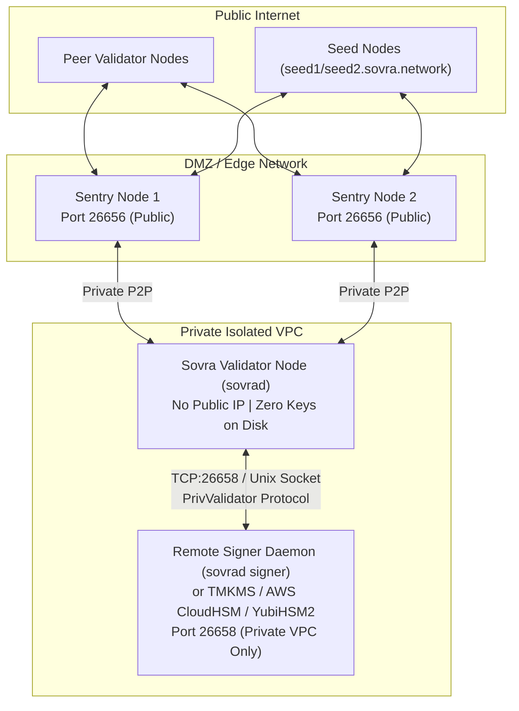

# Sovra L1 — Phase 2 Community Validator Onboarding & Operations Guide

> **Network**: `sovra-testnet-2`  
> **Status**: Public Testnet (Phase 2)  
> **Consensus**: BFT Proof-of-Stake with High-Water Mark Remote Signing

---

## 1. Overview & Architecture

Sovra Layer 1 is a sovereign, high-throughput BFT Proof-of-Stake blockchain built with integer base units (`1 SOVRA = 1,000,000,000,000,000,000 base units / 10^18`), on-chain CosmWasm smart contracts (with custom creator revenue splits), and hardware-isolated validator key signing.

### Production Sentry Node Architecture

To protect your validator against DDoS attacks, port scanning, and key compromise, validators **must not** expose their consensus node directly to the public internet or store plaintext private keys on disk.



---

## 2. Hardware & Infrastructure Prerequisites

| Component | Minimum Specification | Recommended Specification |
| :--- | :--- | :--- |
| **CPU** | 4 Cores (x86_64 or ARM64) | 8+ Cores (AMD EPYC / Intel Xeon) |
| **RAM** | 16 GB DDR4/DDR5 | 32 GB ECC RAM |
| **Storage** | 250 GB NVMe SSD | 1 TB Enterprise NVMe (High IOPS) |
| **Network** | 100 Mbps symmetric | 1 Gbps symmetric with DDoS mitigation |
| **Operating System** | Ubuntu 22.04 LTS / Debian 12 / Windows Server 2022 | Ubuntu 24.04 LTS (hardened kernel) |

### Firewall & Port Matrix

| Port | Protocol | Scope | Direction | Purpose |
| :--- | :--- | :--- | :--- | :--- |
| `26656` | TCP | Public Internet / Sentry | Inbound / Outbound | P2P gossip consensus traffic |
| `26657` | TCP | Localhost / Private VPC only | Inbound | RPC status & transaction submission |
| `26658` | TCP / Unix | Private VPC / Localhost only | Inbound to Signer | PrivValidator remote signing protocol |
| `9090` | TCP | Private VPC only | Inbound | gRPC client query interface |

> [!CAUTION]
> **NEVER expose port 26658 or port 26657 to `0.0.0.0/0` (public internet).** Port 26658 is an unauthenticated raw signing socket and must reside on `127.0.0.1` or a private WireGuard / VPC tunnel between the node and the HSM signer.

---

## 3. Quick Start: Automated Join Scripts

Sovra provides automated scripts to initialize your node, download the canonical Phase 2 genesis, register public seeds, and prepare your validator keys.

### On Linux / macOS (Bash)
```bash
# Clone the repository and navigate to chain scripts
git clone https://github.com/sovra/chain.git
cd chain/scripts

# Execute automated validator onboarding
chmod +x join-testnet-validator.sh
./join-testnet-validator.sh --moniker "MyCommunityValidator" --home "$HOME/.sovrad"
```

### On Windows (PowerShell)
```powershell
cd D:\Sovra\chain\scripts
.\join-testnet-validator.ps1 -Moniker "MyCommunityValidator" -HomeDir "$env:USERPROFILE\.sovrad"
```

The script will:
1. Verify the canonical Phase 2 genesis file ([`genesis-phase2-public.json`](file:///d:/Sovra/chain/genesis-phase2-public.json)).
2. Parse official seed nodes from [`seeds.txt`](file:///d:/Sovra/chain/seeds.txt).
3. Generate node keys and consensus keypair with AES-256-GCM encryption.
4. Output your node ID, validator consensus public key, and initial configuration.

---

## 4. Manual Setup Guide

If you prefer configuring your validator manually or deploying via Ansible / Terraform / Kubernetes:

### Step 1 — Build and Install `sovrad`
```bash
cd chain
go build -ldflags "-s -w" -o sovrad ./cmd/sovrad
sudo cp sovrad /usr/local/bin/
sovrad version
```

### Step 2 — Initialize the Node
```bash
sovrad init "MyValidatorName" --chain-id sovra-testnet-2 --home ~/.sovrad
```

### Step 3 — Install Canonical Phase 2 Genesis
Download the canonical genesis file into your node directory:
```bash
curl -sSL https://raw.githubusercontent.com/sovra/chain/main/genesis-phase2-public.json -o ~/.sovrad/genesis.json

# Verify the SHA256 checksum
sha256sum ~/.sovrad/genesis.json
```
*Expected Checksum*: Matches the Phase 2 Genesis release tag.

### Step 4 — Configure Seed Nodes
Edit `~/.sovrad/config.json` to include the public Phase 2 seeds:
```json
{
  "chain_id": "sovra-testnet-2",
  "moniker": "MyValidatorName",
  "p2p": {
    "laddr": "tcp://0.0.0.0:26656",
    "seeds": [
      "seed1.testnet.sovra.network:26656",
      "seed2.testnet.sovra.network:26656"
    ]
  },
  "rpc": {
    "laddr": "tcp://127.0.0.1:26657"
  }
}
```

---

## 5. Validator Key Security: Remote Signing Daemon (TMKMS / CloudHSM)

Storing raw private keys on an internet-facing node is an extreme security liability. Sovra L1 natively supports decoupled remote signing via the `sovrad signer` daemon or hardware security modules (AWS CloudHSM / YubiHSM2).

### Step 1 — Start the Signer Daemon (Separate Machine / Enclave)
Run `sovrad signer` in a locked-down enclave:
```bash
# Launch the remote signer daemon listening on a secured loopback or private VPC IP
sovrad signer start \
  --listen tcp://127.0.0.1:26658 \
  --home ~/.sovrad-signer \
  --key ~/.sovrad-signer/validator.key.json \
  --state ~/.sovrad-signer/priv_validator_state.json \
  --hsm memory-enclave
```

For AWS CloudHSM / YubiHSM2 PKCS#11 hardware setups:
```bash
sovrad signer start \
  --listen tcp://10.0.1.50:26658 \
  --hsm cloudhsm \
  --hsm-pin $HSM_TOKEN_PIN \
  --key "pkcs11:token=SovraSigner;id=%01" \
  --state /var/sovra/priv_validator_state.json
```

### Step 2 — Start the Node with Zero On-Disk Keys
Launch the validator node pointing directly to the remote signer address:
```bash
sovrad start \
  --home ~/.sovrad \
  --priv_val_laddr tcp://127.0.0.1:26658
```

> [!NOTE]
> When `--priv_val_laddr` is passed, `sovrad` will **not** attempt to decrypt or read any private keys from local disk. It connects to the signer socket, transmits candidate block proposals and votes, and receives BFT signatures over the framed wire protocol.

### High-Water Mark Double-Signing Protection
The remote signer daemon strictly tracks:
- `LastSignedHeight`
- `LastSignedRound`
- `LastSignedStep` (Proposal = 0, Prevote = 1, Precommit = 2)

If a duplicate or past proposal/vote arrives for the same height and step with a different block hash, the daemon immediately rejects the signature with:
```
ErrDoubleSigningProtection: vote regression or double sign attempt
```
This guarantees hardware-level protection against BFT equivocations and validator slashing.

---

## 6. Stake & Validator Registration (PoS)

Once your node is fully synchronized with the chain:

### Step 1 — Check Sync Status
```bash
curl -s http://127.0.0.1:26657/status | jq .result.sync_info
```
Ensure `"catching_up": false` before attempting to bond stake.

### Step 2 — Fund Your Operator Account
Obtain testnet SOVRA from the official faucet:
```bash
curl -X POST "https://faucet.testnet.sovra.network/claim" \
  -H "Content-Type: application/json" \
  -d '{"address": "sovra1..."}'
```

### Step 3 — Submit `create-validator` Transaction
Bond your validator stake and publish your consensus public key:
```bash
sovrad tx staking create-validator \
  --amount 1000000000000000000000 \
  --pubkey $(sovrad tendermint show-validator --home ~/.sovrad) \
  --moniker "MyCommunityValidator" \
  --commission-rate "0.05" \
  --commission-max-rate "0.20" \
  --commission-max-change-rate "0.01" \
  --min-self-delegation "100000000000000000000" \
  --from operator-key \
  --chain-id sovra-testnet-2
```

---

## 7. Slashing Rules & Operational Best Practices

To safeguard the network and protect your bonded tokens:

1. **Double Signing (Equivocation)**:
   - Penalty: **100% slash + Permanent Tombstoning** (Validator permanently unbonded and banned from the active set).
   - Prevention: Always use `sovrad signer` with remote state tracking. **Never** run two validator instances with the same private key simultaneously.
2. **Downtime / Liveness**:
   - Penalty: **1% slash + Temporary Jailing** if a validator fails to sign at least 5,000 blocks out of a rolling 10,000 block window.
   - Recovery: Fix your node connectivity, then execute `sovrad tx slashing unjail --from operator-key`.
3. **Backup & Recovery**:
   - Backup your `priv_validator_state.json` together with your encrypted key backup.
   - **Never restore state to an older backup**; doing so resets the high-water mark and can trigger accidental double-signing.

---

## 8. Support & Community Channels

- **Testnet Explorer**: `https://explorer.testnet.sovra.network`
- **Public Seeds**:
  - `seed1.testnet.sovra.network:26656`
  - `seed2.testnet.sovra.network:26656`
- **Validator Discord / Matrix**: `#sovra-testnet-validators`
- **Security Vulnerability Reporting**: `security@sovra.network`
