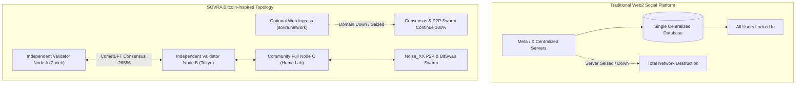

# BITCOIN vs SOVRA — ARCHITECTURAL COMPARISON & NODE INDEPENDENCE SPECIFICATION

> **Standard:** Decentralized Systems Benchmark & Comparative Protocol Analysis  
> **Status:** Phase 0 Architecture Deliverable  
> **Repository Commit:** `6306538` | **Date:** 2026-11-05  

---

## 1. Executive Summary & Design Inspiration

Bitcoin demonstrated that a global digital network can survive for over 15 years without a corporate headquarters, centralized cloud provider, primary website, legal entity, or single administrator. 

SOVRA takes direct inspiration from **Bitcoin's fundamental design principles**:
- **Protocol Over Website:** The network is defined by cryptographic protocol rules, not a web server.
- **Independent Full Validation:** Any operator running commodity hardware can independently verify every transaction without trusting any other node.
- **Decentralized P2P Gossip:** Blocks, transactions, and discovery circulate peer-to-peer over raw TCP sockets without central broker dependencies.
- **Deterministic Token Scarcity:** Strict, unalterable supply cap enforced mathematically by every participating node.

However, SOVRA extends beyond Bitcoin's monetary ledger to support social networking, encrypted communication, creator streaming, and local offline mesh. This comparison analyzes how SOVRA adapts Bitcoin's resiliency while avoiding unnecessary blockchain bloat.

---

## 2. Comparative Architecture Matrix

| Architectural Dimension | Bitcoin (Satoshi Protocol) | SOVRA (Sovereign Ecosystem) | Architectural Adaptation & Rationale |
|:---|:---|:---|:---|
| **Consensus Mechanism** | Proof-of-Work (PoW, SHA-256) with longest-chain Nakamoto consensus. | CometBFT ($3f+1$ BFT) + Proof-of-Usage (PoU) issuance keeper. | High throughput ($1\text{s}$ block time) and instant deterministic finality without mining energy waste. |
| **Monetary Scarcity & Cap** | $21,000,000 \text{ BTC}$ hard cap; 4-year halving intervals. | **$100,000,000 \text{ SOV}$ hard cap**; continuous half-life decay over 20 years. | Bounded supply guaranteed by integer math in [`chain/x/issuance/types/emission.go`](file:///d:/Sovra/chain/x/issuance/types/emission.go). |
| **Node Independence** | Bitcoin Core full node validates all rules; does not depend on `bitcoin.org`. | SOVRA Full Node ([`chain/cmd/sovrad`](file:///d:/Sovra/chain)) runs standalone; does not depend on `sovra.network`. | Network survives even if all SOVRA web domains are seized or suspended. |
| **Peer Discovery** | DNS seeders + hardcoded IP fallback + `addr` gossip over TCP 8333. | DNS seeders ([`chain/seeds.txt`](file:///d:/Sovra/chain/seeds.txt)) + Kademlia DHT + mDNS over TCP 26656 / 4001. | Redundant multi-protocol discovery (DHT + DNS seeds + LAN multicast). |
| **Transaction & Block Relay** | Compact Blocks (BIP 152) and flood-fill inventory vectors. | Libp2p GossipSub v1.2 with peer scoring and CometBFT mempool. | Bandwidth-efficient mesh gossip with Sybil flood protection. |
| **State Storage Substrate** | UTXO set in LevelDB + raw append-only block flat files. | CockroachDB Pebble LSM (balances & WASM) + SQLite WAL (social data). | High-concurrency ACID relational queries for social metadata; Pebble for consensus state. |
| **Identity & Keys** | ECDSA (secp256k1) / Schnorr (BIP 340) keypairs; BIP-39 mnemonics. | W3C DIDs + WebAuthn Passkeys + Ed25519/secp256k1 + ML-KEM-768 PQC. | Hardware enclave security (biometric passkeys) with post-quantum future-proofing. |
| **Media & File Handling** | **Zero media on-chain** (limited `OP_RETURN` byte payload). | **Zero media on-chain**; Content-addressed UnixFS Merkle DAGs over BitSwap. | Prevents blockchain bloat; media is streamed peer-to-peer via BitSwap seeder nodes. |
| **Sybil Attack Resistance** | Energy expenditure (hashrate difficulty target). | Layer-1 Staking Bonds ($50\text{ SOV}$) + Passkey uniqueness + PoU challenge history. | Economic and cryptographic stake replaces brute-force electrical computation. |
| **Offline Resilience** | Offline transactions require manual raw tx transfer (sneaker-net / PSBT). | Native multi-hop BLE GATT mesh + Wi-Fi Direct store-and-forward outbox. | Local offline messaging, tipping, and soundwave pay function without Internet. |

---

## 3. The "Website Is Not the Network" Principle

### 3.1 Eliminating the Web Dependency
In Bitcoin, `bitcoin.org` is simply an informational website. If `bitcoin.org` is deleted or blocked, Bitcoin continues producing blocks and settling billions of dollars without missing a second.

In SOVRA, the same architecture is enforced:
1. **The Web Gateway is an Ingress Adapter:** `scripts/dev-server.ts` is an HTTP/WebSocket translation layer for standard web browsers.
2. **Autonomous Protocol Core:** Mobile apps, desktop nodes, and validators communicate directly using the native Go binary (`chain/cmd/sovrad`) and `@sovra/p2p` over raw TCP sockets.
3. **Decoupled Monetary Authority:** The web application database (`sovra-social.sqlite`) does not govern balances. All balances, issuance curves, and escrows are validated by independent full nodes executing the Go ABCI state machine against Pebble DB.

---

## 4. Key Takeaways & Anti-Bloat Guardrails

- **Do Not Store Files on Blockchain:** Storing images or videos on a blockchain leads to exponential state bloat and centralized validation. SOVRA strictly uses BitSwap for media and keeps the blockchain lean.
- **Do Not Introduce Unnecessary PoW:** CometBFT provides sub-second transaction settlement with negligible carbon footprint while maintaining Byzantine Fault Tolerance ($3f+1$).
- **Mandate Independent Validation:** Every community node operator must be capable of bootstrapping from genesis (`chain/genesis-phase2-public.json`) and verifying all block headers independently.
