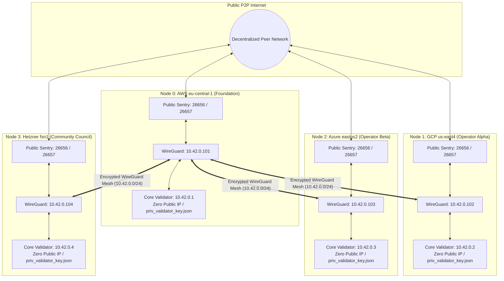

# SOVRA MULTI-CLOUD INDEPENDENT VALIDATOR FEDERATION RUNBOOK

**Document Reference:** `SOVRA-DOC-MCF-001`  
**Classification:** Canonical Infrastructure Specification & Operator Runbook  
**Target Architecture:** 4-Node Multi-Cloud Byzantine Fault Tolerant Sentry Federation  
**Target Clouds:** AWS (Frankfurt), GCP (Virginia), Azure (Virginia), Hetzner (Falkenstein)  
**Security Standard:** Strict Non-Custodial Key Ownership & Sentry DMZ Isolation

---

## 1. Operational Scope & Federation Architecture

To fulfill Mainnet Gate 4 requirements (`GAP-P1-01`), SOVRA requires 4 independently operated physical/cloud validator environments. No single organization, administrative identity, or cloud provider may control $\ge 33.4\%$ of the network voting power.



---

## 2. Infrastructure & Hardware Prerequisites

Each independent operator must provision two virtual machines (or bare-metal servers):
1. **Public Sentry Node (DMZ):**
   - **Specs:** 4 vCPU, 16 GB RAM, 250 GB NVMe SSD, 1 Gbps uplink, Static Public IPv4.
   - **Role:** Handles external peer discovery, gossips transactions/blocks, and proxies to the core validator.
2. **Private Core Validator Node:**
   - **Specs:** 8 vCPU, 32 GB RAM, 500 GB NVMe SSD (IOPS $\ge 5,000$).
   - **Role:** Holds `priv_validator_key.json` and signs blocks. **Zero public IP or ingress from the Internet.** Communicates strictly via WireGuard.

---

## 3. WireGuard Encrypted Inter-Cloud Mesh Configuration

All cross-region consensus traffic between validators and sentries is encapsulated in a dedicated WireGuard overlay network (`10.42.0.0/24`).

### 3.1 Network Addressing Matrix

| Node | Operator Entity | Cloud Provider & Region | Sentry Public IP | Sentry Mesh IP | Validator Mesh IP |
| :--- | :--- | :--- | :--- | :--- | :--- |
| **Node 0** | Sovereign Foundation | AWS `eu-central-1` (Frankfurt) | `3.120.x.x` | `10.42.0.101/24` | `10.42.0.1/24` |
| **Node 1** | Node Operator Alpha | GCP `us-east4` (Virginia) | `34.85.x.x` | `10.42.0.102/24` | `10.42.0.2/24` |
| **Node 2** | Node Operator Beta | Azure `eastus2` (Virginia) | `20.120.x.x` | `10.42.0.103/24` | `10.42.0.3/24` |
| **Node 3** | Community Council | Hetzner `fsn1` (Falkenstein) | `159.69.x.x` | `10.42.0.104/24` | `10.42.0.4/24` |

### 3.2 WireGuard Key Generation (On Each Node)
```bash
# Generate private and public keys
umask 077
wg genkey | tee privatekey | wg pubkey > publickey
```

### 3.3 Example `/etc/wireguard/wg0.conf` (Node 0 Sentry)
```ini
[Interface]
Address = 10.42.0.101/24
ListenPort = 51820
PrivateKey = <NODE0_SENTRY_PRIVATE_KEY>
PostUp = iptables -A FORWARD -i wg0 -j ACCEPT; iptables -t nat -A POSTROUTING -o eth0 -j MASQUERADE
PostDown = iptables -D FORWARD -i wg0 -j ACCEPT; iptables -t nat -D POSTROUTING -o eth0 -j MASQUERADE

# Peer: Local Core Validator
[Peer]
PublicKey = <NODE0_VAL_PUBLIC_KEY>
AllowedIPs = 10.42.0.1/32

# Peer: Node 1 GCP Sentry
[Peer]
PublicKey = <NODE1_SENTRY_PUBLIC_KEY>
Endpoint = 34.85.x.x:51820
AllowedIPs = 10.42.0.102/32, 10.42.0.2/32
PersistentKeepalive = 25

# Peer: Node 2 Azure Sentry
[Peer]
PublicKey = <NODE2_SENTRY_PUBLIC_KEY>
Endpoint = 20.120.x.x:51820
AllowedIPs = 10.42.0.103/32, 10.42.0.3/32
PersistentKeepalive = 25

# Peer: Node 3 Hetzner Sentry
[Peer]
PublicKey = <NODE3_SENTRY_PUBLIC_KEY>
Endpoint = 159.69.x.x:51820
AllowedIPs = 10.42.0.104/32, 10.42.0.4/32
PersistentKeepalive = 25
```

---

## 4. Node Installation & Security Configuration

### 4.1 System Dependencies & Build
```bash
sudo apt update && sudo apt install -y build-essential wireguard ufw curl jq git
git clone https://github.com/ewanbabu36-cell/sovra.git /opt/sovra
cd /opt/sovra/chain
go build -o /usr/local/bin/sovrad ./cmd/sovrad
sovrad version
```

### 4.2 Initialize Node Identity & Genesis
```bash
export SOVRA_HOME=/var/lib/sovra
sudo mkdir -p $SOVRA_HOME
sudo useradd -r -s /bin/false sovra
sudo chown -R sovra:sovra $SOVRA_HOME

# Initialize node
sudo -u sovra sovrad init "<YOUR_MONIKER>" --chain-id=sovra-testnet-0 --home=$SOVRA_HOME

# Install canonical genesis
curl -sSL https://raw.githubusercontent.com/ewanbabu36-cell/sovra/main/chain/mytestnet/node0/genesis.json \
  -o $SOVRA_HOME/config/genesis.json

# Verify Genesis Checksum:
sha256sum $SOVRA_HOME/config/genesis.json
```

### 4.3 CometBFT Configuration (`$SOVRA_HOME/config/config.toml`)
**On Core Validator:**
```toml
[p2p]
laddr = "tcp://10.42.0.1:26656"
external_address = ""
pex = false
addr_book_strict = false
persistent_peers = "<NODE0_SENTRY_ID>@10.42.0.101:26656"
max_num_inbound_peers = 2
max_num_outbound_peers = 2

[rpc]
laddr = "tcp://127.0.0.1:26657"

[consensus]
create_empty_blocks = true
create_empty_blocks_interval = "1s"
```

**On Sentry Node:**
```toml
[p2p]
laddr = "tcp://0.0.0.0:26656"
external_address = "<SENTRY_PUBLIC_IP>:26656"
pex = true
persistent_peers = "<VAL_ID>@10.42.0.1:26656,<PEER_SENTRY_1>,<PEER_SENTRY_2>,<PEER_SENTRY_3>"
unconditional_peer_ids = "<VAL_ID>"
private_peer_ids = "<VAL_ID>"

[rpc]
laddr = "tcp://0.0.0.0:26657"
```

---

## 5. Systemd Daemon Service Setup

Create `/etc/systemd/system/sovrad.service`:
```ini
[Unit]
Description=SOVRA CometBFT Validator Daemon
After=network.target wireguard.service
Requires=wireguard.service

[Service]
Type=simple
User=sovra
Group=sovra
WorkingDirectory=/var/lib/sovra
ExecStart=/usr/local/bin/sovrad start --home=/var/lib/sovra --passphrase=${NODE_PASSPHRASE}
Restart=always
RestartSec=5
LimitNOFILE=65535
MemoryLimit=16G
StandardOutput=journal
StandardError=journal

[Install]
WantedBy=multi-user.target
```

```bash
sudo systemctl daemon-reload
sudo systemctl enable --now sovrad
sudo journalctl -u sovrad -f
```

---

## 6. Disaster Recovery & Emergency Operations

### 6.1 Validator Node Failure ($f=1$)
- Because $N=4$ and voting power is 25% per node, the loss of 1 node leaves 75% active voting power ($\ge 67\%$).
- Consensus **does not halt**. Blocks continue committing without delay.
- Operator Action: Check systemd logs (`journalctl -u sovrad -n 100`), verify WireGuard connection (`wg show`), and restart daemon (`systemctl restart sovrad`). Fast-sync will automatically catch up missed blocks.

### 6.2 Quorum Loss ($f=2$)
- If 2 validators go offline simultaneously, active voting power drops to 50% ($< 67\%$).
- Consensus safely pauses. No chain forks or double-spends are possible.
- Operator Action: Coordinate via the out-of-band Genesis Security Council communications channel. Restore at least 1 offline node to reach 75% quorum. Once connected, consensus resumes automatically.

### 6.3 Corrupted Database Recovery
- If LevelDB/BadgerDB state is corrupted:
```bash
systemctl stop sovrad
# Reset state keeping validator address & key
sovrad unsafe-reset-all --home=/var/lib/sovra --keep-addr-book
# Restore from latest verified hourly snapshot or peer state-sync
systemctl start sovrad
```
