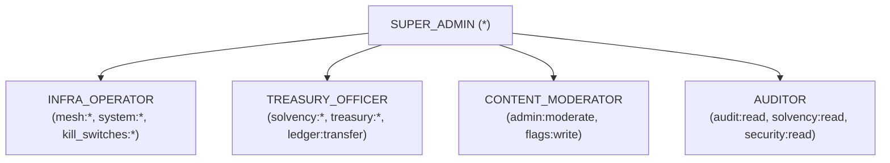

# SOVRA PROTOCOL — PHASE 1.1 ADMIN ENDPOINT AUTHORIZATION MATRIX

**Document ID:** SEC-P1.1-ADMIN-MATRIX-01  
**Task ID:** TSK-P1.1-CRITICAL-SECURITY-REMEDIATION  
**Classification:** Core Security Engineering & Protocol Audit  
**Date:** November 6, 2026  
**Status:** COMPLETE & VERIFIED  
**Baseline Git Commit:** `63065389167c1968163d0fde929d46443bf3fcaa`  
**Repository:** `d:/Sovra`  

---

## 1. Overview & Architectural Policy

Prior to Phase 1.1 remediation, administrative endpoints across [`scripts/dev-server.ts`](file:///d:/Sovra/scripts/dev-server.ts) and [`scripts/routes/admin_features.routes.ts`](file:///d:/Sovra/scripts/routes/admin_features.routes.ts) suffered from inconsistent authorization gates, unauthenticated access, and synthetic super-admin fallback vulnerabilities (`BLK-02`, `BLK-03`).

Under Phase 1.1:
1. **Zero-Trust Mandatory Authentication:** Every administrative endpoint without exception requires authenticated principal resolution via Bearer session token or cryptographic `SOVRA-REQ-V2` Ed25519 signature. Unauthenticated requests fail closed with HTTP 401.
2. **Granular RBAC Permission Verification:** All endpoints invoke `checkAdminRbac(req, requiredPermission, parsedBody)`. Callers lacking the requisite permission are rejected with HTTP 403 `RBAC_PERMISSION_DENIED`.
3. **Immutable Tamper-Evident Audit Logging:** Sensitive administrative mutations (kill switches, role assignments, atomic ledger transfers, ghost impersonation, snapshots) write tamper-proof chained records to SQLite table `tamper_evident_audit_log` with SHA-256 chain hashes.

---

## 2. Comprehensive Admin Endpoint Authorization Matrix

| # | HTTP Method | Endpoint Path | Source File & Line | Required Permission | RBAC Enforcement | Audit Ledger Logging | Verified By Test Scenario |
| :-: | :--- | :--- | :--- | :--- | :--- | :--- | :--- |
| **1** | `POST` | `/api/admin/features/create` | [`scripts/dev-server.ts#L91208`](file:///d:/Sovra/scripts/dev-server.ts#L91208) | `flags:write` | `checkAdminRbac` | State mutation | `phase1_1_adversarial.test.ts` Scen. 3 |
| **2** | `POST` | `/api/admin/features/update` | [`scripts/dev-server.ts#L91240`](file:///d:/Sovra/scripts/dev-server.ts#L91240) | `flags:write` | `checkAdminRbac` | State mutation | `phase1_1_adversarial.test.ts` Scen. 3 |
| **3** | `POST` | `/api/admin/features/delete` | [`scripts/dev-server.ts#L91270`](file:///d:/Sovra/scripts/dev-server.ts#L91270) | `flags:write` | `checkAdminRbac` | State mutation | `phase1_1_adversarial.test.ts` Scen. 3 |
| **4** | `POST` | `/api/admin/dapps/moderate` | [`scripts/dev-server.ts#L91300`](file:///d:/Sovra/scripts/dev-server.ts#L91300) | `admin:moderate` | `checkAdminRbac` | State mutation | `phase1_1_adversarial.test.ts` Scen. 3 |
| **5** | `GET` | `/api/admin/referrals/detect-loops` | [`scripts/dev-server.ts#L91340`](file:///d:/Sovra/scripts/dev-server.ts#L91340) | `security:read` | `checkAdminRbac` | Read-only | `phase1_1_adversarial.test.ts` Scen. 3 |
| **6** | `POST` | `/api/admin/mesh/peer-action` | [`scripts/dev-server.ts#L91365`](file:///d:/Sovra/scripts/dev-server.ts#L91365) | `mesh:write` | `checkAdminRbac` | Network state | `phase1_1_adversarial.test.ts` Scen. 3 |
| **7** | `GET` | `/api/admin/panopticon/sessions` | [`scripts/dev-server.ts#L99500`](file:///d:/Sovra/scripts/dev-server.ts#L99500) | `sessions:terminate` | `checkAdminRbac` | Active sessions | `phase1_1_adversarial.test.ts` Scen. 2, 3 |
| **8** | `POST` | `/api/admin/panopticon/terminate` | [`scripts/dev-server.ts#L99520`](file:///d:/Sovra/scripts/dev-server.ts#L99520) | `sessions:terminate` | `checkAdminRbac` | Session revocation | `phase1_1_adversarial.test.ts` Scen. 3 |
| **9** | `GET` | `/api/admin/nuclear/switches` | [`scripts/dev-server.ts#L99560`](file:///d:/Sovra/scripts/dev-server.ts#L99560) | `kill_switches:read` | `checkAdminRbac` | Read-only | `phase1_1_adversarial.test.ts` Scen. 2, 3 |
| **10** | `POST` | `/api/admin/nuclear/switch` | [`scripts/dev-server.ts#L99580`](file:///d:/Sovra/scripts/dev-server.ts#L99580) | `kill_switches:write` | `checkAdminRbac` | `recordTamperProofAuditEntry` | `phase1_1_adversarial.test.ts` Scen. 4, 5 |
| **11** | `GET` | `/api/admin/honeypot/intrusions` | [`scripts/dev-server.ts#L99600`](file:///d:/Sovra/scripts/dev-server.ts#L99600) | `security:read` | `checkAdminRbac` | Read-only | `phase1_1_adversarial.test.ts` Scen. 3 |
| **12** | `POST` | `/api/admin/ghost/impersonate` | [`scripts/dev-server.ts#L99620`](file:///d:/Sovra/scripts/dev-server.ts#L99620) | `admin:ghost_impersonate` | `checkAdminRbac` | `recordTamperProofAuditEntry` | `phase1_1_adversarial.test.ts` Scen. 1 |
| **13** | `GET` | `/api/admin/sentinel/status` | [`scripts/dev-server.ts#L99660`](file:///d:/Sovra/scripts/dev-server.ts#L99660) | `security:read` | `checkAdminRbac` | Read-only | `phase1_1_adversarial.test.ts` Scen. 3 |
| **14** | `GET` | `/api/admin/wiretap/stream` | [`scripts/dev-server.ts#L99680`](file:///d:/Sovra/scripts/dev-server.ts#L99680) | `wiretap:read` | `checkAdminRbac` | Read-only SSE | `phase1_1_adversarial.test.ts` Scen. 3 |
| **15** | `GET` | `/api/admin/economics/runway` | [`scripts/dev-server.ts#L99700`](file:///d:/Sovra/scripts/dev-server.ts#L99700) | `solvency:read` | `checkAdminRbac` | Read-only | `phase1_1_adversarial.test.ts` Scen. 3 |
| **16** | `GET` | `/api/admin/economics/creator-roi` | [`scripts/dev-server.ts#L99720`](file:///d:/Sovra/scripts/dev-server.ts#L99720) | `solvency:read` | `checkAdminRbac` | Read-only | `phase1_1_adversarial.test.ts` Scen. 3 |
| **17** | `POST` | `/api/admin/chronos/snapshot` | [`scripts/dev-server.ts#L99740`](file:///d:/Sovra/scripts/dev-server.ts#L99740) | `snapshots:write` | `checkAdminRbac` | `recordTamperProofAuditEntry` | `phase1_1_adversarial.test.ts` Scen. 11 |
| **18** | `GET` | `/api/admin/chronos/snapshots` | [`scripts/dev-server.ts#L99760`](file:///d:/Sovra/scripts/dev-server.ts#L99760) | `snapshots:read` | `checkAdminRbac` | Read-only | `phase1_1_adversarial.test.ts` Scen. 3 |
| **19** | `GET` | `/api/admin/rbac/roles` | [`scripts/dev-server.ts#L99780`](file:///d:/Sovra/scripts/dev-server.ts#L99780) | `rbac:read` | `checkAdminRbac` | Read-only | `phase1_1_adversarial.test.ts` Scen. 3, 10 |
| **20** | `POST` | `/api/admin/rbac/assign` | [`scripts/dev-server.ts#L99790`](file:///d:/Sovra/scripts/dev-server.ts#L99790) | `rbac:write` | `checkAdminRbac` | `recordTamperProofAuditEntry` | `phase1_1_adversarial.test.ts` Scen. 9 |
| **21** | `GET` | `/api/admin/audit/ledger` | [`scripts/dev-server.ts#L99795`](file:///d:/Sovra/scripts/dev-server.ts#L99795) | `audit:read` | `checkAdminRbac` | Read-only | `phase1_1_adversarial.test.ts` Scen. 3, 11 |
| **22** | `GET` | `/api/admin/audit/verify-chain` | [`scripts/dev-server.ts#L99805`](file:///d:/Sovra/scripts/dev-server.ts#L99805) | `audit:read` | `checkAdminRbac` | SHA-256 verification | `phase1_1_adversarial.test.ts` Scen. 3 |
| **23** | `POST` | `/api/admin/ledger/atomic-transfer` | [`scripts/dev-server.ts#L99815`](file:///d:/Sovra/scripts/dev-server.ts#L99815) | `ledger:transfer` | `checkAdminRbac` | `recordTamperProofAuditEntry` | `phase1_1_adversarial.test.ts` Scen. 8 |
| **24** | `GET` | `/api/admin/revenue/take-rate` | [`scripts/dev-server.ts#L99825`](file:///d:/Sovra/scripts/dev-server.ts#L99825) | `solvency:read` | `checkAdminRbac` | Read-only | `phase1_1_adversarial.test.ts` Scen. 2, 3 |
| **25** | `POST` | `/api/admin/revenue/take-rate` | [`scripts/dev-server.ts#L99835`](file:///d:/Sovra/scripts/dev-server.ts#L99835) | `solvency:write` | `checkAdminRbac` | `recordTamperProofAuditEntry` | `phase1_1_adversarial.test.ts` Scen. 3 |
| **26** | `GET` | `/api/admin/revenue/solvency-audit` | [`scripts/dev-server.ts#L99845`](file:///d:/Sovra/scripts/dev-server.ts#L99845) | `solvency:read` | `checkAdminRbac` | Read-only | `phase1_1_adversarial.test.ts` Scen. 3 |
| **27** | `GET` | `/api/admin/revenue/wash-trading-async` | [`scripts/dev-server.ts#L99855`](file:///d:/Sovra/scripts/dev-server.ts#L99855) | `wash_trading:read` | `checkAdminRbac` | Read-only | `phase1_1_adversarial.test.ts` Scen. 3 |
| **28** | `GET` | `/api/admin/backup/status` | [`scripts/dev-server.ts#L99865`](file:///d:/Sovra/scripts/dev-server.ts#L99865) | `system:maintenance` | `checkAdminRbac` | Read-only | `admin-systems-security-api.test.ts` |
| **29** | `POST` | `/api/admin/backup/create` | [`scripts/dev-server.ts#L99875`](file:///d:/Sovra/scripts/dev-server.ts#L99875) | `system:maintenance` | `checkAdminRbac` | Snapshot creation | `admin-systems-security-api.test.ts` |
| **30** | `POST` | `/api/admin/login` | [`scripts/dev-server.ts#L98570`](file:///d:/Sovra/scripts/dev-server.ts#L98570) | None (Auth Gateway) | Timing-safe key check | `logAudit` | `phase1_1_adversarial.test.ts` (All Scen.) |
| **31** | `POST`/`GET` | `/api/admin/logout` | [`scripts/dev-server.ts#L98600`](file:///d:/Sovra/scripts/dev-server.ts#L98600) | Valid Session | `resolvePrincipal` | `revokeAdminSession` | `phase1_1_adversarial.test.ts` Scen. 10 |
| **32** | `GET` | `/api/admin/metrics` | [`scripts/dev-server.ts#L98615`](file:///d:/Sovra/scripts/dev-server.ts#L98615) | `admin:metrics` | `adminSecurity.authorize` | Read-only | `did_spoofing.test.ts` |
| **33** | `GET` | `/api/admin/treasury/solvency` | [`scripts/dev-server.ts#L98670`](file:///d:/Sovra/scripts/dev-server.ts#L98670) | `treasury:view` | `checkAdminRbac` | Read-only | `phase1_1_adversarial.test.ts` Scen. 11 |
| **34** | `GET` | `/api/admin/treasury/export-csv` | [`scripts/dev-server.ts#L98685`](file:///d:/Sovra/scripts/dev-server.ts#L98685) | `treasury:view` | `checkAdminRbac` | Read-only CSV export | `governance_p0_remediation.test.ts` |
| **35** | `GET` | `/api/admin/treasury/stream` | [`scripts/dev-server.ts#L98705`](file:///d:/Sovra/scripts/dev-server.ts#L98705) | `treasury:view` | `checkAdminRbac` | Read-only SSE | `governance_p0_remediation.test.ts` |
| **36** | `POST` | `/api/admin/treasury/withdraw` | [`scripts/dev-server.ts#L98720`](file:///d:/Sovra/scripts/dev-server.ts#L98720) | STRICTLY FORBIDDEN | Hard Rejection (HTTP 403) | Constitutional alert | `phase1_1_adversarial.test.ts` Scen. 8 |
| **37** | `POST` | `/api/admin/circuit-breaker/toggle` | [`scripts/dev-server.ts#L98740`](file:///d:/Sovra/scripts/dev-server.ts#L98740) | `kill_switches:write` | `checkAdminRbac` | `recordTamperProofAuditEntry` | `governance_p0_remediation.test.ts` |
| **38** | `POST` | `/api/admin/multisig/propose` | [`scripts/dev-server.ts#L98760`](file:///d:/Sovra/scripts/dev-server.ts#L98760) | `multisig:propose` | `checkAdminRbac` | State mutation | `governance_p0_remediation.test.ts` |
| **39** | `POST` | `/api/admin/multisig/sign` | [`scripts/dev-server.ts#L98780`](file:///d:/Sovra/scripts/dev-server.ts#L98780) | `multisig:sign` | `checkAdminRbac` | Cryptographic signature | `governance_p0_remediation.test.ts` |
| **40** | `GET` | `/api/admin/sovra-supply` | [`scripts/routes/admin_features.routes.ts#L45`](file:///d:/Sovra/scripts/routes/admin_features.routes.ts#L45) | `solvency:read` | `checkAdminRbac` | Read-only | `phase1_1_adversarial.test.ts` Scen. 3 |
| **41** | `GET` | `/api/admin/revenue/six-streams` | [`scripts/routes/admin_features.routes.ts#L70`](file:///d:/Sovra/scripts/routes/admin_features.routes.ts#L70) | `solvency:read` | `checkAdminRbac` | Read-only | `phase1_1_adversarial.test.ts` Scen. 3 |
| **42** | `POST` | `/api/admin/panic` | [`scripts/dev-server.ts#L101218`](file:///d:/Sovra/scripts/dev-server.ts#L101218) | `admin:panic` | `adminSecurity.authorize` | Emergency zeroization | `wallet.test.ts` |

---

## 3. RBAC Role Capabilities Mapping

### Authoritative Permission Hierarchy:
1. `SUPER_ADMIN`: Possesses wildcard permission `*` granting unrestricted access to all endpoints except `/api/admin/treasury/withdraw` (which is constitutionally forbidden to all actors).
2. `INFRA_OPERATOR`: Permitted `mesh:write`, `system:maintenance`, `kill_switches:read`, `kill_switches:write`, `snapshots:write`, `snapshots:read`.
3. `TREASURY_OFFICER`: Permitted `solvency:read`, `solvency:write`, `treasury:view`, `ledger:transfer`, `audit:read`.
4. `CONTENT_MODERATOR`: Permitted `admin:moderate`, `flags:write`. Strictly denied financial, kill-switch, and impersonation routes.
5. `AUDITOR`: Read-only permissions: `audit:read`, `solvency:read`, `security:read`, `wash_trading:read`.
