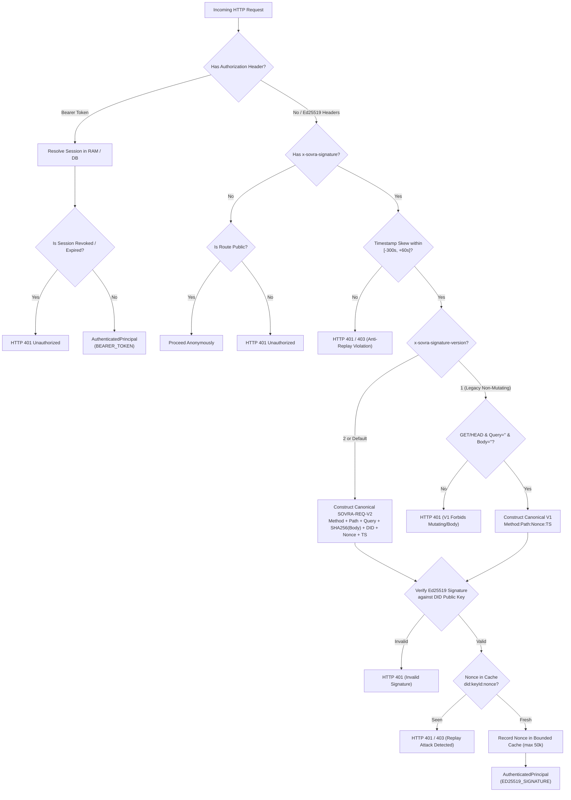

# SOVRA PROTOCOL — PHASE 1.1 DUAL AUTHENTICATION PROTOCOL SPECIFICATION

**Specification ID:** SPEC-AUTH-SOVRA-V2  
**Standard Version:** 2.0.0-PROD  
**Classification:** Core Cryptographic Architecture Specification  
**Date:** November 6, 2026  
**Status:** ACTIVE & ENFORCED  
**Target Repository:** `d:/Sovra`  

---

## 1. Architectural Overview

The SOVRA Protocol enforces a **Dual Authentication Model** ensuring both high-throughput session-oriented client interaction and zero-trust, stateless cryptographic transaction verification.



---

## 2. Authentication Protocol 1: Bearer Session Model

The Bearer Session Model is used by interactive clients (web browsers, mobile applications, operations console).

### 2.1. Session Token Format
Administrative and user sessions utilize high-entropy, cryptographically secure pseudo-random tokens generated via `crypto.randomBytes`:
- **Admin Session Token:** `adm_${crypto.randomBytes(24).toString('hex')}` (48 hexadecimal characters, total length 52 chars).
- **User Session Token:** `usr_${crypto.randomBytes(24).toString('hex')}` or 64-character hex string.

### 2.2. Session Authentication Flow
1. **Administrative Login:** Client sends `POST /api/admin/login` with `{ did, role, adminKey }`.
   - The master administrative secret is compared using timing-safe string comparison:
     ```ts
     const isValidKey = crypto.timingSafeEqual(
       Buffer.from(providedKey, 'utf8'),
       Buffer.from(configuredMasterKey, 'utf8')
     );
     ```
   - Brute-force protection: Accounts are temporarily locked after 5 failed attempts for 900 seconds (15 minutes).
2. **Session Persistence & Principal Creation:**
   - Active administrative principals are cached in memory in `AdminSecurityEngine.adminSessions` Map:
     ```ts
     interface AuthenticatedPrincipal {
       did: string;
       sessionId: string;
       role: AdminRole | 'USER';
       capabilities: readonly PrincipalCapability[];
       expiresAt: number; // Unix timestamp in seconds
       authenticationMethod: 'BEARER_TOKEN' | 'ED25519_SIGNATURE';
     }
     ```
3. **Session Revocation:**
   - Client sends `POST /api/admin/logout` with `Authorization: Bearer <token>`.
   - Dev-server invokes `adminSecurity.revokeAdminSession(principal.sessionId)` and `sovraDb.revokeToken(principal.sessionId)`.
   - Subsequent requests with this token are rejected with HTTP 401.

---

## 3. Authentication Protocol 2: Cryptographic Request Signing (`SOVRA-REQ-V2`)

For decentralized, gateway-decoupled, or machine-to-machine operations, requests are authenticated purely through Ed25519 digital signatures.

### 3.1. Required HTTP Headers
| Header Name | Type | Description | Example |
| :--- | :--- | :--- | :--- |
| `X-Sovra-DID` | String | Signer Decentralized Identifier (`did:key:z...` or registered DID) | `did:key:z6MkoVmKwZQZ9GyXrNEyztNNuYK3e36NqvfHri1vSTRQEFDD` |
| `X-Sovra-Key-Id` | String | Key identifier within the DID document (defaults to signer DID) | `did:key:z6MkoVm...` |
| `X-Sovra-Timestamp` | String | Client UNIX epoch millisecond timestamp | `1730872800000` |
| `X-Sovra-Nonce` | String | Cryptographically unique random string per request | `nonce_e94f09a1c258` |
| `X-Sovra-Signature` | String | Hexadecimal representation of 64-byte Ed25519 signature | `a7b93...64bytes` |
| `X-Sovra-Signature-Version` | String | Protocol version string (must be `'2'`) | `2` |

### 3.2. Canonical String Specification (`SOVRA-REQ-V2`)
The canonical string to be signed is constructed with strict newline (`\n`, `0x0A`) delimiters:

$$\text{CanonicalString} = \texttt{SOVRA-REQ-V2}\mathbin{\Vert}\texttt{"\textbackslash n"}\mathbin{\Vert}\text{Method}\mathbin{\Vert}\texttt{"\textbackslash n"}\mathbin{\Vert}\text{Path}\mathbin{\Vert}\texttt{"\textbackslash n"}\mathbin{\Vert}\text{SortedQuery}\mathbin{\Vert}\texttt{"\textbackslash n"}\mathbin{\Vert}\text{BodyHash}\mathbin{\Vert}\texttt{"\textbackslash n"}\mathbin{\Vert}\text{DID}\mathbin{\Vert}\texttt{"\textbackslash n"}\mathbin{\Vert}\text{KeyId}\mathbin{\Vert}\texttt{"\textbackslash n"}\mathbin{\Vert}\text{Nonce}\mathbin{\Vert}\texttt{"\textbackslash n"}\mathbin{\Vert}\text{Timestamp}$$

#### Field Construction Rules:
1. **Domain Separator:** Exactly `SOVRA-REQ-V2`.
2. **HTTP Method:** Uppercase ASCII string (`GET`, `POST`, `PUT`, `DELETE`, `PATCH`).
3. **Canonical Path:** The absolute URI pathname starting with `/` (e.g., `/api/admin/nuclear/switch`).
4. **Canonical Sorted Query:**
   - If query string is absent or empty, this line is empty string `""`.
   - If query parameters exist, split key-value pairs, sort lexicographically by parameter name (`key`), and re-encode as `k1=v1&k2=v2`.
5. **SHA-256 Body Hash:**
   - Compute SHA-256 digest of the exact raw bytes transmitted in the HTTP request body.
   - For empty body (e.g. GET requests), the hash is computed over the empty byte buffer:
     $$\text{SHA-256}(\texttt{""}) = \texttt{e3b0c44298fc1c149afbf4c8996fb92427ae41e4649b934ca495991b7852b855}$$
   - Hexadecimal output in lowercase.
6. **Signer DID:** Exact DID of the author.
7. **Key ID:** Authorized signing key ID.
8. **Nonce:** High-entropy single-use nonce string.
9. **Timestamp:** String representation of client epoch milliseconds.

### 3.3. Timing Drift & Clock Skew Boundaries
A signed request is valid if and only if:

$$t_{\text{server}} - 300\,000\text{ ms} \le t_{\text{client}} \le t_{\text{server}} + 60\,000\text{ ms}$$

- Maximum backward clock drift: 300 seconds (5 minutes).
- Maximum forward clock drift: 60 seconds (1 minute).
- Requests violating these boundaries fail closed with HTTP 401 / HTTP 403.

### 3.4. Anti-Replay Scoped Nonce Validation
To prevent replay attacks while avoiding cross-user collisions:
- Cache key is scoped as:
  $$\text{CacheKey} = \text{DID}\mathbin{\Vert}\texttt{":"}\mathbin{\Vert}\text{KeyId}\mathbin{\Vert}\texttt{":"}\mathbin{\Vert}\text{Nonce}$$
- Stored in a bounded LRU/FIFO Map limited to 50,000 entries.
- If $\text{CacheKey}$ has been seen within the drift window, the request is immediately rejected.
- Independent users utilizing identical nonces never collide because the scope includes their unique cryptographic DID.

---

## 4. Client Request Signing Reference Implementation (TypeScript)

```typescript
import crypto from 'node:crypto';

export interface SovraRequestSignature {
  headers: Record<string, string>;
  canonicalString: string;
}

export function signSovraRequest(params: {
  method: string;
  url: string;
  body?: string | Buffer | Record<string, any>;
  did: string;
  keyId?: string;
  privateKeyDerOrObject: crypto.KeyObject | Buffer;
  nonce?: string;
  timestamp?: number;
}): SovraRequestSignature {
  const method = params.method.toUpperCase();
  const parsedUrl = new URL(params.url);
  const pathname = parsedUrl.pathname;

  // 1. Deterministically sort query parameters
  const searchParams = new URLSearchParams(parsedUrl.search);
  const sortedKeys = Array.from(searchParams.keys()).sort();
  const sortedPairs: string[] = [];
  for (const key of sortedKeys) {
    const vals = searchParams.getAll(key).sort();
    for (const val of vals) {
      sortedPairs.push(`${encodeURIComponent(key)}=${encodeURIComponent(val)}`);
    }
  }
  const canonicalQuery = sortedPairs.join('&');

  // 2. Compute exact SHA-256 body hash
  let rawBodyBytes: Buffer;
  if (params.body === undefined || params.body === null) {
    rawBodyBytes = Buffer.alloc(0);
  } else if (Buffer.isBuffer(params.body)) {
    rawBodyBytes = params.body;
  } else if (typeof params.body === 'string') {
    rawBodyBytes = Buffer.from(params.body, 'utf8');
  } else {
    rawBodyBytes = Buffer.from(JSON.stringify(params.body), 'utf8');
  }
  const bodyHash = crypto.createHash('sha256').update(rawBodyBytes).digest('hex');

  const did = params.did;
  const keyId = params.keyId || did;
  const nonce = params.nonce || 'nonce_' + crypto.randomBytes(12).toString('hex');
  const timestamp = String(params.timestamp || Date.now());

  // 3. Construct Canonical V2 String
  const canonicalString = [
    'SOVRA-REQ-V2',
    method,
    pathname,
    canonicalQuery,
    bodyHash,
    did,
    keyId,
    nonce,
    timestamp,
  ].join('\n');

  // 4. Sign with Ed25519
  const sigBytes = crypto.sign(null, Buffer.from(canonicalString, 'utf8'), params.privateKeyDerOrObject as any);

  return {
    headers: {
      'X-Sovra-DID': did,
      'X-Sovra-Key-Id': keyId,
      'X-Sovra-Nonce': nonce,
      'X-Sovra-Timestamp': timestamp,
      'X-Sovra-Signature': sigBytes.toString('hex'),
      'X-Sovra-Signature-Version': '2',
    },
    canonicalString,
  };
}
```
