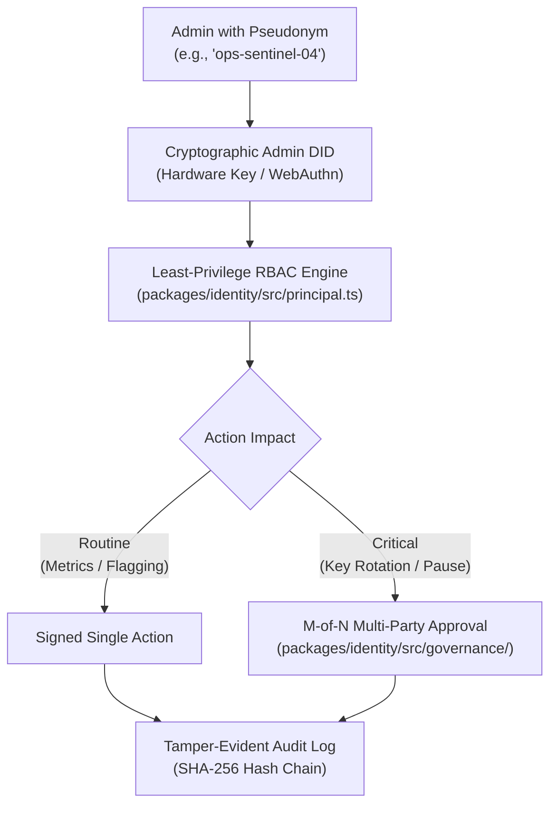
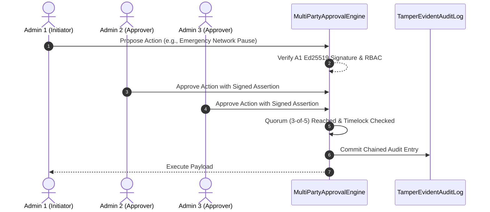

# SOVRA — ADMINISTRATOR ANONYMITY AND CONTROL POLICY

> **Policy Identifier:** GOV-ADM-001  
> **Status:** Operational Security & Administration Standard  
> **Applicability:** All System Administrators, Operations Personnel, Moderators  
> **Version:** 1.0.0 | **Effective Date:** 2026-11-05  

---

## 1. Executive Summary

In alignment with SOVRA's privacy-first ethos, all system administrators, operations engineers, and moderators have the right to operate under public pseudonyms. However, **pseudonymity does not diminish accountability**. Every administrative act is bound to an independently authenticated cryptographic identity, audited on-chain, and constrained by least-privilege role boundaries and multi-party authorizations.

```
+-------------------------------------------------------------------------+
|                       ADMINISTRATIVE GOLDEN RULE                        |
|                                                                         |
|  "We know what role acted, what cryptographic key signed the action,     |
|   what precise changes occurred, and why—without requiring the public    |
|   doxxing of the human behind the terminal."                            |
+-------------------------------------------------------------------------+
```

---

## 2. Core Administrative Requirements



### 2.1 Cryptographic Attribution
1. Every administrator is provisioned a unique W3C Decentralized Identifier:
   $$\text{Admin DID} = \text{did:sovra:admin:}\langle\text{pubkey\_fingerprint}\rangle$$
2. No administrative command can execute without a valid Ed25519 digital signature or WebAuthn Passkey credential assertion. Anonymous, shared, or unauthenticated shell logins are strictly forbidden.

### 2.2 Least-Privilege Role Separation (RBAC)
Permissions are partitioned into segregated, non-overlapping roles defined in [`principal.ts`](file:///d:/Sovra/packages/identity/src/principal.ts):

| Role | Scope of Capability | Restrictions |
|:---|:---|:---|
| **`SUPER_ADMIN`** | System orchestration, role delegation | Requires 3-of-5 multi-party approval for critical mutations. |
| **`SECURITY_ADMIN`** | Key revocation, intrusion response, panic wipe | Zero financial transfer or content manipulation capabilities. |
| **`MODERATOR`** | Content takedown for illegal CSAM/terrorist material | Zero infrastructure, protocol, or financial capabilities. |
| **`INFRA_OPERATOR`** | Node deployment, network telemetry, container rollout | Read-only metrics; zero state mutation or user data access. |
| **`ANALYST`** | Aggregate metrics and health monitoring | Strictly read-only telemetry. |

### 2.3 Ephemeral Sessions & Brute-Force Safeguards
1. **Short Session TTL:** Administrative sessions are strictly bounded to an ephemeral time-to-live of 1 hour (3,600 seconds) maximum.
2. **Brute-Force Lockout:** As implemented in [`AdminSecurityEngine`](file:///d:/Sovra/packages/identity/src/admin.ts), exceeding 5 failed login attempts triggers an automatic 15-minute lockout and broadcasts a high-priority audit event.
3. **Timing-Safe Key Comparison:** Constant-time cryptographic comparisons prevent side-channel timing attacks against administrative endpoints.

---

## 3. Multi-Party Approval for Critical Operations

Critical actions cannot be triggered by an individual administrator alone. The following operations mandate M-of-N multi-party cryptographic authorization:



1. **Emergency Network Pauses:** Requires 3-of-5 Security Council signatures.
2. **Master Key Rotations:** Requires 3-of-5 multi-signature threshold.
3. **Validator Slashing Adjustments:** Requires Community Assembly vote or 4-of-7 validator consensus.
4. **Emergency Data Wipe (Panic Wipe):** Requires 2-of-3 threshold across hardware security keys.

---

## 4. Public Accountability & Audit Trail Disclosure

All administrative actions are published to the public transparency dashboard:

- **What is Disclosed:**
  - Administrative DID (e.g., `did:sovra:admin:9fa4...`) and public pseudonym.
  - Exact action performed (`ADMIN_SECRET_ROTATED`, `NODE_QUARANTINED`, `METRIC_FLAGGED`).
  - Cryptographic signature and SHA-256 state transition digest.
  - Timestamp (UTC) and multi-party approval ticket.
- **What is Protected:**
  - Real-world legal name and biological identity.
  - Physical IP address and geographical coordinates (masked to autonomous system / ISP level).
  - User private data or decrypted payloads.
