# SOVRA — BLE & WI-FI OFFLINE NETWORK PROTOCOL
## Device-to-Device Mesh, GATT Specifications & Delay-Tolerant Networking (Layer C)

**Principal Architect:** Principal Distributed Systems Engineer & Mobile Systems Architect  
**Date:** 2026-11-05  
**Version:** 1.0.0-PROPOSAL  
**Standard:** GATT Bluetooth 5.3, Wi-Fi Direct (P2P Wi-Fi), Epidemic DTN Routing  

---

### 1. Offline Mesh Architecture & Hardware Realism

SOVRA's device-to-device network operates without cellular towers, satellite links, or central internet access by combining **Bluetooth Low Energy (BLE)** for continuous proximity discovery with **Wi-Fi Direct / Local Wi-Fi** for high-bandwidth data payload exchanges.

```mermaid
graph LR
    subgraph Discovery["1. Discovery & Radar (BLE)"]
        BLEBeacon["GATT Service 0x5076<br/>Signed Proximity Beacon Frame"]
        PathLoss["Log-Distance Path Loss<br/>RSSI to Distance (Meters)"]
    end

    subgraph Authentication["2. Mutual Handshake"]
        NoiseHandshake["Noise_XX Mutual Exchange<br/>Ephemeral Curve25519 Keys"]
        Channel["Encrypted GATT Channel (ChaCha20)"]
    end

    subgraph HighBandwidth["3. Payload Transport"]
        SmallMsg["BLE Small Messages (< 512 bytes)"]
        WiFiDirect["Wi-Fi Direct / Local NAN Socket<br/>Media & Block Transfers (> 512 bytes)"]
    end

    subgraph DTN["4. Store & Forward Outbox"]
        Outbox["Local SQLite Outbox Queue"]
        MultiHop["Multi-Hop Epidemic Gossip<br/>TTL = 7 Hops, Deduplication"]
    end

    Discovery --> Authentication
    Authentication --> HighBandwidth
    HighBandwidth --> DTN
```



---

### 2. BLE GATT Specification

#### 2.1 Service & Characteristic UUID Allocation
The official SOVRA BLE service is assigned to 16-bit short UUID `0x5076` expanded to 128-bit canonical format:
- **Service UUID:** `00005076-0000-1000-8000-00805f9b34fb` (Sovra Mesh Primary Service)
- **Beacon Characteristic:** `00005077-0000-1000-8000-00805f9b34fb` (`READ`, `NOTIFY` — Broadcast Beacon Frame)
- **Packet Characteristic:** `00005078-0000-1000-8000-00805f9b34fb` (`WRITE`, `WRITE_WITHOUT_RESPONSE` — Inbound DTN Packet)

#### 2.2 Proximity Beacon Frame Structure (28 Bytes Compact)
```
+---------+---------+-----------+-----------+------------+--------------------+
| Version | Flags   | Battery   | Tx Power  | Timestamp  | Truncated Signature|
| (1 Byte)| (1 Byte)| (1 Byte)  | (1 Byte)  | (4 Bytes)  | (20 Bytes)         |
+---------+---------+-----------+-----------+------------+--------------------+
```
- **Version:** `0x01`
- **Flags:** `0x01` (Accepts Relays), `0x02` (Wi-Fi Direct Ready), `0x04` (Encrypted)
- **Battery:** `0–100%`
- **Tx Power:** Calibrated RSSI at 1 meter (default `-59 dBm`)
- **Timestamp:** Monotonic Unix epoch in seconds (modulo $2^{32}$) to reject replayed beacons > 300s
- **Signature:** Ed25519 signature of the beacon payload truncated to 20 bytes for GATT advertisement compliance

#### 2.3 Log-Distance Path Loss Formula
Distance is calculated from calibrated RSSI using:
$$d = 10^{\frac{TxPower - RSSI}{10 \cdot n}}$$
where $n = 2.4$ represents standard indoor/outdoor path loss exponent.

---

### 3. Wi-Fi Direct & High-Bandwidth Local Transport

When peer nodes detect high-volume data payloads (video files, encrypted voice notes, or large BitSwap blocks exceeding 512 bytes):
1. **Capability Negotiation:** Discovered BLE peers check the `WiFi Direct Ready` flag in the beacon.
2. **Autonomous Group Owner (GO) Election:** The device with higher battery percentage assumes the Group Owner role.
3. **Local Socket Connection:** Devices connect over standard TCP port `4001` on the local `192.168.49.x` subnet.
4. **Noise_XX Session:** Sockets immediately execute a Noise_XX handshake before transferring UnixFS block streams.

---

### 4. Delay-Tolerant Networking (DTN) Epidemic Store-and-Forward

When sender and recipient are not in direct physical range:
1. **Packet Structure:**
   ```typescript
   export interface OfflineMeshPacket {
     packetId: string;       // SHA-256 hash of (senderDid, nonce, payload)
     senderDid: string;
     recipientDid: string;   // Target DID or 'did:sovra:broadcast'
     hopCount: number;       // Starts at 0, max TTL = 7
     timestamp: number;
     encryptedPayloadHex: string; // Encrypted with recipient's X25519 public key
     signatureHex: string;   // Sender's Ed25519 signature
   }
   ```
2. **Deduplication Bloom Filter:** Nodes maintain an in-memory 8KB counting Bloom filter of recently seen `packetId`s with a 24-hour expiration window.
3. **Hop Count & Expiration:** Packets exceeding `hopCount >= 7` or `now - timestamp > 48 hours` are dropped to prevent bufferbloat.

---

### 5. Mobile OS Hardware Limitations & Mitigation

#### 5.1 Apple iOS Background Constraints
- **The Problem:** iOS CoreBluetooth terminates peripheral advertising when the application enters the background after 15–30 seconds. Central scans in background are throttled and cannot read custom manufacturer advertisement data without the app in foreground.
- **The Engineered Reality:**
  - BLE mesh acts primarily in foreground interactive mode (e.g. user opens Mesh Radar tab).
  - Background rendezvous leverages Apple Push Notification service (APNs) silent data wakeups (`content-available: 1`) when internet is intermittent.
  - Core SOVRA messaging operates cleanly over cellular/Wi-Fi when BLE is suspended.

#### 5.2 Android Doze & Battery Optimization
- **The Problem:** Android OEM battery managers terminate background GATT scans and suspend network sockets during Doze mode.
- **The Engineered Reality:**
  - Android client utilizes a persistent `ForegroundService` with notification icon when Offline Mesh is explicitly enabled by the user.
  - Scan cycles use duty cycling: 5 seconds active scan followed by 25 seconds low-power sleep.
