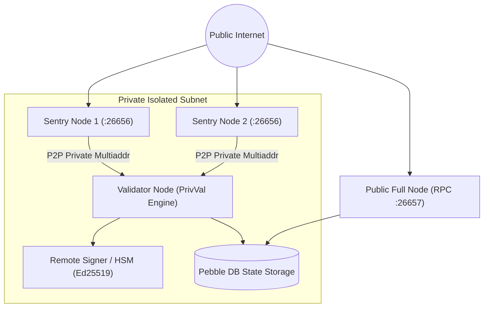

# SOVRA — BLOCKCHAIN NODE OPERATIONS & VALIDATOR DEPLOYMENT GUIDE

> **Standard:** Sovereign Layer-1 Consensus Operations & Sentry Node Architecture  
> **Status:** Phase 0 Architecture Deliverable  
> **Repository Commit:** `6306538` | **Date:** 2026-11-05  

---

## 1. Protocol Architecture & Consensus Overview

The SOVRA blockchain is an independent Layer-1 protocol engineered in Go (`chain/`). It utilizes CometBFT (Tendermint BFT v0.38) consensus, CockroachDB Pebble LSM storage, and a pure-Go Wazero CosmWasm smart contract engine.



---

## 2. Validator Node Architecture & Sentry Defense

To protect consensus validators from direct Distributed Denial of Service (DDoS) attacks, IP exhaustion, and targeted network partition, validators **must never be directly exposed to the public internet**.

### 2.1 Sentry Node Topology
1. **Validator Node:** Placed on a private LAN or VPN. Listens exclusively on an internal interface. Configured with `pex = false` (Peer Exchange disabled) to prevent IP advertisement.
2. **Sentry Nodes:** Publicly accessible full nodes running on redundant cloud providers (e.g. AWS, Hetzner, OVHcloud). Sentries maintain persistent authenticated P2P connections to the validator and handle all public gossip, transaction flooding, and block dissemination.

### 2.2 Sentry & Validator Configuration Directives
In `config.toml`:
```toml
# Validator Node (Private)
[p2p]
pex = false
addr_book_strict = false
persistent_peers = "sentry1_id@10.0.0.2:26656,sentry2_id@10.0.0.3:26656"

# Sentry Node (Public)
[p2p]
pex = true
unconditional_peer_ids = "validator_node_id"
persistent_peers = "validator_id@10.0.0.1:26656,seed1_id@seed1.testnet.sovra.network:26656"
```

---

## 3. Validator Key Management & Anti-Double-Signing

> [!CAUTION]
> **Strict Operational Rule:** Never commit validator private keys to source control, never expose them via HTTP endpoints, and never inject them into ordinary web application environment variables (`.env`).

### 3.1 Key Isolation Options
1. **Tier 1 (Enterprise Production):** Remote Signer (`privval/remote-signer`) communicating over encrypted mTLS / Unix socket to a Hardware Security Module (YubiKey HSM2 or AWS KMS).
2. **Tier 2 (Standard Validator):** Local filesystem `priv_validator_key.json` with permissions restricted strictly to the service user (`chmod 0600`), running on an encrypted disk volume (LUKS / dm-crypt).

### 3.2 Double-Signing Protection
CometBFT tracks the consensus voting state in `priv_validator_state.json`:
- `height`: Monotonically increasing integer.
- `round`: Current consensus voting round.
- `step`: Pre-vote or pre-commit phase.
- **Fail-Safe Mechanism:** The signing daemon refuses to sign any proposal or vote where $(\text{height}, \text{round}, \text{step}) \le (\text{last\_height}, \text{last\_round}, \text{last\_step})$. An accidental validator reboot or migration will never emit conflicting votes.

---

## 4. Node Provisioning & Testnet Operations

Scripts for joining and orchestrating the testnet are located in [`chain/scripts/`](file:///d:/Sovra/chain/scripts):
- `chain/scripts/join-testnet-validator.sh`: Automates genesis download, seed connection, and validator daemon startup.
- `chain/scripts/orchestrate-phase2-seeds.ps1`: Multi-node local cluster orchestration.

### 4.1 Quick-Start Verification Drill
```bash
# 1. Compile native Go daemon
cd chain
go build -o ../bin/sovrad ./cmd/sovrad

# 2. Initialize node configuration
../bin/sovrad init "community-validator-01" --chain-id "sovra-testnet-0"

# 3. Download verified public genesis
cp genesis-phase2-public.json ~/.sovrad/config/genesis.json

# 4. Configure seed nodes from registry (chain/seeds.txt)
SEEDS=$(grep -v '^#' seeds.txt | paste -sd, -)
sed -i "s/seeds = \"\"/seeds = \"$SEEDS\"/" ~/.sovrad/config/config.toml

# 5. Start consensus daemon
../bin/sovrad start --home ~/.sovrad
```

---

## 5. Monetary Integrity & 100M Supply Verification

The authoritative token supply is locked at $100,000,000 \text{ SOV}$ ($10^{14} \mu\text{SOV}$) in [`chain/x/issuance/types/constants.go`](file:///d:/Sovra/chain/x/issuance/types/constants.go).

### 5.1 Supply Invariant Assertion Command
Operators verify monetary integrity at any time via the ABCI state query:
```bash
../bin/sovrad query issuance total-supply --output json
```
**Expected Deterministic Output:**
```json
{
  "max_supply_micro_sov": "100000000000000",
  "circulating_supply_micro_sov": "15000000000000",
  "unminted_pool_micro_sov": "85000000000000",
  "invariant_satisfied": true
}
```
If $\text{Circulating} + \text{Unminted} \neq 100,000,000,000,000 \mu\text{SOV}$, the Pebble store halts block commits with `ErrSupplyInvariantViolated`.
