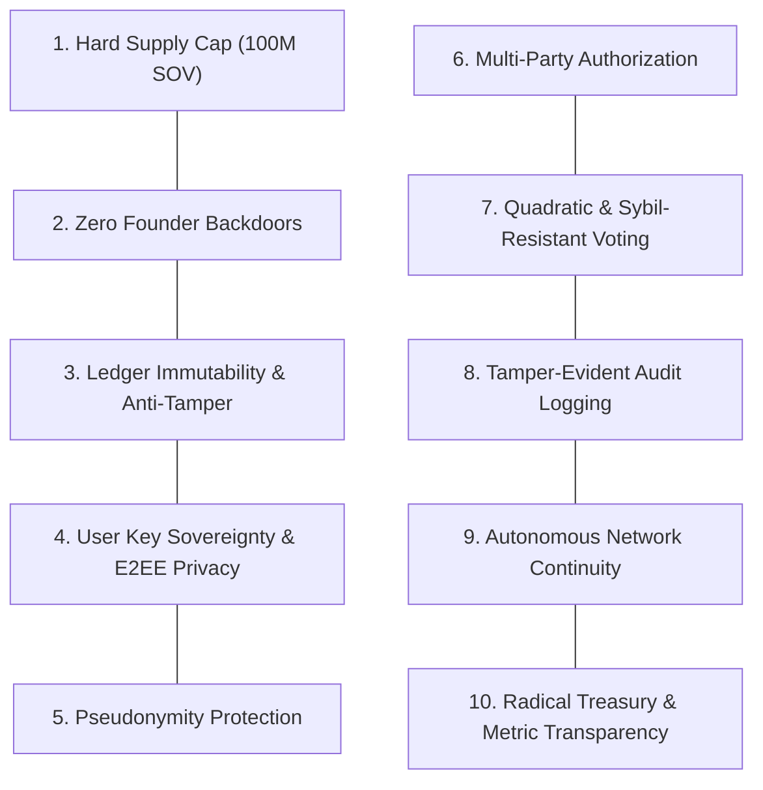

# SOVRA — COMMUNITY-FIRST CONSTITUTION

> **Document Identifier:** GOV-CONST-001  
> **Status:** Supreme Foundational Document  
> **Governance Model:** Community-Sovereign, Polycentric, Non-Custodial  
> **Version:** 1.0.0 | **Ratification Date:** 2026-11-05  

---

## Preamble

We, the creators, developers, node operators, validators, and community participants of SOVRA, establish this Constitution to secure an enduring, decentralized, privacy-first digital ecosystem. 

SOVRA is dedicated to individual sovereignty, cryptographic privacy, open communication, and fair economic opportunity. Recognizing that centralized authorities, charismatic founders, and financial oligopolies historically compromise open networks, this Constitution establishes **the Community as the supreme governing authority**, bound forever by verifiable cryptographic invariants.

---

## Article I: The Ten Inviolable Invariants

The following ten invariants are mathematically and procedurally entrenched. No governance proposal, emergency action, administrative fiat, or hard fork sanctioned by the SOVRA community may violate these principles:



### Invariant 1: Fixed Monetary Cap
The lifetime issuance of SOVRA Coin is strictly bounded to:
$$\text{Max Lifetime Issuance} = 100,000,000\text{ SOV} = 10^{14}\;\mu\text{SOV}$$
No inflation, emergency minting, or synthetic credit expansion shall ever exceed this threshold.

### Invariant 2: Zero Founder Backdoors
No secret master key, administrative god-mode, bypass token, or founder override shall exist in any production codebase, smart contract, or consensus engine.

### Invariant 3: Ledger Immutability
Historical ledger transactions, proof-of-usage rewards, and user balances cannot be reversed, censored, or unilaterally confiscated by founders, administrators, or validators.

### Invariant 4: Inviolable Privacy & Self-Custody
Every user owns and holds their cryptographic private keys. End-to-end encrypted messages (E2EE Double Ratchet) and zero-knowledge credentials shall never be weakened, backdoored, or escrowed.

### Invariant 5: Protection of Pseudonymity
All contributors, founders, validators, and community participants have the right to operate pseudonymously. No governance vote may compel the disclosure of an individual’s personal, legal, or biological identity.

### Invariant 6: Multi-Party Authorization (M-of-N)
High-impact actions—including treasury distributions, contract migrations, and emergency pauses—require multi-party cryptographic threshold signatures ($M \ge 3$, $N \ge 5$) and enforced timelocks.

### Invariant 7: Voting Power $\neq$ Coin Wealth
Governance voting power is decoupled from raw coin holdings through quadratic voting ($V \propto \sqrt{\text{Stake}}$) modulated by verified engagement and Sybil-resistant account age. Financial plutocracy is strictly barred.

### Invariant 8: Cryptographic Audit Logging
Every administrative, validator, and governance event must be immutably recorded in a SHA-256 hash-chained, digital-signature-verified audit log.

### Invariant 9: Autonomous Continuity
The Layer-1 blockchain, P2P storage swarm, and mesh gossip network are fully autonomous. The sudden disappearance, incapacity, or departure of the founder shall cause zero degradation to network operations.

### Invariant 10: Complete Economic & Governance Transparency
All treasury inflows, grant distributions, fee burns, validator stakes, and governance tally logs shall be publicly auditable in real-time through the decentralized transparency dashboard.

---

## Article II: Governance Bodies & Separation of Powers

SOVRA distributes governance across four distinct, mutually checking bodies:

```mermaid
graph TD
    CA["Community Assembly\n(All Verified Community Members)\n- Sovereign legislative body\n- Passes SIP proposals\n- Quadratic voting"]
    TC["Technical Committee\n(Elected Core Maintainers)\n- Evaluates code security\n- Formulates implementation specs\n- Merges audited code"]
    SC["Security Council\n(Multi-Sig Emergency Body)\n- 5-of-7 threshold\n- Pauses exploits with timelock\n- Zero spending authority"]
    VN["Validator Swarm\n(Independent Node Operators)\n- Signals hard-fork readiness\n- Executes consensus state\n- Protects L1 finality"]

    CA <-->|Proposes & Enacts| TC
    SC -.->|Emergency Pause (Max 72h)| VN
    TC <-->|Signals Compatibility| VN
    CA -.->|Elects & Removes| SC
```

1. **The Community Assembly:** The supreme legislative body consisting of all verified, non-Sybil participant DIDs. Enacts all policy, treasury, and parameter changes.
2. **The Technical Committee:** An elected group of peer maintainers responsible for code quality, security verification, and implementation roadmaps. Has zero unilateral spending or rule-setting power.
3. **The Security Council:** A 5-of-7 multi-signature body tasked exclusively with emergency pause mechanisms in the event of active zero-day exploits. Actions expire automatically within 72 hours unless confirmed by the Community Assembly.
4. **The Validator Swarm:** Independent node operators running CometBFT consensus engines across independent geographic infrastructure.

---

## Article III: Conflict of Interest & Anti-Plutocracy

1. **Mandatory Conflict Disclosure:** Any proposer, committee member, or founder voting on a proposal that directly benefits their registered DID, affiliated project, or personal estate must formally declare the conflict. Undisclosed conflicts invalidate the proposal retroactively.
2. **Whale Mitigation:** In no vote may a single entity or affiliated cartel cast more than 5% of the total effective voting weight, regardless of coin holdings.
3. **Founder Parity:** The founder participates in the Community Assembly under the exact same rights, quadratic weighting, and restrictions as any community participant.

---

## Article IV: Constitutional Amendment Process

Amendments to this Constitution represent the highest order of governance change:

1. **Proposal Period:** Must be submitted as a Constitutional Improvement Proposal (CIP) with 90 days of mandatory public discussion.
2. **Quorum Threshold:** A minimum of 50% of all registered active network participants must cast ballots.
3. **Approval Threshold:** An 80% supermajority of cast votes is required.
4. **Immutability of Core Invariants:** Articles I.1 through I.5 are permanent and cannot be repealed.
