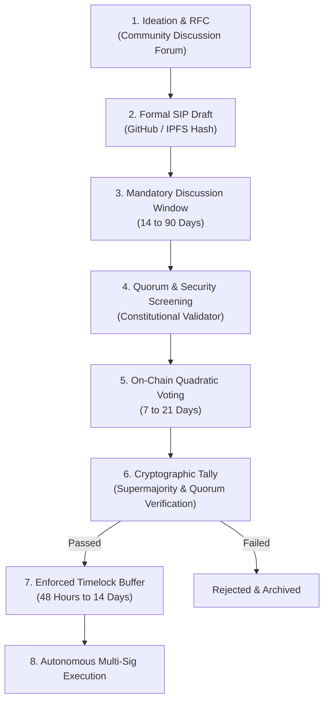

# SOVRA — COMMUNITY GOVERNANCE RULEBOOK

> **Rulebook Identifier:** GOV-RULE-001  
> **Status:** Operational Governance Specification  
> **Applicability:** All Network Participants, Proposal Authors, Voters  
> **Version:** 1.0.0 | **Effective Date:** 2026-11-05  

---

## 1. Executive Summary & Principles

This Rulebook governs the submission, deliberation, voting, quorum verification, and execution of **SOVRA Improvement Proposals (SIPs)**.

```
+-------------------------------------------------------------------------+
|                        THE ANTI-PLUTOCRACY RULE                         |
|                                                                         |
|  "Voting power does not equal coin wealth. Financial cartels and        |
|   whales cannot purchase unilateral governance control. Power is        |
|   derived from active, verifiable participation and quadratic weight."   |
+-------------------------------------------------------------------------+
```

---

## 2. Proposal Lifecycle & Stages



---

## 3. Proposal Categorization & Threshold Matrix

| Category | Typical Scope | Min Discussion Period | Min Quorum Required | Approval Threshold | Timelock Buffer |
|:---|:---|:---:|:---:|:---:|:---:|
| **`SIP-TECH`** (Standard Technical) | API extensions, bug fixes, UI/UX upgrades | 14 Days | 10% Active DIDs | Simple Majority (>50%) | 48 Hours |
| **`SIP-TREASURY`** (Grants & Funding) | Developer ecosystem grants, liquidity loans | 21 Days | 15% Active DIDs | 60% Supermajority | 72 Hours |
| **`SIP-PROTOCOL`** (L1 Hard/Soft Fork) | Consensus logic, gas fees, block parameters | 30 Days | 25% Active DIDs | 66.7% Supermajority | 7 Days |
| **`SIP-VALIDATOR`** (Slashing & Staking) | Slashing rules, validator commission caps | 30 Days | 20% Active DIDs | 66.7% Supermajority | 7 Days |
| **`SIP-CONST`** (Constitutional Amend) | Fundamental rights, governance rules | 90 Days | 50% Active DIDs | 80% Supermajority | 14 Days |

---

## 4. Quadratic Voting & Anti-Sybil Mathematics

To prevent financial plutocracy, SOVRA enforces **Quadratic Stake-Weighted Voting** augmented by an Account Maturity and Activity Multiplier:

### 4.1 Effective Voting Weight Formula
For any voter $i$ with locked token balance $S_i$, account age in days $A_i$, and verified proof-of-usage score $U_i$:
$$V_i = \sqrt{S_i} \times \left(1 + \min\left(1.0, \frac{A_i}{365}\right)\right) \times \left(0.5 + 0.5 \times U_i\right)$$

```
Comparison: 10,000 SOV Whale vs. 100 Active Community Members (100 SOV each)
- Whale (10,000 SOV):
  V_whale = sqrt(10,000) * (1 + 1) * 1.0 = 100 * 2.0 = 200 Effective Votes
- 100 Members (100 SOV each, active > 1 yr):
  V_member = sqrt(100) * (1 + 1) * 1.0 = 10 * 2.0 = 20 Effective Votes
  Total for 100 Members = 100 * 20 = 2,000 Effective Votes!
  
RESULT: Community members hold 10x the voting power of the single whale!
```

### 4.2 Sybil Resistance Requirements
1. DIDs must be registered for at least 30 days prior to snapshot block.
2. Must possess at least 1 verified cryptographic interaction (post, message, or transaction) to qualify.

---

## 5. Constitutional Redlines & Prohibited Proposals

The [`GovernanceQuorumValidator`](file:///d:/Sovra/packages/identity/src/governance/quorum-validator.ts) rejects any proposal containing redline violations before voting can initiate:

1. **Forced De-anonymization:** Any proposal compelling the involuntary disclosure of personal legal names or biological likeness of founders, admins, or users.
2. **Monetary Cap Inflation:** Any proposal attempting to mint coins beyond the $100,000,000\text{ SOV}$ ceiling.
3. **Ledger Reversal:** Any proposal confiscating user funds without a valid cryptographic transaction.
4. **Encryption Weakening:** Any proposal compromising client-side Double Ratchet E2EE or introducing escrow backdoors.
5. **Founder Veto:** Any proposal seeking to grant the founder or any individual permanent unilateral veto authority.

---

## 6. Execution & Dispute Resolution

1. **Automated On-Chain Execution:** Approved proposals that meet all threshold and timelock criteria are queued for autonomous execution by the [`MultiPartyApprovalEngine`](file:///d:/Sovra/packages/identity/src/governance/multi-party-approval.ts).
2. **Emergency Pause:** If a critical exploit is uncovered during the timelock window, the Security Council may enact a temporary 72-hour freeze with 5-of-7 multi-sig approval.
3. **Decentralized Appeals:** Administrative moderation actions can be appealed to a randomly selected community jury panel using blinded zero-knowledge voting.
