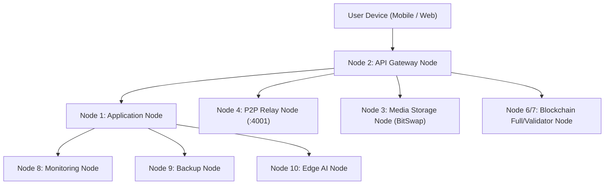
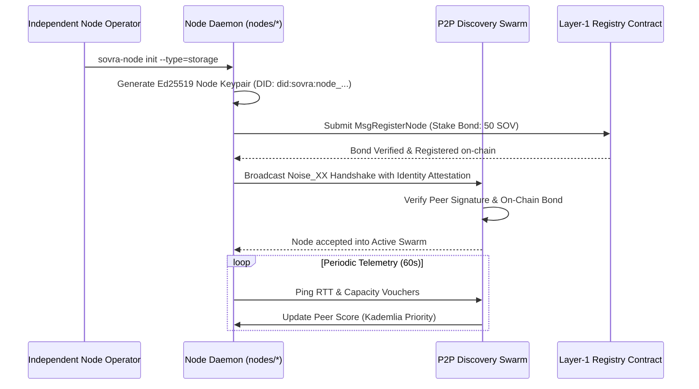

# SOVRA — COMMUNITY INFRASTRUCTURE NODE SPECIFICATION

> **Standard:** Decentralized Community Operator Protocol  
> **Status:** Phase 0 Architecture Deliverable  
> **Repository Commit:** `6306538` | **Date:** 2026-11-05  

---

## 1. Vision & Federation Architecture

SOVRA is operated by a global federation of independent community nodes. Anyone running commodity hardware can contribute bandwidth, computation, storage, or consensus voting, earning micro-SOV through Proof-of-Usage (PoU).

---

## 2. The Ten Community Node Archetypes

| Node Archetype | Repository Package / Entrypoint | Minimum Specs | Core Function & Network Contribution | Proof-of-Usage Reward Mechanism |
|:---|:---|:---|:---|:---|
| **1. Application Node** | [`services/api/`](file:///d:/Sovra/services/api), [`scripts/dev-server.ts`](file:///d:/Sovra/scripts/dev-server.ts) | 2 vCPU, 2 GB RAM, 20 GB SSD | Serves user requests, local feed rankings, and profile state. | Gateway availability voucher settlement. |
| **2. API Gateway Node** | [`docker/Caddyfile`](file:///d:/Sovra/docker/Caddyfile) + Gateway | 1 vCPU, 1 GB RAM, 10 GB SSD | Public HTTPS edge reverse proxy; TLS termination and DDoS filtering. | Attested request routing vouchers. |
| **3. Media Storage Node** | [`nodes/storage-node/`](file:///d:/Sovra/nodes/storage-node) | 2 vCPU, 4 GB RAM, 250 GB SSD | Pins and serves UnixFS video chunks over BitSwap `/sovra/bitswap/1.2.0`. | Proof-of-Storage challenges; byte-hour pinning credits. |
| **4. P2P Relay Node** | [`nodes/relay-node/`](file:///d:/Sovra/nodes/relay-node), [`scripts/bootstrap-node.ts`](file:///d:/Sovra/scripts/bootstrap-node.ts) | 1 vCPU, 1 GB RAM, 10 GB SSD | Circuit Relay v2; bridges firewalled mobile peers behind symmetric NATs. | Hop telemetry vouchers signed by bridged peers. |
| **5. Community Gateway Node** | [`nodes/community-node/`](file:///d:/Sovra/nodes/community-node) | 1 vCPU, 2 GB RAM, 40 GB SSD | Local community hub; caches neighborhood feeds and directories. | Community engagement & membership growth score. |
| **6. Blockchain Full Node** | [`chain/cmd/sovrad`](file:///d:/Sovra/chain) | 2 vCPU, 4 GB RAM, 100 GB NVMe | Full CometBFT state sync, mempool propagation, and JSON-RPC query serving. | RPC query service credits. |
| **7. Blockchain Validator Node** | [`chain/node/`](file:///d:/Sovra/chain/node) | 4 vCPU, 8 GB RAM, 250 GB NVMe | Proposes and votes on blocks; executes CosmWasm WASM contracts. | Native block emission rewards ($85\text{M SOV}$ pool). |
| **8. Monitoring Node** | [`scripts/self-healing-daemon.ts`](file:///d:/Sovra/scripts/self-healing-daemon.ts) | 1 vCPU, 512 MB RAM, 10 GB SSD | Scrapes `/metrics` across swarm; detects network partitions and solvency drift. | Public network audit bounty. |
| **9. Backup Node** | [`scripts/sovra-backup-restore.ts`](file:///d:/Sovra/scripts/sovra-backup-restore.ts) | 1 vCPU, 1 GB RAM, 100 GB Storage | Stores off-site encrypted SQLite `VACUUM INTO` snapshots with SHA-256 seals. | Disaster recovery escrow insurance fee. |
| **10. Edge Computing Node** | [`packages/ai/`](file:///d:/Sovra/packages/ai), [`services/transcoder/`](file:///d:/Sovra/services/transcoder) | 4 vCPU / GPU, 8 GB RAM | Asynchronous HLS video transcoding ladder and federated model aggregation. | Compute work proof per transcode segment. |

---

## 3. Cryptographic Node Onboarding & Lifecycle Protocol

Independent nodes are untrusted until authenticated and scored cryptographically:

### 3.1 Node Identity & Delegation
Every node generates an Ed25519 identity key (`SovraIdentityKey`) and registers an authorized device delegation (`SovraDeviceKey`) signed with the operator's primary DID wallet. Private keys are stored in encrypted vaults (`mode 0600`) and never transmitted across the wire.

### 3.2 Anti-Abuse, Sybil Defense & Slashing
1. **Bond Staking Requirement:** To register as a public Gateway, Storage Node, or Relay, the operator must stake a minimum bond ($50\text{ SOV}$) on Layer-1.
2. **Peer Scoring (GossipSub v1.2):** Nodes track peer behavior (valid signatures, timely deliveries, message deduplication). Peers whose score drops below $-50$ are automatically disconnected and blacklisted for 24 hours.
3. **Malicious Behavior Slashing:** Nodes caught attempting to alter E2EE ciphertexts, inject corrupted BitSwap blocks, or double-sign blocks lose 100% of their staked bond via automated ABCI penalty evidence.

### 3.3 Graceful Join & Leave
- **Join:** Node queries Kademlia DHT `/sovra/bootstrap`, syncs block headers, performs BitSwap handshake, and announces availability.
- **Leave:** Node broadcasts `NODE_DRAIN` notice 30 minutes prior to shutdown; in-flight BitSwap block streams and relay circuits are gracefully migrated to peer nodes.
