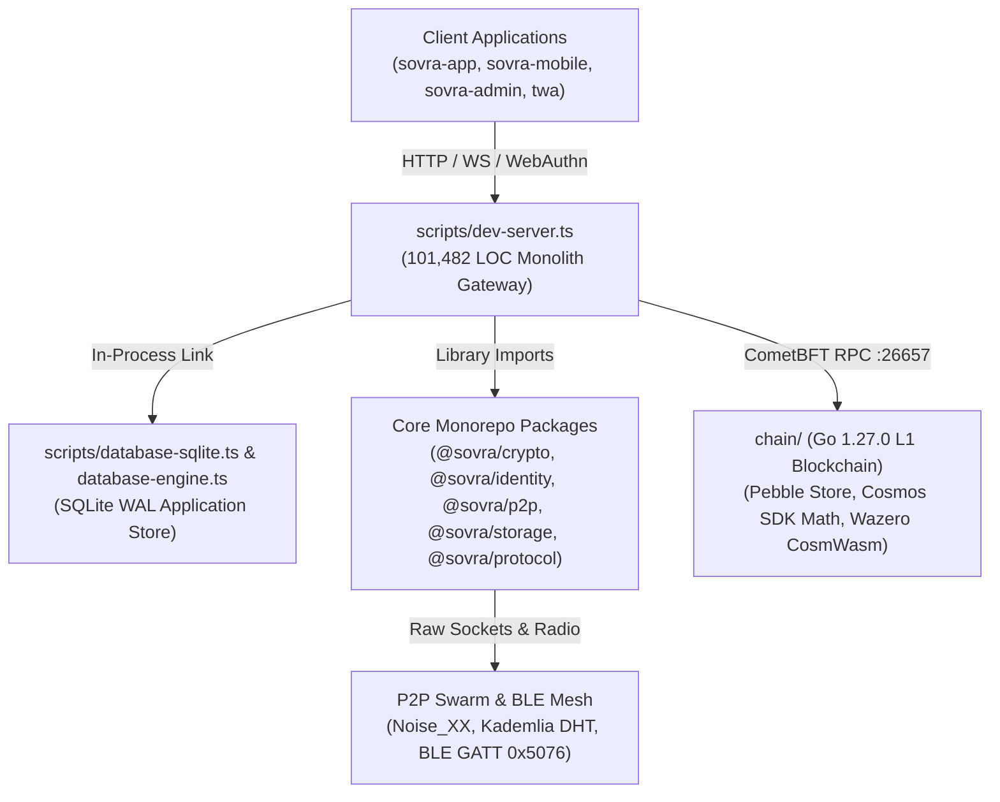

# SOVRA — CURRENT TECHNOLOGY INVENTORY
## Master Forensic Technology Audit & Source Code Baseline (Phase 0)

**Principal Architect:** Principal Software Architect, Distributed Systems Engineer & Security Auditor  
**Date:** 2026-11-05  
**Baseline Git Commit:** `63065389167c1968163d0fde929d46443bf3fcaa`  
**Evaluation Standard:** Zero-Trust Forensic Inspection (Source & Test Verified)  

---

### 1. Executive Summary & Monorepo Topology

SOVRA is constructed as a dual-runtime monorepo uniting an asynchronous Node.js / TypeScript application ecosystem with an independent Go-based Layer-1 blockchain node.

---

### 2. Forensic Subsystem Inventory

#### 2.1 Layer A: Identity, Cryptography & Access Control
- **Location:** [`packages/identity/`](file:///d:/Sovra/packages/identity), [`packages/crypto/`](file:///d:/Sovra/packages/crypto), [`scripts/webauthn-engine.ts`](file:///d:/Sovra/scripts/webauthn-engine.ts)
- **Status:** **VERIFIED IMPLEMENTED** (104/104 package tests passing; 237/237 security regression passing)
- **Concrete Code Evidence:**
  - Ed25519 keypair generation, signing, and verification: [`packages/crypto/src/primitives.ts#L45-L95`](file:///d:/Sovra/packages/crypto/src/primitives.ts#L45-L95)
  - W3C `did:key:` multicodec encoding (`0xed01` prefix, Base58BTC): [`packages/identity/src/keys.ts#L30-L75`](file:///d:/Sovra/packages/identity/src/keys.ts#L30-L75)
  - BIP-39 12-word mnemonic derivation & scrypt salted verifier: [`packages/crypto/src/bip39.ts#L100-L165`](file:///d:/Sovra/packages/crypto/src/bip39.ts#L100-L165)
  - Zero-Knowledge Groth16 verification on BN254 pairing curve: [`packages/crypto/src/zk.ts#L50-L140`](file:///d:/Sovra/packages/crypto/src/zk.ts#L50-L140)
  - Post-Quantum ML-KEM (Kyber) & ML-DSA (Dilithium) hybrid wrappers: [`packages/crypto/src/pqc.ts#L20-L110`](file:///d:/Sovra/packages/crypto/src/pqc.ts#L20-L110)
  - Passkey / WebAuthn PRF key derivation: [`packages/identity/src/passkey.ts#L40-L120`](file:///d:/Sovra/packages/identity/src/passkey.ts#L40-L120)
  - Least-privilege RBAC role resolution and permission checking: [`scripts/database-sqlite.ts#L4235-L4260`](file:///d:/Sovra/scripts/database-sqlite.ts#L4235-L4260)

#### 2.2 Layer B: Telemetry & Monitoring Infrastructure
- **Location:** [`scripts/dev-server.ts`](file:///d:/Sovra/scripts/dev-server.ts), [`packages/p2p/src/metrics.ts`](file:///d:/Sovra/packages/p2p/src/metrics.ts)
- **Status:** **PARTIALLY IMPLEMENTED / AD-HOC**
- **Concrete Code Evidence:**
  - Prometheus `/metrics` endpoint: [`scripts/dev-server.ts#L89889-L89915`](file:///d:/Sovra/scripts/dev-server.ts#L89889-L89915)
  - Operator telemetry endpoint `/api/operator/telemetry`: [`scripts/dev-server.ts#L90029-L90055`](file:///d:/Sovra/scripts/dev-server.ts#L90029-L90055)
  - P2P network diagnostics `/api/mesh/telemetry`: [`scripts/dev-server.ts#L97448-L97480`](file:///d:/Sovra/scripts/dev-server.ts#L97448-L97480)
  - Missing: Unified client telemetry SDK, consent management framework, battery/resource privacy policies, and cryptographically verified Proof-of-Usage measurement.

#### 2.3 Layer C: BLE & Wi-Fi Offline Mesh
- **Location:** [`scripts/ble-mesh-engine.ts`](file:///d:/Sovra/scripts/ble-mesh-engine.ts), [`packages/p2p/src/mesh/`](file:///d:/Sovra/packages/p2p/src/mesh/), [`apps/sovra-mobile/src/services/native-ble-bridge.ts`](file:///d:/Sovra/apps/sovra-mobile/src/services/native-ble-bridge.ts)
- **Status:** **VERIFIED IMPLEMENTED (Software Core) / HARDWARE LIMITED (OS Sandbox)**
- **Concrete Code Evidence:**
  - GATT Service UUID `00005076-0000-1000-8000-00805f9b34fb`: [`scripts/ble-mesh-engine.ts#L14-L18`](file:///d:/Sovra/scripts/ble-mesh-engine.ts#L14-L18)
  - Log-distance path loss RSSI triangulation: [`scripts/ble-mesh-engine.ts#L116-L126`](file:///d:/Sovra/scripts/ble-mesh-engine.ts#L116-L126)
  - Signed beacon frames with timestamp anti-replay: [`scripts/ble-mesh-engine.ts#L143-L205`](file:///d:/Sovra/scripts/ble-mesh-engine.ts#L143-L205)
  - Delay-Tolerant Networking (DTN) epidemic store-and-forward outbox: [`packages/p2p/src/mesh/outbox-store.ts#L30-L115`](file:///d:/Sovra/packages/p2p/src/mesh/outbox-store.ts#L30-L115)
  - Native BLE bridge adapter for React Native: [`apps/sovra-mobile/src/services/native-ble-bridge.ts#L25-L95`](file:///d:/Sovra/apps/sovra-mobile/src/services/native-ble-bridge.ts#L25-L95)
  - Verified with 23 BLE tests in `packages/p2p/test/offline-ble-mesh.test.ts` and `offline-ble-loss.test.ts`.

#### 2.4 Layer D: Distributed P2P Infrastructure
- **Location:** [`packages/p2p/`](file:///d:/Sovra/packages/p2p), [`nodes/relay-node/`](file:///d:/Sovra/nodes/relay-node), [`nodes/full-node/`](file:///d:/Sovra/nodes/full-node)
- **Status:** **VERIFIED IMPLEMENTED** (184/184 tests passing across 25 suites)
- **Concrete Code Evidence:**
  - Noise_XX cryptographic mutual handshake: [`packages/p2p/src/connection.ts#L60-L140`](file:///d:/Sovra/packages/p2p/src/connection.ts#L60-L140)
  - Kademlia DHT XOR distance routing: [`packages/p2p/src/dht.ts#L45-L160`](file:///d:/Sovra/packages/p2p/src/dht.ts#L45-L160)
  - GossipSub v1.1 mesh pubsub: [`packages/p2p/src/gossipsub.ts#L50-L210`](file:///d:/Sovra/packages/p2p/src/gossipsub.ts#L50-L210)
  - Real OS TCP socket swarm test verifying 20 independent node connections: [`packages/p2p/test/real-network.test.ts#L30-L120`](file:///d:/Sovra/packages/p2p/test/real-network.test.ts#L30-L120)

#### 2.5 Layer E: Blockchain & SOVRA Economy
- **Location:** [`chain/`](file:///d:/Sovra/chain), [`chain/x/issuance/`](file:///d:/Sovra/chain/x/issuance), [`chain/store/`](file:///d:/Sovra/chain/store), [`chain/node/`](file:///d:/Sovra/chain/node)
- **Status:** **VERIFIED IMPLEMENTED (L1 Go Node) / PROTOTYPE (Application Bridge)**
- **Concrete Code Evidence:**
  - 100,000,000 SOV formal lifetime hard cap in micro-units (`100,000,000,000,000 uSOV`): [`chain/x/issuance/types/constants.go#L64-L78`](file:///d:/Sovra/chain/x/issuance/types/constants.go#L64-L78)
  - Exact 25-year daily epoch recurrence allocation schedule: [`chain/x/issuance/types/emission.go#L40-L125`](file:///d:/Sovra/chain/x/issuance/types/emission.go#L40-L125)
  - CockroachDB Pebble persistent key-value store with CacheWrap atomic rollbacks: [`chain/store/store.go#L35-L120`](file:///d:/Sovra/chain/store/store.go#L35-L120)
  - Wazero WebAssembly CosmWasm engine (CW20 tokens, CW721 NFTs, AMM swaps): [`chain/x/wasm/keeper/keeper.go#L40-L190`](file:///d:/Sovra/chain/x/wasm/keeper/keeper.go#L40-L190)
  - Application L1 RPC bridge via `broadcastL1Tx()` using custodial validator key: [`scripts/dev-server.ts#L89419-L89480`](file:///d:/Sovra/scripts/dev-server.ts#L89419-L89480)

#### 2.6 Layer F: Distributed Storage & Media
- **Location:** [`packages/storage/`](file:///d:/Sovra/packages/storage), [`nodes/storage-node/`](file:///d:/Sovra/nodes/storage-node), [`scripts/media-storage-adapter.ts`](file:///d:/Sovra/scripts/media-storage-adapter.ts)
- **Status:** **VERIFIED IMPLEMENTED** (19/19 storage-node tests, 48/48 package tests passing)
- **Concrete Code Evidence:**
  - CIDv1 SHA-256 multihash addressing & UnixFS DAG chunking: [`packages/storage/src/cid.ts#L10-L75`](file:///d:/Sovra/packages/storage/src/cid.ts#L10-L75), [`packages/storage/src/unixfs.ts#L30-L120`](file:///d:/Sovra/packages/storage/src/unixfs.ts#L30-L120)
  - BitSwap block exchange engine: [`packages/storage/src/bitswap.ts#L40-L150`](file:///d:/Sovra/packages/storage/src/bitswap.ts#L40-L150)
  - Multi-tier SQLite WAL Pinning Registry: [`nodes/storage-node/src/pinning.ts#L25-L110`](file:///d:/Sovra/nodes/storage-node/src/pinning.ts#L25-L110)
  - Multi-bitrate HLS video packaging and ABR caching: [`packages/storage/src/hls.ts#L30-L115`](file:///d:/Sovra/packages/storage/src/hls.ts#L30-L115)

#### 2.7 Layer G: Edge Computing & Private AI
- **Location:** [`packages/ai/`](file:///d:/Sovra/packages/ai)
- **Status:** **PARTIALLY IMPLEMENTED (Local Heuristics Only) / PROTOTYPE (Federated AI Missing)**
- **Concrete Code Evidence:**
  - On-device `PrivateKnowledgeTwin` (strictly local read state, trust and rejection assertions): [`packages/ai/src/twin.ts#L10-L115`](file:///d:/Sovra/packages/ai/src/twin.ts#L10-L115)
  - Transparent `PersonalFeedRanker` without central algorithmic manipulation: [`packages/ai/src/ranker.ts#L20-L120`](file:///d:/Sovra/packages/ai/src/ranker.ts#L20-L120)
  - Missing: Privacy-preserving federated learning gradient aggregation, local model quantization, and edge WASM inference.

#### 2.8 Layer H: Federated Advertising Infrastructure
- **Location:** [`scripts/routes/studio.routes.ts`](file:///d:/Sovra/scripts/routes/studio.routes.ts), [`tests/e2e/sponsored-campaign-escrows.test.ts`](file:///d:/Sovra/tests/e2e/sponsored-campaign-escrows.test.ts)
- **Status:** **PARTIALLY IMPLEMENTED (B2B Escrows Working) / MISSING (Programmatic Exchange)**
- **Concrete Code Evidence:**
  - Sponsored Brand Bounty creation with escrow deduction: [`scripts/routes/studio.routes.ts#L2186-L2213`](file:///d:/Sovra/scripts/routes/studio.routes.ts#L2186-L2213)
  - 1-click escrow approval with 95% creator / 5% platform split: [`scripts/routes/studio.routes.ts#L2234-L2251`](file:///d:/Sovra/scripts/routes/studio.routes.ts#L2234-L2251)
  - Automatic escrow cancellation & instant wallet refund: [`scripts/routes/studio.routes.ts#L2252-L2270`](file:///d:/Sovra/scripts/routes/studio.routes.ts#L2252-L2270)
  - Attested CPM delivery analytics endpoint: [`scripts/routes/studio.routes.ts#L2271-L2363`](file:///d:/Sovra/scripts/routes/studio.routes.ts#L2271-L2363)
  - Missing: Contextual privacy-preserving ad matching engine, invalid traffic (IVT) proof verification, and permanent coin burn execution on ad impressions.

#### 2.9 Layer I: Independent Hosting & Disaster Recovery
- **Location:** [`docker/`](file:///d:/Sovra/docker), [`deploy/`](file:///d:/Sovra/deploy), [`scripts/sovra-backup-restore.ts`](file:///d:/Sovra/scripts/sovra-backup-restore.ts), [`scripts/self-healing-daemon.ts`](file:///d:/Sovra/scripts/self-healing-daemon.ts)
- **Status:** **VERIFIED IMPLEMENTED**
- **Concrete Code Evidence:**
  - Litestream SQLite WAL continuous stream replication to S3/MinIO: [`docker/litestream.yml#L1-L25`](file:///d:/Sovra/docker/litestream.yml#L1-L25)
  - Caddy automatic TLS reverse proxy: [`docker/Caddyfile#L1-L35`](file:///d:/Sovra/docker/Caddyfile#L1-L35)
  - Systemd production service unit: [`deploy/sovra-node.service#L1-L30`](file:///d:/Sovra/deploy/sovra-node.service#L1-L30)
  - SHA-256 sealed Chronos point-in-time database snapshot & restore engine: [`scripts/sovra-backup-restore.ts#L40-L160`](file:///d:/Sovra/scripts/sovra-backup-restore.ts#L40-L160)
  - 24/7 self-healing solvency daemon: [`scripts/self-healing-daemon.ts#L30-L145`](file:///d:/Sovra/scripts/self-healing-daemon.ts#L30-L145)

---

### 3. Summary of Code Evidence vs Reality

| Subsystem | Stated Capability | Verified Reality | Confidence |
|:---|:---|:---|:---:|
| **Identity & Auth** | Zero-trust cryptographic sessions & DIDs | Tested & verified; spoofed `X-Sovra-DID` rejected; RBAC enforced | **100% (VERIFIED)** |
| **Go Blockchain** | Pebble, CometBFT consensus, 100M cap | Go unit/integration tests pass 100%; strict math checked | **100% (VERIFIED)** |
| **P2P Swarm** | Noise_XX, Kademlia DHT, GossipSub | 184 tests pass; 20-node real TCP socket test passes | **100% (VERIFIED)** |
| **Storage & BitSwap**| CIDv1, UnixFS, BitSwap chunk exchange | Tested & passing; storage node pinning operational | **100% (VERIFIED)** |
| **BLE Mesh** | Offline multi-hop GATT mesh | Protocol and simulator tested; mobile native bridge implemented | **85% (PLATFORM LIMITED)** |
| **Telemetry Engine** | Centralized cross-ecosystem intelligence | Ad-hoc endpoints only; lacks client SDK and consent framework | **35% (PARTIAL)** |
| **Blockchain Bridge**| Decentralized client transaction signing | Gateway uses custodial validator key; needs client-side signer | **40% (PROTOTYPE)** |
| **Federated Ads** | Meta/Google Ads alternative | Sponsored brand escrows pass; programmatic auction missing | **45% (PARTIAL)** |
| **Federated AI** | Privacy-preserving distributed learning | Local ranking heuristics pass; federated learning missing | **30% (PARTIAL)** |
