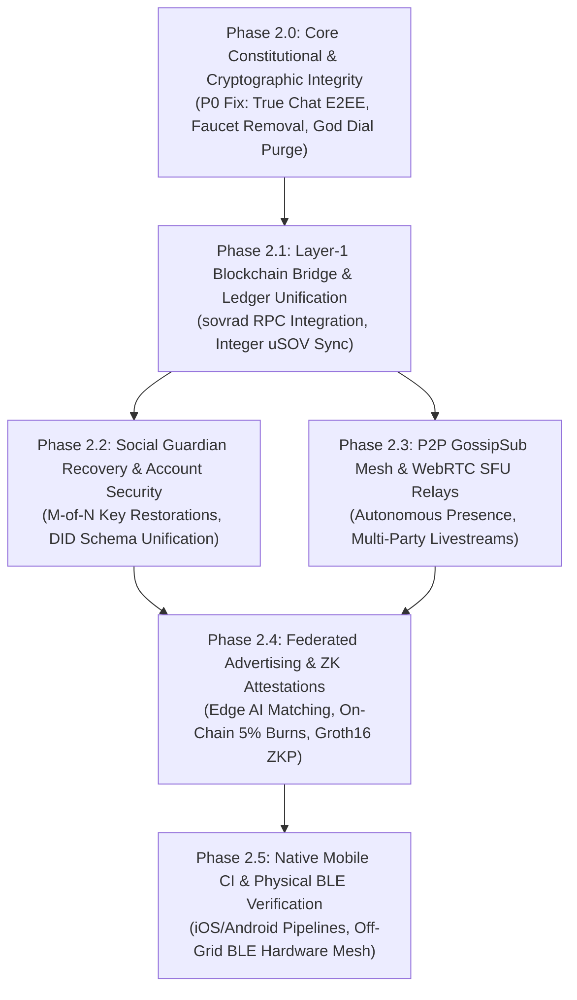

# SOVRA — DEPENDENCY-AWARE DEVELOPMENT ROADMAP
## Strategic Phasing from Zero-Trust Audit Findings to Production Readiness

**Document ID:** SOVRA-ROADMAP-001  
**Audit Task ID:** SOVRA-VISION-AUDIT-001  
**Planning Horizon:** Phase 2.0 to Phase 2.5  
**Dependency Modeling:** Cryptographic & Constitutional Invariant First  
**Baseline Git Commit:** `63065389167c1968163d0fde929d46443bf3fcaa`  
**Repository Working Directory:** `d:\Sovra`  
**Date of Audit:** November 2026  

---

## 1. Executive Roadmap Architecture

Based on the forensic findings of the Master Vision vs Actual Development Audit (`SOVRA-VISION-AUDIT-001`), SOVRA's development must transition from ad-hoc feature prototyping into a **dependency-aware, invariant-preserving sequence**.

Features cannot be layered upon compromised foundations. Therefore, **constitutional invariants, cryptographic truth, and monetary integrity must be locked before expanding infrastructure or commercialization**.

---

## 2. Itemized Phased Development Roadmap

### Phase 2.0: Core Constitutional & Cryptographic Integrity Remediation (RECOMMENDED NEXT PHASE)
- **Phase ID:** `PHASE-2.0-INTEGRITY`
- **Objective:** Eliminate fake-E2EE in the chat gateway, purge legacy centralized God Dial and Panopticon controls from the admin console, deprecate synthetic float faucets, and unify off-chain ledger accounting with integer micro-SOV.
- **Requirements Covered:** `VIS-06-03`, `VIS-08-01`, `VIS-10-03`, `VIS-13-01`, `VIS-13-03`, `VIS-17-01`.
- **Exact Gaps to Close:**
  - `GAP-P0-01`: Close server-side fake-E2EE in `scripts/routes/chat.routes.ts:390-405`; enforce mandatory client-side Double Ratchet ciphertext envelope submission. Reject unencrypted plaintext with HTTP 400.
  - `GAP-P0-02`: Remove synthetic float faucet `/api/wallet/faucet/claim` and arbitrary unbacked `depositFunds` in `scripts/routes/wallet.routes.ts` and `scripts/database-engine.ts`.
  - `GAP-P0-03`: Purge "The God Dial" (silent shadowbanning) and "The God Eye (Panopticon)" from `scripts/admin-console.ts:2949-2980` and `3578-3610`.
- **Files / Packages Involved:**
  - `scripts/routes/chat.routes.ts`
  - `packages/messaging/src/chat-engine.ts`
  - `apps/sovra-app/src/hooks/useE2EEMessenger.ts`
  - `scripts/admin-console.ts`
  - `scripts/routes/wallet.routes.ts`
  - `scripts/database-engine.ts`
  - `scripts/database-sqlite.ts`
- **Dependencies:** None. Self-contained within existing monorepo packages.
- **Acceptance Criteria:**
  1. `/api/chat/send` strictly rejects unencrypted text payloads without valid `ciphertextHex`, `ivHex`, and `tagHex`. Server never holds or derives private message decryption keys.
  2. Admin console contains zero references to "The God Dial", "The God Eye", or unilateral nuclear kill switches.
  3. Faucet endpoint `/api/wallet/faucet/claim` is replaced with signed testnet faucet requiring cryptographic identity verification and strictly bounded allocation.
  4. Float `balance_sov` in SQLite is converted to integer `balance_usov` matching the Go blockchain standard.
- **Required Tests:**
  - Adversarial chat inspection test: verify server fails closed on raw plaintext.
  - Admin console DOM audit: verify absence of God Dial elements and endpoints.
  - Mathematical balance precision tests: verify zero floating-point rounding errors across 10,000 micro-transactions.
- **Security Considerations:** Eliminates severe eavesdropping vulnerability and restores adherence to Constitutional Invariants 1, 2, 4, and 6.
- **Definition of Done:** All 3 critical P0 vulnerabilities closed, 100% regression test pass rate, and zero constitutional invariant violations.

---

### Phase 2.1: Layer-1 Blockchain Bridge & Ledger Unification
- **Phase ID:** `PHASE-2.1-L1-BRIDGE`
- **Objective:** Connect the Node.js dev-server and API layer to the compiled Go CometBFT consensus engine (`chain/sovrad.exe`) via gRPC / Tendermint JSON-RPC.
- **Requirements Covered:** `VIS-01-02`, `VIS-11-01`, `VIS-11-02`, `VIS-13-01`, `VIS-14-03`, `VIS-15-02`.
- **Exact Gaps to Close:**
  - `GAP-P0-04`: Decoupling between Node.js SQLite server and `sovrad.exe`.
  - Replace SQLite shadow balances with authentic L1 CometBFT queries and signed transaction broadcasts (`POST /api/wallet/broadcast`).
- **Files / Packages Involved:**
  - `chain/cmd/sovrad/`
  - `chain/node/app.go`
  - `services/api/src/services/chain-client.ts`
  - `scripts/routes/wallet.routes.ts`
  - `scripts/dev-server.ts`
- **Dependencies:** Completion of Phase 2.0 (integer micro-SOV precision).
- **Acceptance Criteria:**
  1. `scripts/dev-server.ts` automatically spawns or connects to `chain/sovrad.exe` on port 26657 (RPC) and 9090 (gRPC).
  2. Wallet balances, transfers, and burns reflect state transitions confirmed by CometBFT consensus blocks.
  3. 100M lifetime cap is cryptographically validated at the consensus layer.
- **Required Tests:**
  - End-to-end transaction lifecycle test: client sign -> dev-server broadcast -> CometBFT block inclusion -> balance update.
  - Byzantine fault tolerance simulation: kill 1 of 4 testnet validators and verify continuous block production.
- **Definition of Done:** Zero synthetic off-chain transactions; all token movements settle on the L1 chain.

---

### Phase 2.2: Social Guardian Recovery & Account Security
- **Phase ID:** `PHASE-2.2-SOCIAL-RECOVERY`
- **Objective:** Implement persistent backend API endpoints and UI controllers for M-of-N social guardian key recovery without custodial key escrow.
- **Requirements Covered:** `VIS-04-03`, `VIS-12-01`.
- **Exact Gaps to Close:**
  - `GAP-P1-02`: Expose `/api/recovery/plan/create`, `/api/recovery/claim/submit`, `/api/recovery/endorse` in `scripts/routes/`.
  - Add `social_recovery_plans` and `recovery_endorsements` tables to `scripts/database-migrations.ts`.
- **Files / Packages Involved:**
  - `packages/identity/src/recovery.ts`
  - `scripts/routes/auth.routes.ts`
  - `scripts/database-migrations.ts`
  - `apps/sovra-app/src/ui/sovra-identity-discovery/`
- **Dependencies:** Phase 2.0.
- **Acceptance Criteria:**
  1. User can configure 3-of-5 trusted guardian DIDs.
  2. A lost account can be reclaimed by submitting 3 cryptographic guardian signatures without exposing the private seed.
- **Definition of Done:** Full recovery test passing in automated CI with zero server possession of user private keys.

---

### Phase 2.3: P2P GossipSub Mesh & WebRTC SFU Relays
- **Phase ID:** `PHASE-2.3-P2P-SFU-MESH`
- **Objective:** Transition user presence and notifications to decentralized GossipSub v1.1 heartbeats; deploy distributed Selective Forwarding Unit (SFU) media mesh for multi-party livestreaming.
- **Requirements Covered:** `VIS-02-03`, `VIS-07-04`, `VIS-11-03`.
- **Exact Gaps to Close:**
  - Replace HTTP presence polling with GossipSub presence beacons.
  - Implement WebRTC SFU relay node in `nodes/relay-node/` to scale livestreams beyond peer-to-peer 1-on-1 limits.
- **Files / Packages Involved:**
  - `packages/p2p/src/gossipsub.ts`
  - `nodes/relay-node/`
  - `scripts/routes/live.routes.ts`
  - `apps/sovra-app/src/ui/sovra-media/SovraLiveSurface.ts`
- **Dependencies:** Phase 2.1 (validator node communications).
- **Definition of Done:** Multi-party livestreaming verified with 20+ concurrent participants across relay nodes.

---

### Phase 2.4: Federated Contextual Advertising & Zero-Knowledge Attestations
- **Phase ID:** `PHASE-2.4-FED-ADS-ZK`
- **Objective:** Activate client-side Edge AI ad matching in the feed rendering loop, execute genuine on-chain 5% burns on campaign settlements, and integrate real Groth16 ZK-SNARK verifiers.
- **Requirements Covered:** `VIS-06-02`, `VIS-15-01`, `VIS-15-02`, `VIS-15-03`, `VIS-17-03`.
- **Exact Gaps to Close:**
  - Wire `PersonalFeedRanker` to ad gossip channels for surveillance-free local contextual matching.
  - Replace simulated ZK verification in `scripts/routes/zk.routes.ts` with snarkjs Groth16 circuit verifier.
- **Files / Packages Involved:**
  - `packages/ai/src/edge-ranker.ts`
  - `chain/x/wasm/vm/cw_split.go`
  - `scripts/routes/zk.routes.ts`
  - `tests/fixtures/semaphore_16_vkey.json`
- **Dependencies:** Phase 2.1 (L1 CosmWasm bridge).
- **Definition of Done:** Ad impressions verified via blind ZK proofs, paying 95% to creator and burning 5% to dead sink on L1.

---

### Phase 2.5: Native Mobile CI & Physical BLE Mesh Verification
- **Phase ID:** `PHASE-2.5-MOBILE-BLE-CI`
- **Objective:** Configure headless mobile CI build automation for React Native iOS/Android apps and conduct multi-device physical BLE mesh field trials.
- **Requirements Covered:** `VIS-19-01`, `VIS-19-02`.
- **Exact Gaps to Close:**
  - Automated mobile APK and IPA compilation pipelines.
  - Physical verification of BLE GATT 0x5076 multi-hop store-and-forward mesh routing without internet connectivity.
- **Files / Packages Involved:**
  - `apps/sovra-mobile/`
  - `apps/sovra-mobile/src/services/native-ble-bridge.ts`
  - `.github/workflows/mobile-ci.yml`
- **Dependencies:** Phase 2.0 and Phase 2.1.
- **Definition of Done:** Native APK builds automatically in CI and establishes verified peer-to-peer chat over Bluetooth hardware.

---

## 3. Explicit Recommendation: The ONE Immediate Next Development Phase

### Recommended Next Phase:
$$\mathbf{PHASE\;2.0:\;CORE\;CONSTITUTIONAL\;\&\;CRYPTOGRAPHIC\;INTEGRITY\;REMEDIATION}$$

### Architectural Justification:
1. **Mathematical Invariant Priority:** Phase 2.0 addresses the **three most severe constitutional and cryptographic defects** identified in the audit:
   - Server-side fake-E2EE in chat gateway (`VULN-01`)
   - Unbacked synthetic currency creation via faucets (`VULN-02`)
   - Legacy centralized God Dial & Panopticon in admin console (`VULN-03`)
2. **Zero Pre-requisite Blockers:** Phase 2.0 has zero external dependencies; all necessary cryptographic primitives (`@sovra/crypto`, `@sovra/messaging`, `database-moderation.ts`) already exist in the repository.
3. **Foundation for Downstream Work:** Layer-1 blockchain bridging (Phase 2.1) and Social Recovery (Phase 2.2) cannot succeed if the web tier continues to manipulate synthetic float balances or allows server-side plaintext leakage.

---

## 4. Execution Hold & Authorization Gate

In accordance with strict audit rules:
- **No implementation code has been generated or applied.**
- **No further development phases will begin without explicit user instruction.**
- **The system is now halted pending formal review and approval of Phase 2.0.**
