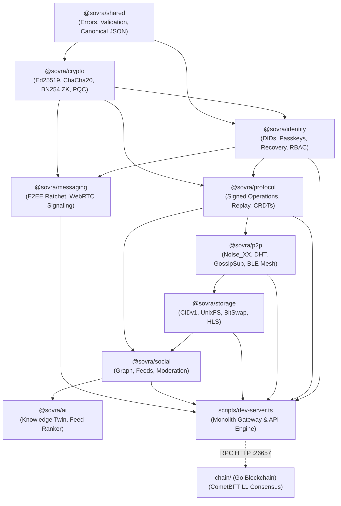

# SOVRA — DEPENDENCY MAP & INTERFACE BOUNDARIES
## Monorepo Architecture, Package Graph & Circular Dependency Prevention (Phase 0)

**Principal Architect:** Principal Software Architect, Distributed Systems Engineer & Network Architect  
**Date:** 2026-11-05  
**Evaluation Standard:** Zero-Trust Modular Decoupling & Strict Layer Isolation  

---

### 1. Monorepo Package Dependency Topology

The SOVRA codebase enforces a unidirectional dependency hierarchy. Low-level primitive packages (`@sovra/crypto`, `@sovra/shared`) sit at the foundation, middle-tier protocol packages consume them, and top-level applications orchestrate execution.

---

### 2. Package Dependency Matrix & Capability Export

| Monorepo Package | Direct Dependencies | Exported Interfaces & Capabilities | Inbound Consumers | Circular Risk Mitigation |
|:---|:---|:---|:---|:---:|
| **`@sovra/shared`** | None (Zero internal dependencies) | Canonical JSON, Result types, Base58/Base64 codecs, Validation primitives | All packages | **Root layer** (Cannot import any `@sovra/*`) |
| **`@sovra/crypto`** | `@sovra/shared` | `signEd25519`, `verifyEd25519`, `encryptChaCha20Poly1305`, `Groth16Verifier`, `deriveKyberKey` | `identity`, `protocol`, `p2p`, `messaging` | Pure algorithmic library; zero network/IO calls |
| **`@sovra/identity`**| `@sovra/shared`, `@sovra/crypto` | `createAuthenticatedPrincipal`, `decodeEd25519DidKey`, `AdminSecurityEngine`, `PasskeyManager` | `protocol`, `messaging`, `dev-server` | Depends strictly down to crypto; zero P2P imports |
| **`@sovra/protocol`**| `@sovra/shared`, `@sovra/crypto`, `@sovra/identity` | `SignedOperation`, `DurableReplayStore`, `CRDTStateSync`, `SeederReceipt` | `p2p`, `social`, `dev-server` | Encapsulates wire formats; zero transport bindings |
| **`@sovra/p2p`**     | `@sovra/shared`, `@sovra/crypto`, `@sovra/protocol` | `NoiseSession`, `KademliaDHT`, `GossipSubRouter`, `BleMeshEngine`, `OutboxStore` | `storage`, `dev-server`, `sovra-mobile` | Decoupled transport interfaces; zero UI bindings |
| **`@sovra/storage`** | `@sovra/shared`, `@sovra/crypto`, `@sovra/p2p` | `CID`, `UnixFS`, `TieredBlockstore`, `BitSwapExchange`, `HlsTranscoder` | `nodes/storage-node`, `dev-server` | Implements content-addressed storage over P2P |
| **`@sovra/messaging`**| `@sovra/shared`, `@sovra/crypto`, `@sovra/identity` | `DoubleRatchetSession`, `WebRtcSignalChannel`, `BitChatTransport` | `dev-server`, `sovra-mobile` | Zero UI; operates as E2EE message stream engine |
| **`@sovra/social`**   | `@sovra/shared`, `@sovra/protocol`, `@sovra/storage` | `SocialGraphEngine`, `FeedGenerator`, `ReputationScorer` | `ai`, `dev-server` | High-level business logic graph |
| **`@sovra/ai`**       | `@sovra/shared`, `@sovra/social` | `PrivateKnowledgeTwin`, `PersonalFeedRanker` | `dev-server`, `sovra-app` | Consumes social events for client-side ranking |

---

### 3. Cross-Layer Architectural Boundaries & Invariants

#### 3.1 Strict Isolation of Private Keys (Layer A Rule)
- Private cryptographic keys (`ed25519PrivKey`, `recoveryMnemonic`, `prfSecret`) are strictly forbidden from crossing into application server boundaries or network request bodies.
- All signing operations occur in client memory, WebAuthn authenticators, or mobile secure enclaves.

#### 3.2 Authoritative vs. Derivative Data Boundaries (Layer E & SQLite Rule)
- **Authoritative Balance Ledger:** Managed exclusively by the Go Layer-1 blockchain (`chain/`).
- **Application SQLite Stores:** Strictly secondary read models, transient event caches, and local outboxes. SQLite must NEVER invent coin balances, bypass the 100M SOV cap, or execute unsanctioned token mints.

#### 3.3 Offline vs. Online Network Boundaries (Layer C & Layer D Rule)
- BLE Mesh operates as an asynchronous, delay-tolerant store-and-forward substrate.
- P2P IP Swarm operates over TCP/WebSockets for global synchronized state.
- When BLE radio is unavailable or denied by mobile OS sandbox, core SOVRA services seamlessly route through the global P2P swarm or independent gateways without fatal crashes.

#### 3.4 Operational Telemetry vs. Advertising Profiles (Layer B & Layer H Rule)
- System metrics (battery, latency, packet loss, node uptime) must NEVER be linked to advertising profiles or user social graphs.
- Telemetry data must be aggregated and anonymized; ad targeting operates purely on local, client-side contextual signals.
