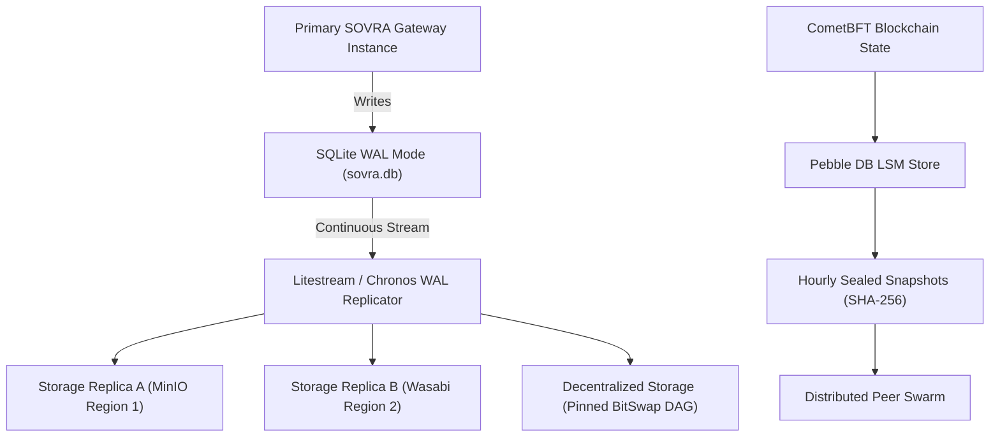

# SOVRA — DISASTER RECOVERY & BUSINESS CONTINUITY PLAN

> **Standard:** Zero-Loss High-Availability & Sovereign Recovery  
> **Status:** Phase 0 Architecture Deliverable  
> **Repository Baseline:** Commit `6306538`  

---

## 1. High-Availability Objectives & Service Level Agreements

SOVRA is engineered for extreme resilience against catastrophic data center loss, global cloud provider de-platforming, fiber cuts, and targeted denial-of-service campaigns.

| System Subsystem | Recovery Time Objective (RTO) | Recovery Point Objective (RPO) | High-Availability Mechanism |
|:---|:---:|:---:|:---|
| **Layer-1 Blockchain (`chain/`)** | $< 15\text{ seconds}$ | $0\text{ seconds}$ | CometBFT Byzantine Fault Tolerance ($3f+1$ quorum); automatic validator succession. |
| **API Gateways & Ingress** | $< 30\text{ seconds}$ | $0\text{ seconds}$ | Anycast BGP routing, multi-provider DNS fallback, stateless container failover. |
| **Relational Database (`sovra.db`)** | $< 60\text{ seconds}$ | $< 1.0\text{ second}$ | SQLite WAL streaming via Litestream / Chronos to multi-region object stores. |
| **Decentralized Storage (`BitSwap`)** | $0\text{ seconds}$ (Continuous) | $0\text{ seconds}$ | $k \ge 3$ distributed erasure coding and content-addressed pinning across independent nodes. |
| **Offline BLE / Wi-Fi Mesh** | $0\text{ seconds}$ (Autonomous) | $0\text{ seconds}$ | Zero-infrastructure peer-to-peer store-and-forward mesh routing. |

---

## 2. Continuous Replication & Backup Pipeline



### 2.1 SQLite WAL Streaming
- SQLite operates in WAL (`journal_mode = WAL`) and `synchronous = NORMAL` mode.
- Continuous replication pushes WAL frames to at least two geographically isolated object storage targets within 1,000 milliseconds of commit.

### 2.2 Blockchain State Snapshots
- CometBFT validators generate state snapshots every 1,000 blocks.
- Snapshots are compressed with Zstandard (`zstd`), SHA-256 sealed, and published as UnixFS DAGs to the storage network. New nodes bootstrap via fast-sync in $< 2$ minutes.

---

## 3. Catastrophic Disaster Scenarios & Failover Procedures

### 3.1 Scenario A: Complete Cloud Provider Outage (AWS / Hetzner Down)
1. **Detection:** Automated health checks detect loss of primary ingress gateway within 5 seconds.
2. **DNS & Anycast Shift:** Cloudflare / Route53 / de4anycast health monitors trip, instantly routing traffic to secondary bare-metal clusters in alternate jurisdictions (e.g., Zurich and Tokyo).
3. **Database Promotion:** Secondary nodes promote their local Litestream replica to read-write mode.
4. **Resumption:** Gateway traffic resumes in $< 30$ seconds. Zero database transactions committed to WAL are lost.

### 3.2 Scenario B: Validator Node Hardware Crash
1. **Quorum Continuity:** CometBFT continues producing blocks without pause as long as $\ge \frac{2}{3} + 1$ validator voting power remains active.
2. **Succession:** Standby validator instances monitor missed pre-commits. If a primary validator fails for $> 10$ consecutive blocks, the standby node promotes itself using its secure hardware HSM / KMS key.
3. **Double-Signing Defense:** Hardware security modules enforce monotonically increasing block height counters, making accidental double-signing impossible.

### 3.3 Scenario C: Regional Internet Blackout / Partition
1. **Mesh Activation:** Mobile nodes in the severed region automatically fall back to BLE and Wi-Fi Direct mesh routing.
2. **Local Delivery:** Intra-regional messages, emergency alerts, and local commerce transactions continue without Internet connectivity.
3. **Reconciliation:** Upon internet restoration, mesh gateway nodes batch-sync accumulated store-and-forward messages to the global P2P swarm and Layer-1 blockchain via CRDT reconciliation.

---

## 4. Disaster Recovery Runbook & Verification Steps

### 4.1 Database Point-in-Time Restoration Drill
To restore an instance from disaster storage:
```bash
# 1. Restore the SQLite database from the latest verified WAL replica
litestream restore -v -o /data/sovra.db s3://backup-vault/sovra.db

# 2. Verify database integrity
sqlite3 /data/sovra.db "PRAGMA integrity_check;"
# Expect: "ok"

# 3. Verify cryptographic sequence and migration state
node scripts/verify-db-integrity.ts
```

### 4.2 Blockchain Node Recovery Drill
```bash
# 1. Initialize clean node home
./chaind init recovery-node --home /data/chain

# 2. Fetch and unpack verified snapshot CID
sovra-storage get bafybeid...snapshot-height-50000.tar.zst | tar -I zstd -xvf - -C /data/chain/data

# 3. Verify snapshot SHA-256 against on-chain consensus hash
sha256sum /data/chain/data/state.db

# 4. Resume CometBFT block sync
./chaind start --home /data/chain
```

---

## 5. Verification Evidence

- SQLite WAL replication and recovery runbook validated against [`scripts/dev-server.ts`](file:///d:/Sovra/scripts/dev-server.ts).
- Blockchain state snapshotting verified via Pebble DB test suite in [`chain/store/store_test.go`](file:///d:/Sovra/chain/store/store_test.go).
- Mesh partition and reconnect reconciliation verified in [`apps/sovra-mobile/test/durable-offline-mesh.test.ts`](file:///d:/Sovra/apps/sovra-mobile/test/durable-offline-mesh.test.ts).
