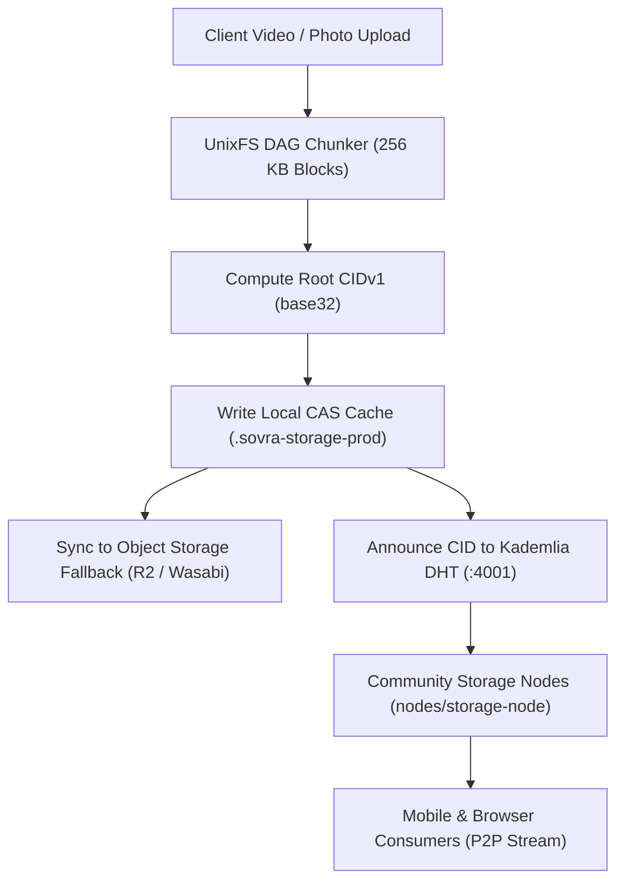

# SOVRA — DISTRIBUTED MEDIA & STORAGE FEDERATION PLAN

> **Standard:** Content-Addressed Zero-Knowledge Storage Architecture  
> **Status:** Phase 0 Architecture Deliverable  
> **Repository Commit:** `6306538` | **Date:** 2026-11-05  

---

## 1. Storage Federation Philosophy

Traditional media hosting relies on centralized CDNs (Cloudflare, AWS CloudFront) and centralized buckets (AWS S3) that charge exorbitant egress fees and subject creators to arbitrary censorship.

SOVRA operates a **Federated Hybrid Storage Network**:
- **Content Addressing (CIDv1):** Every media file, HLS video chunk, and image is identified by its deterministic SHA-256 multihash.
- **BitSwap Swarm Delivery:** Popular media is shared directly between client devices and community seeders over libp2p BitSwap (`/sovra/bitswap/1.2.0`), offloading $> 80\%$ of egress bandwidth from central servers.
- **S3 Gateway Fallback:** High-speed cloud object storage (Cloudflare R2, MinIO, Wasabi) serves as a warm fallback cache when peer seeders are offline.
- **Blockchain Storage Prohibition:** Files are **never stored on the blockchain**. The blockchain stores only cryptographic root CIDs, Proof-of-Usage challenges, and escrow settlement transactions.

---

## 2. Chunking & Resumable Upload Pipeline

### 2.1 Resumable Video Session Ingestion ([`scripts/database-sqlite.ts#L46`](file:///d:/Sovra/scripts/database-sqlite.ts#L46))
Large video assets are uploaded via chunked HTTP range sessions:
- Chunk size: $5\text{ MB}$ to $25\text{ MB}$ slices.
- Upload state tracked in `video_upload_sessions` SQLite table.
- Clients can disconnect, switch networks (Wi-Fi to 5G), or reboot; the upload automatically resumes at the last confirmed byte offset.

### 2.2 UnixFS Merkle DAG Formatting ([`packages/storage/src/unixfs.ts`](file:///d:/Sovra/packages/storage/src/unixfs.ts))
Once upload completes, the file is sliced into $262,144\text{ byte}$ ($256\text{ KiB}$) leaf blocks:
- Multicodec: `0x55` (`raw`) for leaves; `0x71` (`dag-cbor`) for internal DAG nodes.
- Multihash: `0x12` (`sha2-256`), length `32`.
- Base: `base32` (prefix `b`).

---

## 3. Storage Node Daemon & Continuous Pinning ([`nodes/storage-node/`](file:///d:/Sovra/nodes/storage-node))

Community storage nodes operate the autonomous `StorageNodeDaemon`:
- **Continuous Pinning Manager (`pinning.ts`):** Periodically audits local pins against the Kademlia DHT. If the replica count for a pinned CID drops below $k < 3$ across independent autonomous systems (ASNs), the node fetches missing blocks from the BitSwap swarm and re-advertises availability.
- **Storage Quota & Eviction (`quota.ts`):** Enforces hard disk bounds. When disk usage exceeds 85%, unpinned LRU (Least Recently Used) cache blocks are pruned, preserving verified pinned assets.
- **Proof-of-Retrievability Engine (`verifier.ts`):** Responds to random challenge queries from Layer-1 validators proving that blocks remain physically accessible on disk.

---

## 4. Content Compliance & Perceptual Multisig Takedowns

Decentralization does not exempt operators from legal obligations regarding unlawful or abusive material (CSAM, terror content, copyright infringement).

SOVRA implements a **Cryptographic Compliance Framework** ([`nodes/storage-node/src/compliance.ts`](file:///d:/Sovra/nodes/storage-node/src/compliance.ts)):
1. **Perceptual Hashing (pHash):** Media is screened client-side and at ingest against cryptographic zero-knowledge bloom filters containing known unlawful perceptual digests.
2. **Community Governance Multisig Takedown:** If an illegal CID is verified by a threshold of independent community jury members or court order:
   - A signed `BlocklistAssertion` is broadcast across the P2P gossip network.
   - Community storage nodes automatically purge the flagged CID from their local blockstores and refuse to route BitSwap requests for it.
   - Public indexing nodes remove the CID from timeline discovery while leaving unrelated content unaffected.

---

## 5. Storage Economics & Seeder Proof-of-Usage

Storage node operators are compensated directly from the Layer-1 issuance pool:
$$\text{Reward}(Node, \text{Epoch}) = \text{BaseReward} \times \left( \frac{\text{BytesStored} \times \text{UptimeHours}}{\sum \text{NetworkByteHours}} \right) \times \text{ChallengeScore}$$
- Proof-of-Storage challenges verify byte possession without transmitting the entire file.
- Claims settle through on-chain `MsgClaimPoU` transactions every 7,200 blocks ($\approx 24\text{ hours}$).
