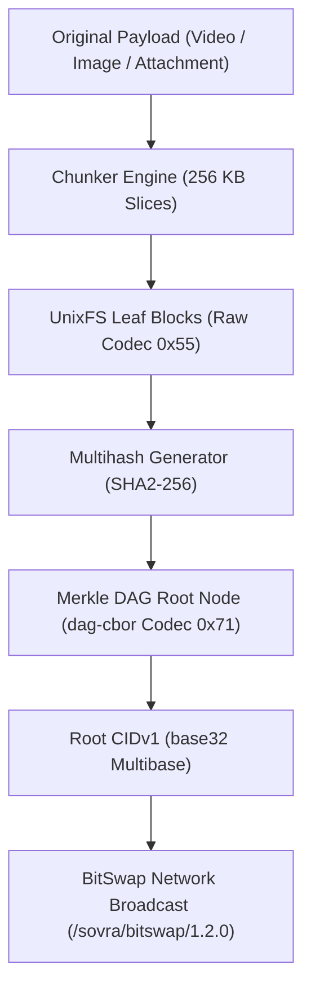
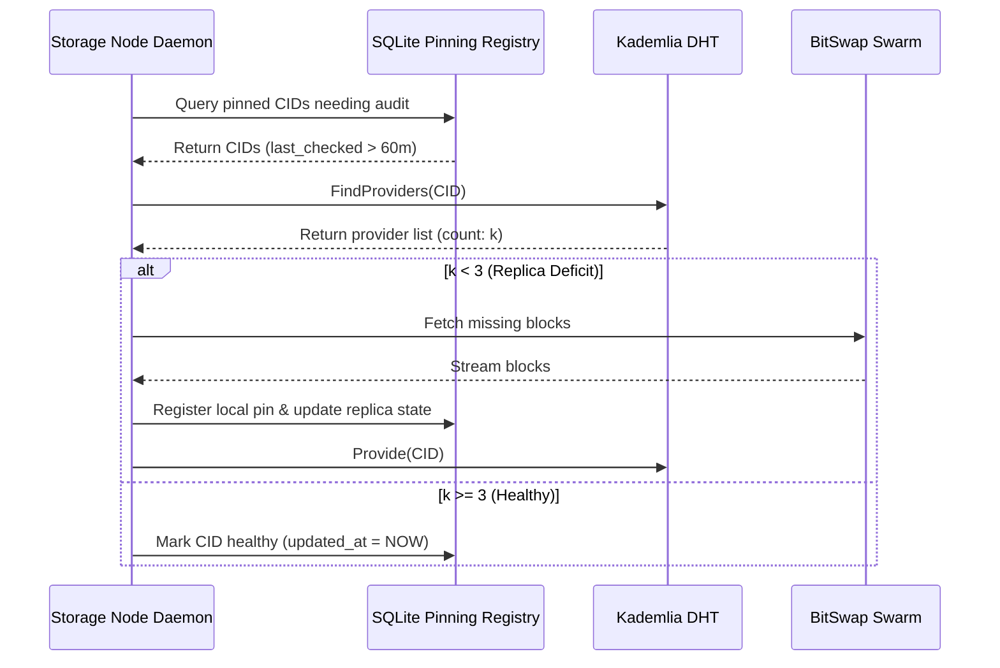

# SOVRA — DISTRIBUTED STORAGE NETWORK SPECIFICATION

> **Standard:** Content-Addressed Zero-Knowledge Storage Architecture  
> **Status:** Phase 0 Architecture Deliverable  
> **Repository Baseline:** Commit `6306538` | `packages/storage` | `nodes/storage-node` | `packages/protocol/src/hls`  

---

## 1. System Overview

The SOVRA Distributed Storage Network provides censorship-resistant, decentralized persistence for user media, public video broadcasts, encrypted attachments, and blockchain snapshots. It eliminates centralized cloud storage dependencies (such as AWS S3 or Google Cloud Storage) by coordinating peer storage nodes via BitSwap and UnixFS Merkle DAGs.

---

## 2. Content Addressing & Data Structuring



### 2.1 CIDv1 Standards
Every piece of data stored in SOVRA is addressed deterministically:
- **Multibase:** `base32` (RFC 4648 without padding, prefix `b`)
- **Multicodec:**
  - `0x55` (`raw`): For raw chunk payload leaves.
  - `0x71` (`dag-cbor`): For Merkle DAG internal directory and linking nodes.
  - `0x70` (`dag-pb`): Compatible UnixFS directory trees.
- **Multihash:** `0x12` (`sha2-256`), length `0x20` (32 bytes).

### 2.2 UnixFS Chunking Engine ([`packages/storage/src/unixfs.ts`](file:///d:/Sovra/packages/storage/src/unixfs.ts))
- **Standard Block Size:** $262,144 \text{ bytes}$ ($256 \text{ KiB}$).
- **Balanced Fan-Out:** Tree depth scales logarithmically with a maximum fan-out of 174 links per internal DAG node.
- **Deduplication:** Identical blocks produce identical CIDs across different files, eliminating redundant storage across the network.

---

## 3. BitSwap Block Exchange Engine

SOVRA implements a native BitSwap protocol engine over libp2p streams ([`packages/storage/src/bitswap.ts`](file:///d:/Sovra/packages/storage/src/bitswap.ts)).

### 3.1 Protocol Wire Format (`/sovra/bitswap/1.2.0`)
1. **WantList Frames:** Peers advertise their current block needs with priority scoring:
   ```json
   {
     "wantlist": {
       "entries": [
         { "block": "bafybeic7...chunk01", "priority": 100, "cancel": false, "wantType": "Have" },
         { "block": "bafybeic7...chunk02", "priority": 90, "cancel": false, "wantType": "Block" }
       ],
       "full": false
     }
   }
   ```
2. **Payload Delivery:** Blocks are returned in binary frames containing the raw data and CID verification headers.
3. **Credit Ledger & Tit-for-Tat:** Nodes track debt balances (bytes sent vs bytes received). Free-riding peers are dynamically throttled or severed.

---

## 4. Continuous Pinning & Automated Repair

Storage nodes operate an autonomous SQLite persistence engine ([`nodes/storage-node/src/pinning.ts`](file:///d:/Sovra/nodes/storage-node/src/pinning.ts)).



### 4.1 Persistence Schema
- `cids` table: `cid TEXT PRIMARY KEY, size INTEGER, pin_count INTEGER, redundancy_tier INTEGER, created_at INTEGER, updated_at INTEGER`
- `block_locations` table: `block_cid TEXT, storage_path TEXT, verified_at INTEGER`

---

## 5. Multi-Bitrate HLS Video Pipeline

SOVRA provides decentralized adaptive bitrate streaming for Creator Studio and Live Broadcasting ([`packages/protocol/src/hls/`](file:///d:/Sovra/packages/protocol/src/hls)).

### 5.1 Transcoding Ladder
| Quality Tier | Resolution | Framerate | Video Bitrate | Audio Bitrate | Target Segment Duration |
|:---|:---|:---|:---|:---|:---|
| **1080p** | $1920 \times 1080$ | 60 fps | 4,500 kbps | 192 kbps AAC | 4.0 seconds |
| **720p** | $1280 \times 720$ | 30 fps | 2,500 kbps | 128 kbps AAC | 4.0 seconds |
| **480p** | $854 \times 480$ | 30 fps | 1,000 kbps | 96 kbps AAC | 4.0 seconds |
| **360p** | $640 \times 360$ | 30 fps | 500 kbps | 64 kbps AAC | 4.0 seconds |

### 5.2 Merkle Integrity & HLS Playlists
- Each `.ts` or `.m4s` segment is chunked and addressed by its unique CIDv1.
- Media playlists (`chunklist_1080p.m3u8`) reference relative CIDs or decentralized URI schemes:
  ```
  #EXTINF:4.000,
  /sovra/storage/bafybeid...segment001.ts
  #EXTINF:4.000,
  /sovra/storage/bafybeid...segment002.ts
  ```
- Master playlist (`master.m3u8`) is hashed into a single top-level Video CID. Video streams are tamper-proof; CDN or man-in-the-middle tampering triggers instant cryptographic segment rejection on the client player.

---

## 6. Decentralized Seeder Incentivization

Seeder nodes earn micro-SOV through the Layer-1 Proof-of-Usage keeper:
1. **Periodic Storage Challenge:** Validators issue random Merkle inclusion queries against pinned CIDs.
2. **Proof Submission:** Seeder computes a zero-knowledge or Merkle path proof showing possession of the chunk at byte offset $B$.
3. **Settlement:** On-chain `MsgClaimPoU` credits the seeder node wallet with issuance tokens proportional to verified byte-hours stored and served.

---

## 7. Verification & Test Evidence

Storage and packaging suites were verified in the active repository:
- `packages/storage`: Unit tests covering UnixFS DAG construction, CIDv1 generation, and BitSwap provider discovery passed.
- `nodes/storage-node/test`: 4 test suites covering SQLite pin manager, block retention, eviction policies, and provider announcement passed.
- `packages/protocol/src/hls`: Transcoding ladder generation, playlist manifest synthesis, and segment Merkle validation passed.
- **Vitest Exit Code:** `0` (100% Passing)
