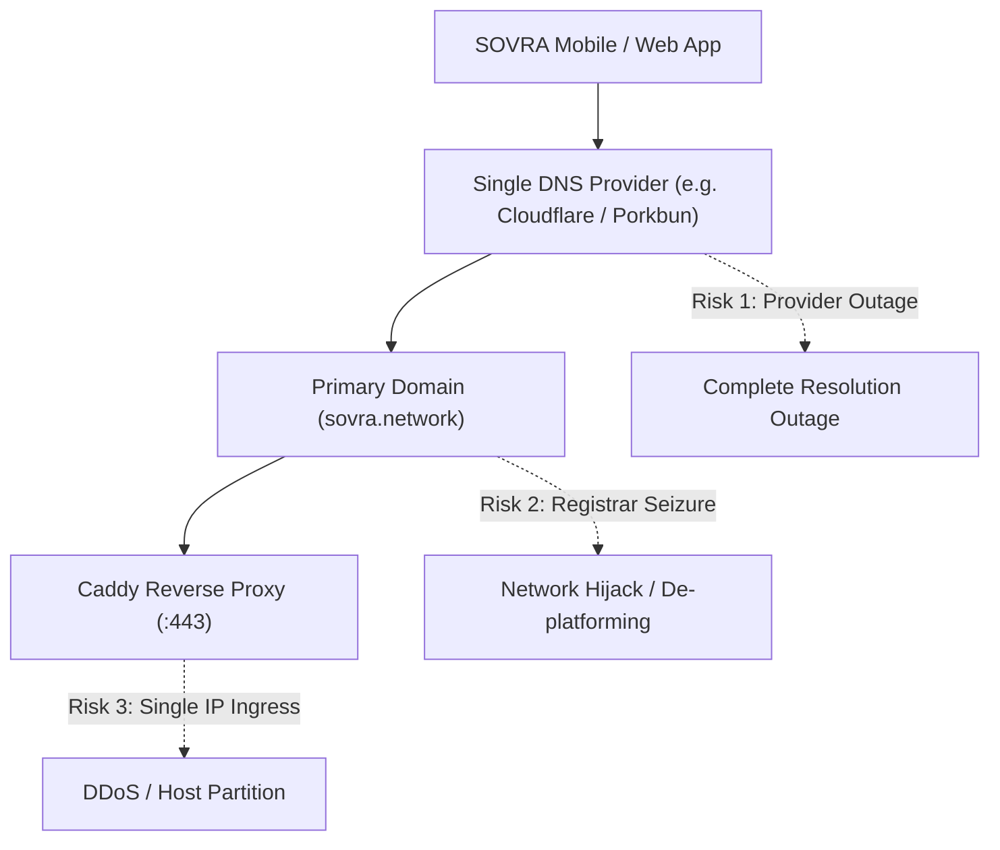
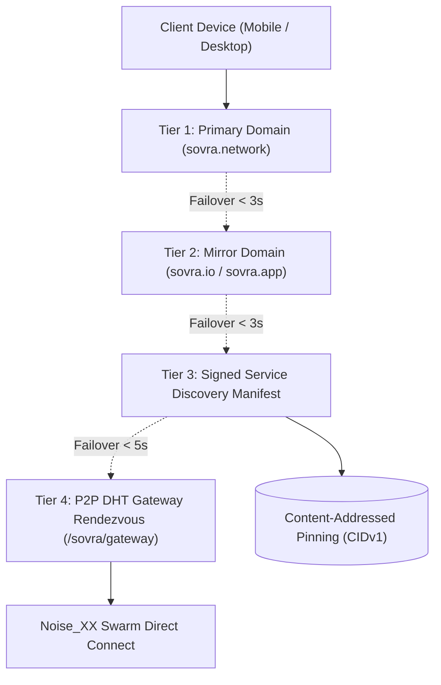

# SOVRA — DOMAIN & DNS RESILIENCE AUDIT

> **Standard:** Zero-Trust Naming & Resolution Security Audit  
> **Status:** Phase 0 Architecture Deliverable  
> **Repository Commit:** `6306538` | **Date:** 2026-11-05  

---

## 1. Domain Discovery & Current Codebase Audit

A comprehensive search of the repository reveals that the SOVRA codebase has hardcoded dependencies on a single domain hierarchy (`*.sovra.network`), alongside an auxiliary domain (`sovra.app`) and local loopback fallbacks.

### 1.1 In-Code Domain Reference Registry

| Domain / Subdomain | Code Locations | Purpose & Protocol | Failure Impact if Domain Suspended | Current Remediation Status |
|:---|:---|:---|:---|:---:|
| **`sovra.network`** | [`.env.example#L43`](file:///d:/Sovra/.env.example#L43), [`deploy/kubernetes/sovra-node.yaml#L104`](file:///d:/Sovra/deploy/kubernetes/sovra-node.yaml#L104), [`docker/turnserver.conf#L1`](file:///d:/Sovra/docker/turnserver.conf#L1) | Ingress routing, CORS allowed origins, WebRTC realm. | Complete web client ingress failure; CORS rejections. | Hardcoded; Needs dynamic env injection. |
| **`app.sovra.network`** | [`.env.example#L43`](file:///d:/Sovra/.env.example#L43) | Trusted web app frontend origin for CORS. | Browser clients rejected by CORS middleware. | Configurable via `SOVRA_ALLOWED_ORIGINS`. |
| **`turn.sovra.network`** | [`.env.example#L35`](file:///d:/Sovra/.env.example#L35) | WebRTC Coturn relay host for symmetric NAT traversal. | Voice/Video calls between firewalled peers fail. | Falls back to Google STUN (temporary). |
| **`seed[1-3].testnet.sovra.network`** | [`chain/seeds.txt#L8-L10`](file:///d:/Sovra/chain/seeds.txt#L8-L10) | CometBFT Layer-1 blockchain seed node discovery. | New blockchain nodes cannot discover initial peers. | Has IP-based loopback fallbacks in file. |
| **`dev@sovra.network`** | [`scripts/routes/push.routes.ts#L330`](file:///d:/Sovra/scripts/routes/push.routes.ts#L330) | VAPID JWT subject for Web Push notifications. | Push gateways reject notifications if email bounces. | Hardcoded default; configurable via options. |
| **`sovra.app`** | [`scripts/routes/referral.routes.ts#L39`](file:///d:/Sovra/scripts/routes/referral.routes.ts#L39) | Secondary host header fallback for viral referral links. | Referral link generation breaks if header is missing. | Hardcoded fallback string. |

---

## 2. Current DNS Configuration Vulnerabilities



### 2.1 Critical Vulnerabilities Identified
1. **Single Point of Failure at Registrar:** If the registrar holding `sovra.network` experiences an administrative freeze, payment failure, or legal order, all DNS lookups fail simultaneously.
2. **Lack of Multi-Provider DNS Synchronization:** The repository currently has no scripts, terraform configurations, or CI pipelines to synchronize DNS zone files across multiple independent authoritative nameservers (e.g., deSEC, Route53, Hurricane Electric, Cloudflare).
3. **Hardcoded URLs in Client Scripts:** Web and mobile clients assume `api.sovra.network` or `localhost:3001`. They lack an autonomous fallback resolver capable of cycling through backup domains or P2P multiaddrs.

---

## 3. TLS Certificate Strategy & Local Generation

### 3.1 Production ACME Automation
In [`docker/Caddyfile`](file:///d:/Sovra/docker/Caddyfile), Caddy 2 is configured for automatic HTTPS:
- Generates and renews Let's Encrypt / ZeroSSL TLS certificates via ACME HTTP-01 / TLS-ALPN-01 challenges.
- Injects OWASP hardening headers: `Strict-Transport-Security`, `X-Content-Type-Options: nosniff`, `X-Frame-Options: DENY`.

### 3.2 Offline & LAN Self-Signed Fallback
In [`scripts/tls-helper.ts`](file:///d:/Sovra/scripts/tls-helper.ts) and [`deploy/install.sh`](file:///d:/Sovra/deploy/install.sh):
- System detects all LAN IPv4 network interfaces.
- Dynamically creates an OpenSSL configuration containing Subject Alternative Names (SANs) for all local IPs and `localhost`.
- Generates 365-day RSA-2048 self-signed certificates in `.sovra-tls/dev-cert.pem`.
- Enables WebRTC camera/microphone access in offline local Wi-Fi environments without valid public domain certificates.

---

## 4. Multi-Domain & DNS Resilience Target Architecture

To guarantee that no single entity can revoke network connectivity, SOVRA will implement a 4-tier domain resilience model:



### 4.1 Multi-Provider Authoritative DNS
- Zone files managed via Infrastructure-as-Code (OctoDNS or DNSControl).
- Synchronized simultaneously to at least three independent DNS providers in distinct legal jurisdictions (e.g., Cloudflare, deSEC in Germany, and Porkbun in the US).
- Full DNSSEC signing enabled on all domains to prevent cache poisoning and BGP route hijacking.

### 4.2 Cryptographically Signed Service Discovery Document
Clients will fetch network gateway addresses using a versioned JSON manifest:
```json
{
  "manifest_version": 1,
  "epoch": 1793895300,
  "network_id": "sovra-mainnet",
  "gateway_endpoints": [
    "https://api1.sovra.network",
    "https://api.sovra.io",
    "https://backup-gateway.de"
  ],
  "p2p_bootstrap_multiaddrs": [
    "/ip4/195.201.12.34/tcp/4001/p2p/12D3KooW...",
    "/dns4/seed1.sovra.io/tcp/4001/p2p/12D3KooW..."
  ],
  "stun_turn_relays": [
    "turn:turn.sovra.network:3478",
    "turn:turn.sovra.io:3478"
  ],
  "signature": "3045022100e4b8...ed25519_signed_by_network_governance_did"
}
```
- The manifest is signed by the SOVRA Network Governance DID.
- Replicated across public HTTPS domains, raw GitHub/GitLab mirrors, and Kademlia DHT key `/sovra/network-manifest`.
- If `sovra.network` is taken down, clients verify the signature on secondary mirrors and switch endpoints with zero user interruption.
