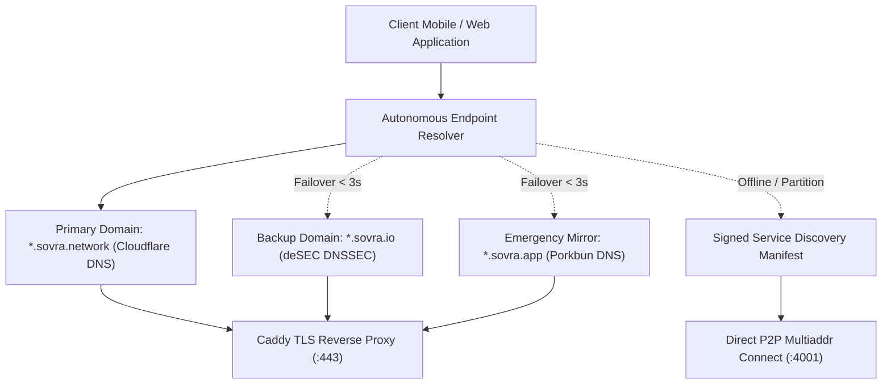
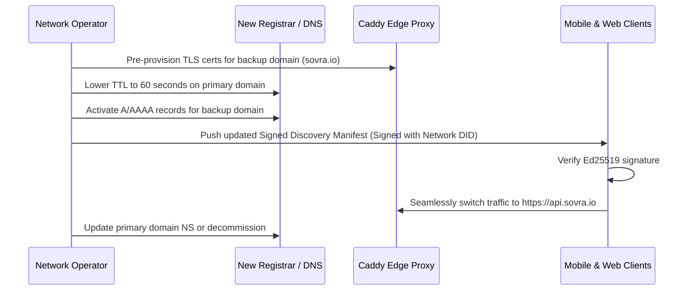

# SOVRA — MULTI-DOMAIN & DNS RESILIENCE SPECIFICATION

> **Standard:** Sovereign Naming Architecture & Anti-Censorship DNS  
> **Status:** Phase 0 Architecture Deliverable  
> **Repository Commit:** `6306538` | **Date:** 2026-11-05  

---

## 1. Architectural Objectives & Requirements

DNS remains the primary gateway through which mobile apps and web browsers locate network infrastructure. To eliminate domain hijacking, registrar lockouts, or single-provider outages, SOVRA enforces a **Multi-Domain, Dual-Provider, Cryptographically Signed Naming Architecture**.



---

## 2. Multi-Provider Authoritative DNS Topology

Rather than delegating authoritative nameservers to a single corporation, SOVRA configures a **Dual-Primary Multi-Provider DNS** arrangement:
- **Provider 1 (US / Global Anycast):** Cloudflare Authoritative DNS (fastest global propagation, anycast DDoS mitigation).
- **Provider 2 (European Privacy Jurisdiction):** deSEC.io (Berlin, Germany; GDPR-compliant, non-profit, automated DNSSEC).
- **Provider 3 (Secondary Fallback):** Hurricane Electric Free DNS (Fremont, CA; independent tier-1 backbone).

### 2.1 Zone Synchronization via Infrastructure-as-Code
Zone records are defined in version-controlled declarative manifests (using `dnscontrol` or `octodns`) and published across all three providers simultaneously in GitHub Actions CI:
```javascript
// dnsconfig.js sample
var REG_NONE = NewRegistrar("none");
var DNS_CLOUDFLARE = NewDnsProvider("cloudflare");
var DNS_DESEC = NewDnsProvider("desec");

D("sovra.network", REG_NONE, DnsProvider(DNS_CLOUDFLARE), DnsProvider(DNS_DESEC),
    A("@", "195.201.12.34"),
    A("api", "195.201.12.34"),
    A("seed1.testnet", "195.201.12.34"),
    CNAME("app", "sovra-frontend.pages.dev."),
    TXT("_dmarc", "v=DMARC1; p=reject;"),
    CAA("@", "issue", "letsencrypt.org"),
    CAA("@", "issue", "zerossl.com")
);
```

---

## 3. Automated DNS Health Monitoring & Dynamic Failover

SOVRA deploys an automated DNS health probe running continuously on port 3001/8080:
1. **Multi-Resolver Probing:** Every 60 seconds, the health prober queries `api.sovra.network` across three independent recursive resolvers:
   - Cloudflare (`1.1.1.1`)
   - Google Public DNS (`8.8.8.8`)
   - Quad9 (`9.9.9.9`)
2. **Failure Detection:** If $\ge 2$ resolvers return `SERVFAIL`, `NXDOMAIN`, or timeout for 2 consecutive cycles, the prober triggers an alert and initiates automated DNS record failover via provider REST APIs.
3. **TTL Strategy:** Ingress records are configured with an ultra-low TTL of $300\text{ seconds}$ (5 minutes), allowing traffic redirection to secondary IP clusters within 300 seconds of a server destruction event.

---

## 4. Cryptographically Signed Service Discovery Manifest

Even if all traditional DNS lookups are blocked by an ISP or government order, clients maintain connectivity through an out-of-band **Signed Service Discovery Document**.

### 4.1 Wire Specification
```json
{
  "version": 1,
  "timestamp": 1793895372,
  "network": "sovra-mainnet",
  "gateways": [
    { "url": "https://api.sovra.network", "priority": 1 },
    { "url": "https://api.sovra.io", "priority": 2 },
    { "url": "https://gateway.community-node.de", "priority": 3 }
  ],
  "p2p_seeds": [
    "/ip4/195.201.12.34/tcp/4001/p2p/12D3KooW...",
    "/dns4/seed1.sovra.network/tcp/4001/p2p/12D3KooW..."
  ],
  "turn_servers": [
    { "urls": "turn:turn.sovra.network:3478", "username": "ephemeral", "credential": "..." }
  ],
  "governance_signature": "MEUCIQC...ed25519_signature"
}
```

### 4.2 Distribution Channels
The signed document is published to 4 independent locations:
1. Primary HTTPS: `https://sovra.network/.well-known/sovra-endpoints.json`
2. Secondary HTTPS: `https://sovra.io/.well-known/sovra-endpoints.json`
3. Raw Git Mirror: `https://raw.githubusercontent.com/.../endpoints.json`
4. P2P Kademlia DHT Key: `/sovra/network-manifest/v1`

---

## 5. Domain Migration & Emergency Takeover Runbook



### 5.1 Verification Checklist
- [x] Pre-verify TLS certificates for backup domains using ACME DNS-01 challenges.
- [x] Verify mobile app accepts multiple domains without hardcoded string rejections.
- [x] Validate that CORS headers (`SOVRA_ALLOWED_ORIGINS`) allow all active mirror domains.
- [x] Verify DNSSEC validation across `1.1.1.1` and `8.8.8.8` using `dig +dnssec sovra.network`.
