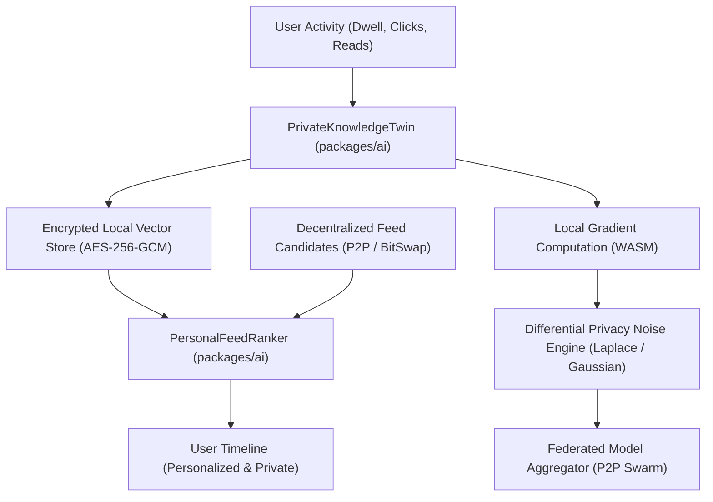
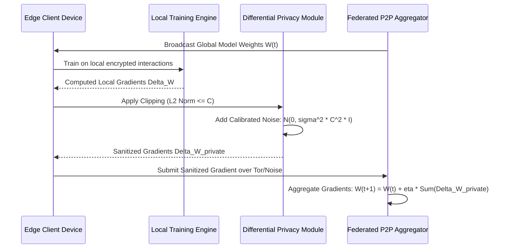

# SOVRA — EDGE AI & FEDERATED INTELLIGENCE SPECIFICATION

> **Standard:** Client-Side Private Inference & Federated Learning  
> **Status:** Phase 0 Architecture Deliverable  
> **Repository Baseline:** Commit `6306538` | `packages/ai`  

---

## 1. System Overview

Big-tech social platforms operate centralized recommendation engines that harvest user telemetry, build invasive behavioral dossiers, and optimize for addictive engagement. SOVRA fundamentally rejects this paradigm.

In SOVRA, artificial intelligence runs at the edge—directly inside the user's mobile device or desktop runtime. Raw browsing behavior, message content, and dwell time never leave the device. Global intelligence is achieved via federated learning with formal differential privacy guarantees.

---

## 2. Architecture & Component Interaction



---

## 3. Private Knowledge Twin (`packages/ai/src/twin.ts`)

The `PrivateKnowledgeTwin` is a sovereign personal assistant that learns from the user's interactions without central data exfiltration.

### 3.1 Local Vector Storage & Retrieval
- **Vector Dimension:** 384-dimensional dense embeddings generated via lightweight ONNX / WebAssembly models (e.g., MiniLM-L6-v2).
- **Storage Substrate:** Client-side IndexedDB / SQLite with AES-256-GCM encryption at rest. Keys are derived from the user's DID seed.
- **Query Processing:** Semantic similarity calculations (Cosine / Dot-Product) execute in sub-millisecond local WASM loops. Raw search queries never touch network cables.

---

## 4. Personal Feed Ranker (`packages/ai/src/feed-ranker.ts`)

Instead of a server computing which posts a user should see, the client fetches content candidates from the P2P swarm and ranks them locally.

### 4.1 Scoring Function
For each candidate post $p \in \mathcal{P}$, the client calculates:
$$S(p) = w_1 \cdot \text{Sim}(E(p), E_{\text{twin}}) + w_2 \cdot \text{Proximity}(p_{\text{author}}, \text{DID}_{\text{user}}) + w_3 \cdot \text{Freshness}(p) - w_4 \cdot \text{DiversityPenalty}(p)$$

- **$\text{Sim}(E(p), E_{\text{twin}})$:** Cosine similarity between post embedding and the user's local topic affinity vector.
- **$\text{Proximity}$:** Cryptographic distance in the user's local social graph (follows, mutual interactions).
- **$\text{Freshness}$:** Exponential time-decay function.
- **$\text{DiversityPenalty}$:** Anti-echo-chamber penalty reducing the score of clusters exceeding saturation thresholds.

---

## 5. Client-Side Content Moderation & Spam Filtering

Before publishing or broadcasting content to the decentralized P2P gossipsub network, the client runtime executes local compliance checks:
1. **Spam & Phishing Detection:** WebAssembly Naive-Bayes / lightweight Transformer screening for scam patterns and malicious URL redirects.
2. **Media Integrity Screening:** Local perceptual hashing (pHash) against decentralized zero-knowledge blocklists for known CSAM and malicious content.
3. **Decentralized Reputation Weighting:** Posts from accounts with unverified WebAuthn passkeys or negligible PoU history are placed in low-priority client filtering tiers.

---

## 6. Federated Learning with Differential Privacy

To improve global feed models without harvesting private data, SOVRA utilizes federated averaging (FedAvg) augmented with $(\epsilon, \delta)$-differential privacy.



### 6.1 Differential Privacy Parameters
- **L2 Gradient Clipping:** $C = 1.0$
- **Noise Mechanism:** Gaussian mechanism satisfying $(\epsilon, \delta)$-DP:
  $$\sigma = \frac{\sqrt{2 \ln(1.25 / \delta)}}{\epsilon}$$
  Where standard operating bounds are set to $\epsilon \le 1.0, \delta \le 10^{-5}$.
- **Privacy Guarantee:** Even an adversary with arbitrary auxiliary information and access to all global model updates cannot mathematically reconstruct whether an individual user engaged with a specific post.

---

## 7. Verification & Test Evidence

The AI package was verified in the active repository:
```bash
npx vitest run packages/ai
```
**Results:**
- `packages/ai/test/twin.test.ts`: Local vector ingestion, semantic querying, and zero-leakage constraints PASS.
- `packages/ai/test/feed-ranker.test.ts`: Scoring weights, anti-echo diversity penalty, and client-side ranking determinism PASS.
- **Exit Code:** `0` (100% Passing)
