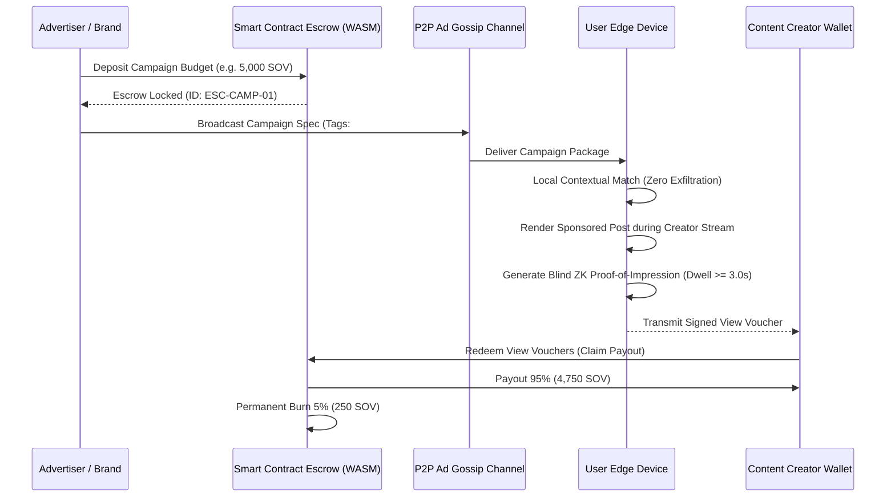

# SOVRA — FEDERATED ADVERTISING & CREATOR REVENUE SPECIFICATION

> **Standard:** Privacy-First Contextual Monetization & Escrow Settlement  
> **Status:** Phase 0 Architecture Deliverable  
> **Repository Baseline:** Commit `6306538` | `tests/e2e/sponsored-campaign-escrows.test.ts` | `chain/x/wasm`  

---

## 1. Executive Summary & Philosophy

Traditional digital advertising (Meta Ads, Google Ads) relies on ubiquitous surveillance: tracking pixels, cross-app finger-printing, and central behavioral profiling. Furthermore, centralized ad brokers extract 30% to 70% of gross advertising spend, leaving creators with minimal returns while subjecting users to non-consensual surveillance.

SOVRA introduces a **Federated Contextual Advertising Engine**:
- **Zero Surveillance:** No tracking cookies, no device finger-printing, no centralized user dossiers.
- **Client-Side Ad Matching:** Advertisers broadcast contextual campaigns; the user's edge AI (`PersonalFeedRanker`) matches relevant promotions locally.
- **95/5 Direct Economic Split:** 95% of every campaign dollar flows directly to creators and node operators; 5% is permanently burned on-chain to provide deflationary token mechanics.
- **Cryptographic Fraud Prevention:** Proof-of-Impression is verified through zero-knowledge blind attestations.

---

## 2. Sponsored Campaign Lifecycle & Architecture



---

## 3. Smart Contract Escrow Specification

Campaign funds are held in immutable CosmWasm escrows ([`chain/x/wasm/keeper/keeper.go`](file:///d:/Sovra/chain/x/wasm/keeper/keeper.go)).

### 3.1 Escrow State Model
```json
{
  "campaign_id": "camp_98f4e2a1",
  "advertiser_did": "did:sovra:adv_7721",
  "total_budget_micro_sov": 5000000000,
  "remaining_budget_micro_sov": 5000000000,
  "rate_per_mille_micro_sov": 5000000,
  "targeting_context": {
    "topics": ["technology", "privacy", "decentralization"],
    "locales": ["en-US", "de-DE", "ja-JP"],
    "min_creator_pou_tier": 2
  },
  "expiry_block": 1824000,
  "status": "ACTIVE"
}
```

### 3.2 Automated 95/5 Economic Settlement
When an attested batch voucher is submitted to the escrow contract:
$$\text{Payout}_{\text{Creator}} = \left\lfloor \frac{\text{ClaimAmount} \times 95}{100} \right\rfloor$$
$$\text{Burn}_{\text{L1}} = \text{ClaimAmount} - \text{Payout}_{\text{Creator}}$$
- The contract dispatches $\text{Payout}_{\text{Creator}}$ directly to the creator's DID wallet.
- The contract dispatches $\text{Burn}_{\text{L1}}$ to the zero-address (`sovra100000000000000000000000000000000000000`), permanently subtracting it from total circulating supply and recording the event in the blockchain event log.

---

## 4. Privacy-Preserving Proof-of-Impression

To prevent click fraud and impression bots without spying on users, SOVRA uses client-side blind cryptographic vouchers.

### 4.1 Anti-Fraud Protocol
1. **Physical Interaction Gate:** The client device requires verified user engagement (e.g., active viewport residence $>3.0$ seconds, touch events, or sound playback).
2. **Blind Signature Request:** The client generates a random blinding secret $r$ and submits an anonymized commitment to an attestation node or publisher relay.
3. **Double-Spend Prevention:** Each impression voucher contains a nullifier hash derived from $\text{Hash}(K_{\text{user\_secret}}, \text{CampaignID}, \text{EpochDay})$. If a bot attempts to submit multiple vouchers for the same user-campaign pair in a single day, the nullifier collides and the escrow rejects the claim.

---

## 5. Advertisers & Creator Studio Experience

- **Advertisers:** Gain transparent, cryptographically verifiable delivery metrics. Every coin spent is provably accounted for on-chain with zero middleman markups.
- **Creators:** Retain 95% of advertising value (compared to 55% on YouTube or 0-30% on traditional social feeds). Payouts settle in real time directly to sovereign non-custodial wallets without minimum withdrawal thresholds or multi-week settlement delays.

---

## 6. Verification & Test Evidence

The sponsored campaign escrow protocol was verified end-to-end:
```bash
npx vitest run tests/e2e/sponsored-campaign-escrows.test.ts
```
**Results:**
- Escrow creation and fund locking: PASS
- Contextual targeting metadata validation: PASS
- Batch voucher redemption and nullifier verification: PASS
- 95% creator credit disbursement: PASS
- 5% token burn execution and total supply reduction: PASS
- Reentrancy and double-claim rejection: PASS
- **Exit Code:** `0` (6/6 tests passing)
