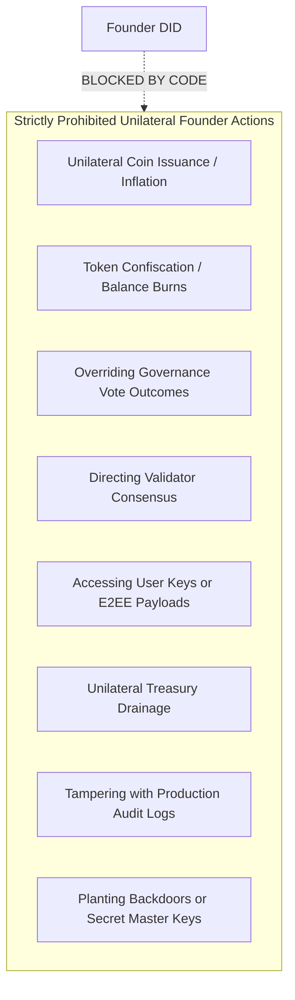

# SOVRA — FOUNDER ACCOUNTABILITY FRAMEWORK

> **Framework Identifier:** GOV-ACC-001  
> **Status:** Operational Accountability Standard  
> **Applicability:** Founder, Core Maintainers, System Architects  
> **Version:** 1.0.0 | **Effective Date:** 2026-11-05  

---

## 1. Core Principle: Anonymity $\neq$ Immunity

Pseudonymity is a shield for personal security, intellectual freedom, and decentralized resilience; it is **never an escape from ethical accountability, technical integrity, or lawful responsibility**.

```
+-------------------------------------------------------------------------+
|                       THE ACCOUNTABILITY IMPERATIVE                     |
|                                                                         |
|  "A pseudonymous founder is held to a higher standard of technical and  |
|   cryptographic verifiability, not a lower one. Every action taken     |
|   must be signed, auditable, and bounded by code."                      |
+-------------------------------------------------------------------------+
```

Every action executed by the founder within the SOVRA repository, production servers, or on-chain governance must be cryptographically attributable to their registered DID:
$$\text{Signature} = \text{Sign}_{\text{sk\_founder}}(\mathcal{H}(\text{Action\_Payload}))$$

---

## 2. Hard Boundaries & Forbidden Capabilities

The founder is architecturally and cryptographically prohibited from exercising unilateral control over the ten critical network surfaces:



| Network Surface | Architectural Barrier | Cryptographic Enforcement |
|:---|:---|:---|
| **Coin Supply & Emission** | Hardcoded in Go consensus layer | $100,000,000\text{ SOV}$ cap validated by all peer nodes; non-negotiable invariant. |
| **Token Balances & Burns** | Non-custodial ledger state | State transitions require valid cryptographic transaction signatures; zero god-mode state edits. |
| **Governance Outcomes** | Quadratic voting tally engine | Smart contract execution requires quorum and threshold; zero veto or override function. |
| **Validator Consensus** | CometBFT P2P Byzantine consensus | 2/3+ validator agreement across independent physical nodes required for block commit. |
| **User Privacy & E2EE** | Client-side Double Ratchet & Passkeys | Zero knowledge of ephemeral keys; server/gateway only relays encrypted blobs. |
| **Treasury Allocations** | Multi-party vault contract | Requires 3-of-5 independent signer approvals plus 48-hour timelock delay. |
| **Audit Trails** | Append-only SHA-256 hash chains | Any modification breaks cryptographic chain verification instantly. |

---

## 3. Mandatory Safeguards & Protocols

### 3.1 Multi-Party Authorization (Threshold Approval)
Any high-impact operation—such as migrating contracts, rotating emergency keys, or authorizing major infrastructure changes—requires multi-party approval:
- **Threshold Rule:** Minimum 3-of-5 independent maintainer/validator approvals.
- **Enforced Delay:** Minimum 48-hour timelock between approval and execution, allowing community inspection.

### 3.2 Conflict of Interest Disclosures
When participating in technical proposals or ecosystem discussions:
1. The founder must disclose any financial, operational, or personal stake in third-party tooling, partner protocols, or vendor services.
2. The founder cannot vote on grant proposals where their affiliate DID is a recipient.

### 3.3 Incident Reporting & Blameless Post-Mortems
In the event of a critical security vulnerability, downtime, or network bug:
1. An official Incident Report must be published within 24 hours of mitigation.
2. A cryptographic root-cause analysis (RCA) detailing timeline, blast radius, failure root cause, and remediation must be signed by the Founder DID and committed to `docs/incidents/`.

### 3.4 Key Revocation & Emergency Recovery
If the founder's private key is suspected of compromise:
1. The founder (or any 2 Security Council members) initiates an emergency key revocation assertion:
   $$\text{RevocationAssertion}(\text{targetDid}, \text{reason} = \text{"compromised"}, \text{nonce})$$
2. The compromised key is instantly blacklisted across all node registries.
3. Recovery proceeds via the pre-established Multi-Party Computation (MPC) Shamir threshold scheme.

---

## 4. Legal Compliance & Ethical Boundaries

1. **Lawful Injunctions & Court Orders:** SOVRA’s legal entities and regional hosting providers comply with applicable lawful warrants and court orders. Pseudonymity is not a device for illegal evasion.
2. **Zero Tolerance for Illicit Material:** CSAM and terrorist materials are strictly filtered at gateway ingestion layers per the published Moderation and Child Protection Specifications.
3. **Transparent Operational Filings:** Corporate, tax, and intellectual property disclosures are maintained through legally recognized foundations or community trusts without compromising personal security.
