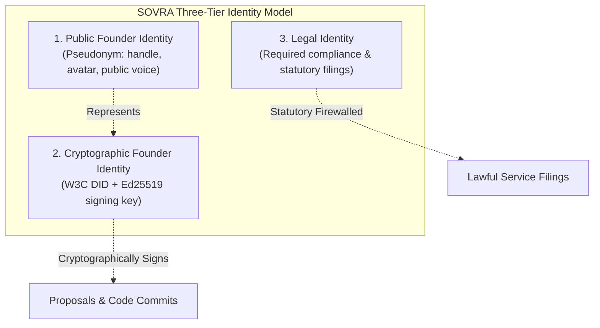

# SOVRA — OFFICIAL FOUNDER IDENTITY POLICY

> **Policy Identifier:** GOV-POL-001  
> **Status:** Proposed Foundational Governance Policy  
> **Governance Model:** Community-First, Founder-Independent  
> **Founder Identity Model:** Pseudonymous by Default  
> **Reveal Model:** Milestone-Based and Voluntary  
> **Version:** 1.0.0 | **Effective Date:** 2026-11-05  

---

## 1. Foundational Philosophy & Purpose

SOVRA is conceived and architected as a sovereign, community-governed, privacy-first digital ecosystem. The foundational premise of SOVRA is that **trust belongs in verifiable mathematics, cryptographic code, and transparent community governance—never in the personal authority, celebrity, or public persona of an individual.**

```
+-------------------------------------------------------------------------+
|                          FOUNDATIONAL PRINCIPLE                         |
|                                                                         |
|  "SOVRA belongs to its community, not to the public identity or         |
|   personal authority of its founder."                                   |
|                                                                         |
|  The founder initiates and guides the architecture, but cannot          |
|  permanently own, unilaterally dictate, or override community           |
|  governance.                                                            |
+-------------------------------------------------------------------------+
```

This policy formally codifies the rights, obligations, cryptographic controls, and boundaries governing the founder’s identity within the SOVRA network.

---

## 2. Three-Tier Identity Separation

To ensure absolute clarity and prevent ambiguity between social participation, cryptographic authorization, and lawful compliance, SOVRA establishes a strict three-tier identity model. These three concepts are **never interchangeable**:



### 2.1 Tier 1: Public Founder Identity (Pseudonym)
- The founder is entitled to operate across all SOVRA applications, social feeds, public discussions, and developer forums under a **public pseudonym** (e.g., `did:sovra:founder-alpha` or a chosen sovereign handle).
- Public disclosure of the founder’s legal name, photographic likeness, physical domicile, phone number, or personal history is **not mandatory**.
- The pseudonym protects the founder from physical coercion, regulatory weaponization, personal harassment, and undue centralization around an individual cult of personality.

### 2.2 Tier 2: Cryptographic Founder Identity (Verifiable DID)
- The founder’s public identity is tied to an immutable cryptographic identity:
  $$\text{Founder DID} = \text{did:sovra:}\mathcal{H}(\text{Ed25519\_PublicKey})$$
- Every official statement, technical roadmap proposal, release artifact sign-off, or code contribution attributable to the founder must be **digitally signed** by this identity.
- The cryptographic founder identity is distinct from ordinary administrator accounts and can be independently verified on-chain and across P2P swarms without revealing underlying personal data.

### 2.3 Tier 3: Legal Identity (Statutory Compliance)
- If and when legal, tax, trademark, or regulatory filings are mandated by applicable jurisdictions, those obligations are fulfilled through appropriate legal entities and designated compliance agents.
- **Strict Anti-Evasion Rule:** Pseudonymity is an architectural shield for privacy and community autonomy—it is **not a mechanism to evade lawful obligations, court orders, consumer protection laws, or financial accountability**.
- Tier 3 disclosures are strictly firewalled and are not leaked into Tier 1 or Tier 2 systems.

---

## 3. Cryptographic Distinction & Impersonation Prevention

1. **No Social-Only Proofs:** The founder cannot claim official project authority through third-party platforms (e.g., X/Twitter, Telegram, Discord) unless accompanied by a cryptographically signed message from the registered Founder DID.
2. **Deterministic Registry:** The canonical Founder Public Key is registered in the immutable genesis state or the on-chain [`FounderIdentityRegistry`](file:///d:/Sovra/packages/identity/src/governance/founder-identity.ts).
3. **Sybil Resistance:** Any entity attempting to impersonate the founder without a valid Ed25519 signature fails cryptographic verification automatically.
4. **No Special System Backdoors:** The founder DID possesses contribution and proposal rights, but **zero administrative master keys or backdoor bypasses**.

---

## 4. Rights and Non-Rights of the Founder

### 4.1 Guaranteed Founder Rights
- **Right to Pseudonymity:** The founder may remain pseudonymous indefinitely unless voluntary reveal conditions are met.
- **Right of Proposal:** The founder may submit Improvement Proposals (SIPs) to the community.
- **Right of Technical Defense:** In any governance dispute, the founder has the right to publish cryptographic dissenting statements for public review.
- **Right of Exit:** The founder may step down or depart at any time without compromising network operation.

### 4.2 Explicit Non-Rights (Absolute Restrictions)
- **NO Unilateral Treasury Drain:** Founder cannot withdraw community or ecosystem treasury funds without multi-party quorum approval.
- **NO Unilateral Parameter Change:** Founder cannot unilaterally modify tokenomics, block rewards, gas limits, or consensus rules.
- **NO Coin Minting or Burning:** Founder has zero access to arbitrary token creation or balance confiscation.
- **NO Decryption Access:** Founder cannot access end-to-end encrypted user communications or user private keys.
- **NO Veto over Governance:** Founder votes carry the exact same quadratic weighting as community participants.

---

## 5. Summary Table: Identity Attributes

| Attribute | Public Pseudonym (Tier 1) | Cryptographic DID (Tier 2) | Legal Identity (Tier 3) |
|:---|:---|:---|:---|
| **Public Visibility** | Publicly known handle | Publicly verifiable key | Strictly confidential / Regulated |
| **Verification Method** | Handle registry | Ed25519 digital signature | Statutory documentation |
| **Scope of Authority** | Discussion & outreach | Proposal & code sign-off | Corporate / legal filings |
| **Transferable?** | No | No (rotatable via MPC only) | Non-transferable |
| **Compulsory Disclosure?** | Never by governance vote | Always cryptographically public | Only when legally mandated |

---

## 6. Policy Enforcement & Amendment

This policy is immutable with respect to simple majority votes. Amendments to this policy require:
1. Formal submission of a Constitutional Amendment Proposal.
2. A minimum 90-day community discussion window.
3. An 80% supermajority approval with at least 40% active stakeholder quorum.
4. Zero retroactive unmasking provisions.
