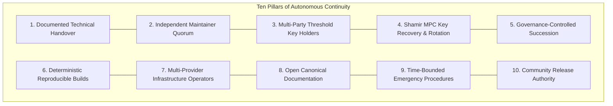

# SOVRA — FOUNDER SUCCESSION AND CONTINUITY PLAN

> **Plan Identifier:** GOV-SUC-001  
> **Status:** Operational Continuity Standard  
> **Applicability:** Founder, Technical Committee, Community Maintainers  
> **Version:** 1.0.0 | **Effective Date:** 2026-11-05  

---

## 1. Foundational Commitment: Zero Founder Dependency

A digital ecosystem that collapses when its founder disappears is not decentralized—it is a centralized project with delayed failure. SOVRA is engineered so that **the sudden loss, permanent incapacitation, voluntary departure, or bitter disagreement of its founder causes ZERO disruption to network consensus, tokenomics, messaging, or community governance.**

```
+-------------------------------------------------------------------------+
|                        THE INDEPENDENCE THEOREM                         |
|                                                                         |
|  "No single founder account, private key, hardware token, or personal   |
|   approval is required to produce blocks, route messages, execute       |
|   contracts, distribute rewards, or maintain the open-source code."     |
+-------------------------------------------------------------------------+
```

---

## 2. The Ten Required Continuity Systems



### 1. Documented Technical Handover
Every core subsystem—CometBFT L1 consensus, P2P BitSwap chunking, SQLite WAL storage, and WebAuthn onboarding—has full architecture specifications, data schemas, and API documentation committed directly to the repository under `docs/`.

### 2. Independent Maintainer Quorum
Code stewardship is distributed among at least five elected members of the Technical Committee located in different geographic jurisdictions. No single maintainer can merge code to `main` without peer review and automated test passage.

### 3. Multiple Authorized Key Holders
Administrative authorizations for contracts, package registries, and DNS routing are held by an M-of-N threshold committee (3-of-5 minimum), preventing a single lost key from stalling releases.

### 4. Secure Key Recovery & Rotation (MPC Shamir)
As implemented in [`packages/crypto/src/mpc.ts`](file:///d:/Sovra/packages/crypto/src/mpc.ts), critical administrative credentials and recovery shares are distributed across independent guardian enclaves using verifiable 2-of-3 Shamir secret sharing over $\text{GF}(2^8)$.

### 5. Governance-Controlled Succession
If the Founder DID remains inactive for 180 consecutive days without signing an on-chain heartbeat ping, the [`SuccessionManagementEngine`](file:///d:/Sovra/packages/identity/src/governance/succession.ts) triggers an automated succession state, transferring primary proposal stewardship to the Community Assembly.

### 6. Reproducible Software Builds
All node daemons (`sovrad`), client PWAs, and mobile APKs are deterministically compiled using locked containerized environments. Anyone can verify that published binaries match public repository commits bit-for-bit.

### 7. Independent Infrastructure Operators
Blockchain validators and P2P storage nodes run on independent hardware across multiple continents (Zurich, Falkenstein, Roubaix, Singapore). None of these nodes are operated by or dependent on the founder.

### 8. Open Technical Documentation
All specifications, protocol formats, threat models, and runbooks are open-source and mirrored across Kademlia DHT swarms and Git repositories.

### 9. Emergency Maintenance Procedures
Documented emergency incident runbooks enable independent engineers to diagnose, hotfix, and deploy patches during network anomalies using published multi-sig escalation paths.

### 10. Community-Approved Release Authority
Software releases, protocol hard forks, and client updates must be cryptographically signed by a 3-of-5 threshold of the Technical Committee and validated by the Community Assembly before mainstream distribution.

---

## 3. Scenarios of Founder Departure or Disagreement

```mermaid
stateDiagram-v2
    [*] --> ActiveCooperation: Founder actively guides project
    ActiveCooperation --> VoluntarySteppingDown: Founder chooses retirement
    ActiveCooperation --> FounderUnavailability: Inactivity > 180 Days
    ActiveCooperation --> GovernanceDispute: Founder disagrees with Assembly

    VoluntarySteppingDown --> CommunitySuccession: Multi-sig transfer executed
    FounderUnavailability --> AutomaticSuccession: Guardian timelock expires
    GovernanceDispute --> ConstitutionalPrecedence: Community vote stands; Founder may fork or dissent

    CommunitySuccession --> AutonomousEcosystem: Ecosystem continues
    AutomaticSuccession --> AutonomousEcosystem: Ecosystem continues
    ConstitutionalPrecedence --> AutonomousEcosystem: Ecosystem continues
```



### Scenario A: Founder Voluntary Withdrawal
1. The founder announces intent through a cryptographically signed statement.
2. Administrative threshold shares are rotated to elected community successors via [`KeyRotationAssertion`](file:///d:/Sovra/packages/identity/src/rotation.ts).
3. The founder retains their earned tokens and personal DID without special privileges.

### Scenario B: Founder Incapacitation or Disappearance
1. The [`GuardianHealthPingManager`](file:///d:/Sovra/packages/identity/src/guardian-liveness.ts) monitors the founder's heartbeat.
2. Inactivity scaling dynamically extends the safety buffer up to 180 days.
3. Upon timeout, the 3-of-5 Security Council activates the succession protocol, reassigning stewardship roles without altering token economics or private messages.

### Scenario C: Founder Disagreement with Community
1. If the Community Assembly passes an SIP that the founder opposes, the founder has the right to publish an official signed dissenting technical opinion.
2. **Community Supremacy:** The founder cannot secretly rollback code, confiscate funds, or halt validator execution.
3. **Right to Fork:** Like Bitcoin, if the disagreement is fundamental, the founder possesses the right to fork the open-source codebase, but cannot strip the SOVRA community of its ledger, nodes, or brand.

---

## 4. Verification & Succession Drill Cadence

To ensure readiness:
- **Annual Succession Drill:** Every 12 months, the community executes an end-to-end "Black Swan Drill" simulating the total sudden loss of the founder's credentials.
- **Verification Metric:** The network must continue block generation, message passing, and governance voting with zero administrative downtime.
