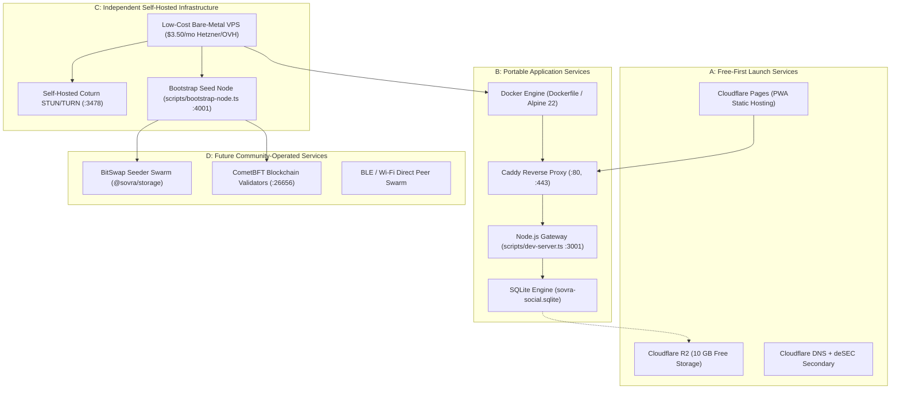

# SOVRA — FREE-FIRST HOSTING COMPARISON & MIGRATION MATRIX

> **Standard:** Empirical Cloud Vendor Evaluation & Zero-Lock-In Migration  
> **Status:** Phase 0 Architecture Deliverable  
> **Repository Commit:** `6306538` | **Date:** 2026-11-05  

---

## 1. Executive Summary & Philosophy

A fundamental trap for decentralized projects is relying on free hosting tiers that compromise architectural portability, inject proprietary SDK dependencies, or abruptly terminate unmetered traffic.

SOVRA employs a **Free-First Launch Strategy** with one strict constraint:
> **Every component running on a free tier must be capable of migrating to an independent, self-hosted Linux VPS or community node within 15 minutes without modifying code.**

Free services are treated as **ephemeral edge relays**, while the authoritative state rests in portable SQLite files, BitSwap UnixFS DAGs, and CometBFT blockchain blocks.

---

## 2. Cloud Provider Evaluation Matrix

| Category | Provider & Tier | Quotas & Limits | Long-Running TCP / WebSocket? | Account Suspension Risk | Data Export & Portability | Recommendation for SOVRA |
|:---|:---|:---|:---:|:---:|:---:|:---|
| **Static Frontend** | **Cloudflare Pages (Free)** | Unlimited requests, 500 builds/mo, 100 custom domains | N/A (Static files) | Low | High (Plain HTML/JS/CSS assets) | **RECOMMENDED PRIMARY** for static PWA & Web App bundle. |
| **Static Frontend** | **Vercel (Hobby)** | 100 GB bandwidth/mo, non-commercial only | No (Serverless 10s timeout) | High (Strict commercial terms) | Medium (Proprietary edge config) | **STAGING ONLY**; avoid for production monetization. |
| **Static Frontend** | **GitHub Pages (Free)** | 100 GB bandwidth/mo, 1 GB repo limit | N/A (Static files) | Low | High (Git repository) | **SECONDARY BACKUP** for static documentation and app fallback. |
| **Containers / Compute** | **Oracle Cloud Always Free (Arm)** | 4 OCPU Ampere, 24 GB RAM, 200 GB SSD, 10 TB egress/mo | **YES (Full root Linux VM)** | **HIGH** (Frequent unannounced reclamation) | **100% (Standard Ubuntu/Debian)** | **RECOMMENDED BOOTSTRAP** for Seed Nodes & Dev Gateway; must maintain real-time off-site WAL backups! |
| **Containers / Compute** | **Render (Free Web Service)** | 512 MB RAM, 0.1 CPU, sleeps after 15 min inactivity | **NO (Sleeps; no raw TCP 4001)** | Medium | High (Docker container) | **NOT RECOMMENDED** (Breaks P2P mesh & SSE streaming). |
| **Containers / Compute** | **Fly.io (Hobby/Free)** | 3 shared-cpu-1x VMs (256 MB RAM), 3 GB volume | Limited (Restricted outbound ports) | Medium | High (Dockerfile based) | **ACCEPTABLE** for stateless lightweight API relay. |
| **Containers / Compute** | **Koyeb (Free Tier)** | 512 MB RAM, 0.1 CPU, 2 services, global edge | HTTP/HTTPS only; no raw TCP | Low | High (Docker) | **STAGING ONLY** for REST API mirrors. |
| **Database** | **Self-Hosted SQLite WAL (In-Container)** | Limited only by host disk; sub-millisecond local reads | **YES (Native in-process)** | **ZERO** (No cloud vendor) | **100% Portable (`.sqlite` file)** | **PRIMARY PRODUCTION STANDARD**. Zero cost, zero latency. |
| **Database** | **Turso / libSQL (Free)** | 9 GB storage, 500 databases, 1B read rows/mo | Yes (HTTP/WebSocket) | Medium | High (Compatible with SQLite) | **SECONDARY OPTION** for edge read replicas. |
| **Database** | **Neon / Supabase (Free Postgres)** | 0.5 GB storage, project pauses after 7 days inactivity | Yes (Postgres protocol) | High (Auto-pauses) | Medium (pg_dump) | **NOT RECOMMENDED** (Breaks 24/7 uptime; SQLite is superior). |
| **Object Storage** | **Cloudflare R2 (Free)** | **10 GB storage, 1M Class A ops, 10M Class B ops, ZERO egress fee** | N/A (S3 REST API) | Low | **100% S3 Compatible** | **RECOMMENDED PRIMARY** for Litestream WAL replicas & media cache. |
| **Object Storage** | **Backblaze B2 (Free)** | 10 GB storage, 1 GB/day free egress | N/A (S3 REST API) | Low | **100% S3 Compatible** | **RECOMMENDED SECONDARY** for multi-cloud disaster backup. |
| **DNS & Routing** | **Cloudflare DNS (Free)** | Unlimited queries, anycast, DDoS protection, DNSSEC | N/A | Medium (Centralized US entity) | High (Standard BIND zone export) | **PRIMARY AUTHORITATIVE DNS**. |
| **DNS & Routing** | **deSEC.io (Free)** | Free, non-profit, automated DNSSEC, hosted in EU | N/A | Low (Academic/Non-profit) | **100% RFC Compliant API** | **RECOMMENDED SECONDARY DNS** (Independent EU jurisdiction). |
| **Monitoring** | **Grafana Cloud (Free)** | 10k Prometheus metrics, 50 GB logs, 3 alert rules | Yes | Low | High (Prometheus standard) | **RECOMMENDED EXTERNAL PROBER**. |
| **Monitoring** | **UptimeRobot / Better Stack (Free)** | 50 monitors, 5-minute intervals | HTTP/HTTPS/TCP checks | Low | High | **RECOMMENDED EDGE HEALTH MONITOR**. |

---

## 3. Deployment Architecture Segmentation

### 3.1 Category A: Free-First Launch Services (Zero Cost)
- **Static Assets:** `public/` web bundle compiled by `scripts/build-client-bundle.ts` deployed to Cloudflare Pages.
- **Continuous Disaster Backup:** Litestream container streams SQLite WAL changes to Cloudflare R2 (10 GB free) and Backblaze B2 (10 GB free).
- **Authoritative DNS:** Zone hosted on Cloudflare with automated AXFR sync to deSEC.io.

### 3.2 Category B: Portable Application Services
- Encapsulated entirely in root [`Dockerfile`](file:///d:/Sovra/Dockerfile) and [`docker/docker-compose.production.yml`](file:///d:/Sovra/docker/docker-compose.production.yml).
- Zero dependencies on proprietary AWS Lambda, Google Cloud Functions, or Cloudflare Workers APIs. Runs anywhere Docker or Node.js executes.

### 3.3 Category C: Independent Self-Hosted Infrastructure
- Bare-metal or cheap VPS instances running Debian 12 / Ubuntu 22.04 LTS provisioned via [`deploy/install.sh`](file:///d:/Sovra/deploy/install.sh).
- Hosts persistent TCP services that free tiers refuse to support: WebRTC Coturn relay (ports 3478, 5349), libp2p Noise_XX (port 4001), and CometBFT consensus (port 26656).

### 3.4 Category D: Community-Operated Services
- Independent node daemons ([`nodes/community-node/`](file:///d:/Sovra/nodes/community-node), [`nodes/storage-node/`](file:///d:/Sovra/nodes/storage-node)) operated by community members.
- Node operators earn micro-SOV through Proof-of-Usage for providing storage, routing, and consensus validation.

---

## 4. Provider Exit & Migration Trigger Thresholds

| Trigger Condition | Threshold | Automated Response / Runbook Execution |
|:---|:---|:---|
| **R2 Storage Consumption** | $\ge 8.5\text{ GB}$ (85% of free tier) | Activate BitSwap continuous pinning to community storage nodes; prune local cache. |
| **Cloudflare Pages Bandwidth** | Commercial notice received | Switch CNAME to secondary static origin or direct Caddy reverse proxy on VPS. |
| **Oracle Free VM Warning** | Inactivity / Reclamation notice | Auto-promote secondary Hetzner VPS; restore SQLite database from latest Litestream snapshot. |
| **Google STUN Rate Limiting** | $> 5\%$ ICE binding timeouts | Client app automatically fails over to community Coturn relays listed in signed discovery manifest. |
