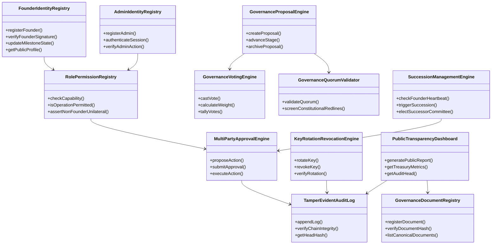
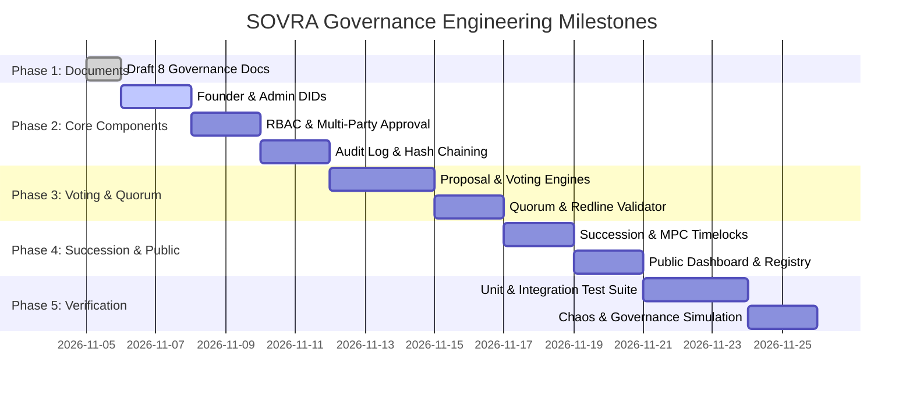

# SOVRA — GOVERNANCE IMPLEMENTATION ROADMAP

> **Roadmap Identifier:** GOV-PLAN-001  
> **Status:** Architecture Implementation Plan  
> **Scope:** Monorepo (`packages/identity`, `packages/crypto`, `chain/`, `apps/`)  
> **Version:** 1.0.0 | **Effective Date:** 2026-11-05  

---

## 1. Executive Summary

This roadmap establishes the detailed engineering, testing, and deployment schedule for implementing SOVRA’s Community-First, Founder-Independent governance framework. It maps the 13 required logical components to concrete TypeScript files, defines phased milestones, and establishes empirical verification gates.

---

## 2. Logical Components Mapping Matrix

| Logical Component | Implementation Target Path | Primary Responsibilities & Cryptographic Guarantees |
|:---|:---|:---|
| **1. `founder_identity_registry`** | `packages/identity/src/governance/founder-identity.ts` | Pseudonym separation, Ed25519 signature checks, milestone reveal state machine. |
| **2. `founder_cryptographic_identity`** | `packages/identity/src/governance/founder-identity.ts` | W3C DID specification (`did:sovra:founder:...`), keypair management. |
| **3. `admin_identity_registry`** | `packages/identity/src/governance/admin-identity.ts` | Authenticated admin DIDs, pseudonymous operators, session creation, brute-force lockout. |
| **4. `role_permission_registry`** | `packages/identity/src/governance/role-permissions.ts` | Least-privilege RBAC, explicit prohibition of unilateral founder powers. |
| **5. `multi_party_approval_engine`** | `packages/identity/src/governance/multi-party-approval.ts` | M-of-N threshold signatures (3-of-5), 48h timelocks, execution gates. |
| **6. `governance_proposal_engine`** | `packages/identity/src/governance/proposal-engine.ts` | Proposal lifecycle (SIPs), categorization, constitutional redline screening. |
| **7. `governance_voting_engine`** | `packages/identity/src/governance/voting-engine.ts` | Quadratic stake-weighting ($V = \sqrt{S} \times \text{age} \times \text{usage}$), Sybil resistance. |
| **8. `governance_quorum_validator`** | `packages/identity/src/governance/quorum-validator.ts` | Supermajority calculation, active quorum check, forced de-anonymization rejection. |
| **9. `tamper_evident_audit_log`** | `packages/identity/src/governance/audit-log.ts` | SHA-256 Merkle hash chaining, cryptographic signature verification. |
| **10. `key_rotation_and_revocation`** | `packages/identity/src/governance/key-rotation-revocation.ts` | Dual-signed rotation assertions, instant emergency compromise revocation. |
| **11. `succession_management`** | `packages/identity/src/governance/succession.ts` | 180-day inactivity timelock, automated transfer of stewardship, zero downtime. |
| **12. `public_transparency_dashboard`** | `packages/identity/src/governance/transparency-dashboard.ts` | Real-time public aggregation of coin cap, burned supply, treasury, and audit hash. |
| **13. `governance_document_registry`** | `packages/identity/src/governance/document-registry.ts` | Content-addressed SHA-256 storage of canonical constitutional policies. |

---

## 3. Phased Implementation Schedule

---

## 4. Acceptance Criteria & Release Verification Gates

Before tagging the release as production-ready:
1. **Zero Unilateral Control Gate:** Automated unit tests must verify that the founder cannot execute token minting, treasury transfers, or vote vetoes without multi-party signatures.
2. **Pseudonymity Gate:** Test cases must demonstrate complete workflow functionality using pseudonymous credentials without revealing legal identity.
3. **Constitutional Shield Gate:** A simulated governance proposal attempting to compel founder de-anonymization must be rejected fail-closed.
4. **Anti-Whale Gate:** Quadratic voting simulations must prove that 100 active community members defeat a 10,000 SOV single whale.
5. **Succession Invariance Gate:** Simulating the deletion of founder keys must result in 100% uninterrupted block generation and automatic stewardship transfer.
6. **Audit Tamper-Resistance Gate:** Bit-flip mutation in audit records must fail cryptographic verification immediately.
