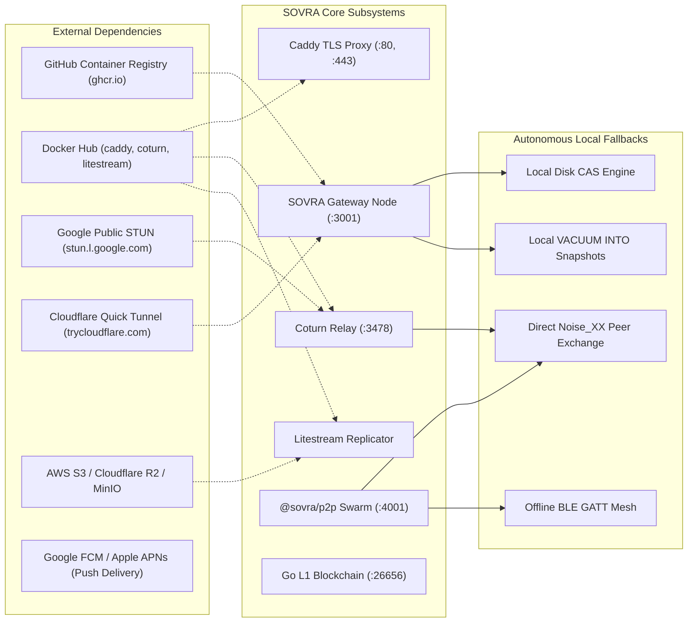

# SOVRA — HOSTING DEPENDENCY & PROVIDER MAP

> **Standard:** Zero-Trust Provider Dependency Mapping  
> **Status:** Phase 0 Architecture Deliverable  
> **Repository Commit:** `6306538` | **Date:** 2026-11-05  

---

## 1. System Dependency Overview

A foundational principle of SOVRA is that **no single hosting provider, domain registrar, or cloud platform controls the network**. This map traces all external hosting touchpoints, vendor dependencies, container base registries, and network relays currently present in the codebase.

---

## 2. Comprehensive Provider Dependency Analysis

| Provider / Resource | Service Type | Code Location | Free Tier Quotas & Limits | Failure Mode if Suspended | Sovereign Fallback / In-Repo Mitigation | Dependency Classification |
|:---|:---|:---|:---|:---|:---|:---:|
| **GitHub Actions / GHCR** | CI/CD & Docker Registry | [`.github/workflows/`](file:///d:/Sovra/.github/workflows), [`deploy/kubernetes/sovra-node.yaml`](file:///d:/Sovra/deploy/kubernetes/sovra-node.yaml) | 2,000 min/mo free; 500 MB storage | Container pulls fail; automated testing stops. | Can build locally via Docker Engine; publish to self-hosted Docker registry or Docker Hub. | Non-Critical (Build-time only) |
| **Docker Hub** | Base Images (`node:22-alpine`, `caddy:2`, `coturn`) | [`Dockerfile`](file:///d:/Sovra/Dockerfile), [`docker/docker-compose.production.yml`](file:///d:/Sovra/docker/docker-compose.production.yml) | 100-200 anonymous pulls / 6 hours | Image pulls rate-limited on VPS spin-up. | Pre-build and bundle Alpine rootfs or mirror base images to self-hosted registry. | Non-Critical (Operational) |
| **Google Public STUN** | WebRTC NAT Discovery | [`.env.example#L35`](file:///d:/Sovra/.env.example#L35) | Unmetered (fair use, undocumented) | Symmetric NAT callers fail initial ICE binding. | Internal Coturn STUN/TURN daemon runs on port 3478; mobile fallback to local Wi-Fi / BLE mesh. | **HIGH (Fallback Required)** |
| **Cloudflare Quick Tunnel** | Ephemeral Ingress (`trycloudflare.com`) | [`scripts/run-cloudflare-tunnel.js`](file:///d:/Sovra/scripts/run-cloudflare-tunnel.js) | Free, temporary, rate-limited, no SLA | URLs expire; subject to Cloudflare ToS termination. | Intended for dev only. Production uses Caddy + Let's Encrypt directly on bare metal/VPS. | Non-Critical (Dev only) |
| **AWS S3 / Cloudflare R2** | Continuous WAL Replication | [`docker/litestream.yml`](file:///d:/Sovra/docker/litestream.yml), [`scripts/media-storage-adapter.ts`](file:///d:/Sovra/scripts/media-storage-adapter.ts) | AWS: 5 GB (12 mo); R2: 10 GB free forever | Remote WAL replication stalls; off-site DR paused. | Local `SovraBackupManager` creates atomic `.sovra-backups` on disk; self-hosted MinIO cluster. | Medium |
| **Google FCM / Apple APNs** | Mobile Background Push | [`scripts/routes/push.routes.ts`](file:///d:/Sovra/scripts/routes/push.routes.ts) | Unmetered (subject to Apple/Google dev terms) | Background notification wakeups fail on iOS/Android. | WebSocket real-time event stream (`/api/realtime/stream`) and P2P GossipSub delivery while app is active. | Medium |
| **NodeSource / Debian Repos** | OS Packages & Node.js Runtime | [`deploy/install.sh`](file:///d:/Sovra/deploy/install.sh), [`scripts/deploy-vps.sh`](file:///d:/Sovra/scripts/deploy-vps.sh) | Free, open-source mirror network | `apt-get` fails if mirrors are blocked or down. | Can bundle standalone portable binaries using Node.js Single Executable Applications (SEA) or static Go. | Low |

---

## 3. Provider Independence & Portability Assessment

### 3.1 Authentication & Identity: 100% Provider-Independent
SOVRA maintains zero dependency on external auth vendors (e.g., Auth0, Firebase Auth, Okta, Google Sign-In). 
- Identity is anchored entirely in W3C DIDs (`did:sovra:*`).
- Authentication uses hardware WebAuthn Passkeys (`packages/crypto/src/webauthn.ts`) and Ed25519/secp256k1 key derivation.
- Compromise or shutdown of any cloud provider does not invalidate user identities or cryptographic credentials.

### 3.2 Monetary & Financial Ledger: 100% Sovereign
- The financial balance ledger is maintained by the Go Layer-1 blockchain (`chain/`) running CometBFT consensus with Pebble DB.
- There is zero reliance on Ethereum, Solana, AWS Quantum Ledger Database (QLDB), or Stripe.
- Independent validator nodes verify state transitions locally.

### 3.3 Media Delivery: Dual-Path Portability
- **Centralized Fallback:** Pluggable S3-compatible driver (`scripts/media-storage-adapter.ts`) supports any standard object storage API (MinIO, Wasabi, Backblaze B2, Cloudflare R2, AWS).
- **Decentralized Primary:** BitSwap and UnixFS DAG block exchange (`nodes/storage-node/`, `packages/storage`) allow media to be seeded and retrieved directly between peer nodes without third-party object stores.

---

## 4. Key Takeaways & Migration Priorities

1. **Eliminate Hardcoded Google STUN:** Replace Google STUN in `.env.example` with multi-provider STUN pools (e.g., coturn, stun.cloudflare.com, stun.matrix.org, community seeders).
2. **De-couple from Quick Tunnels:** Remove `cloudflared.exe` from default startup scripts; treat it strictly as an optional debug helper.
3. **Container Registry Redundancy:** Publish release containers simultaneously to GitHub Packages (`ghcr.io`) and Docker Hub, with scripts to build from source via root `Dockerfile`.
