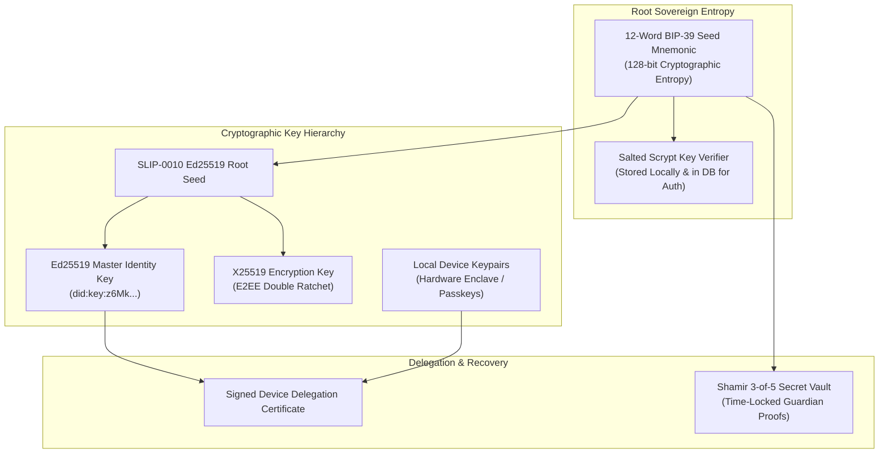

# SOVRA — IDENTITY & CRYPTOGRAPHY SPECIFICATION
## Sovereign Digital Identity, Key Derivation & Cryptographic Protocols (Layer A)

**Principal Architect:** Principal Cryptographer & Security Systems Architect  
**Date:** 2026-11-05  
**Version:** 1.0.0-PROPOSAL  
**Standard:** W3C DID Core, WebAuthn PRF, Shamir Threshold Schemes, NIST Post-Quantum (FIPS 203/204)  

---

### 1. Sovereign Identity Primitives & DID Architecture

SOVRA replaces centralized email/password accounts with self-sovereign cryptographic identifiers where users hold the sole mathematical authority over their data and identity.

---

### 2. Identifier Syntax & Public Formats

1. **W3C `did:key:` Derivation (Ed25519):**
   - Format: `did:key:z6Mk...`
   - Encoding: Multicodec header `0xed01` (2 bytes) prefixed to raw 32-byte Ed25519 public key, Base58BTC encoded with multibase prefix `z`.
2. **Canonical JSON Serialization (RFC 8785):**
   - All cryptographic signatures enforce canonical key ordering without whitespace before hashing:
     `{"action":"transfer","amount":1000,"from":"did:key:...","nonce":"123","to":"did:key:..."}`

---

### 3. Passkey & WebAuthn PRF Derivation

For zero-password biometric authentication:
1. **WebAuthn Credential Creation:** Device authenticates with Touch ID / Face ID / Windows Hello.
2. **HMAC-Secret / PRF Extension:** Device retrieves high-entropy PRF output seed:
   $$K_{PRF} = \text{HKDF-SHA256}(\text{PRF\_Secret}, \text{Salt = "sovra-vault-salt"}, \text{Info = "sovra-device-key"}, 32)$$
3. **ChaCha20-Poly1305 Vault Decryption:** $K_{PRF}$ unlocks the device's local private key vault without transmitting secrets to the server.

---

### 4. Shamir Threshold Recovery Scheme (No Universal Backdoor)

To recover lost accounts without creating an administrative master key:
1. **Polynomial Secret Splitting:** Master entropy is split into $n = 5$ shares with a recovery threshold of $k = 3$:
   $$f(x) = S + a_1 x + a_2 x^2 \pmod p$$
2. **Guardian Allocation:** Shares are distributed to:
   - Share 1: User personal cold backup (encrypted QR/paper).
   - Share 2: Guardian Peer 1 (trusted contact DID).
   - Share 3: Guardian Peer 2 (trusted contact DID).
   - Share 4: Guardian Peer 3 (trusted contact DID).
   - Share 5: Time-Locked Vault (releases after 14-day appeal window).
3. **Threshold Reconstitution:** Reconstructing the seed requires any 3 valid guardian signatures.

---

### 5. Post-Quantum Cryptographic Hybrid Layer (PQC)

To protect identity and long-term communications against future quantum computer attacks:
1. **Key Encapsulation (ML-KEM / Kyber-768):**
   - Ephemeral hybrid session keys combine classical X25519 Diffie-Hellman with NIST FIPS 203 ML-KEM:
     $$K_{shared} = \text{SHA-256}(SS_{X25519} \,\|\, SS_{ML-KEM})$$
2. **Digital Signatures (ML-DSA / Dilithium-3):**
   - High-value governance assertions and blockchain validator blocks support dual signatures (Ed25519 + ML-DSA).

---

### 6. Zero-Knowledge Groth16 Privacy Proofs

For anonymous voting, proof-of-humanity, and untraceable social endorsements:
1. **Curve:** BN254 (alt_bn128) pairing-friendly elliptic curve.
2. **Protocol:** Semaphore Groth16 zk-SNARKs.
3. **Verification Equation:**
   $$e(A, B) = e(\alpha, \beta) \cdot e(x \cdot \gamma, \delta) \cdot e(C, \delta)$$
   Verified on-chain via CosmWasm WASM precompiles in under 5ms.
