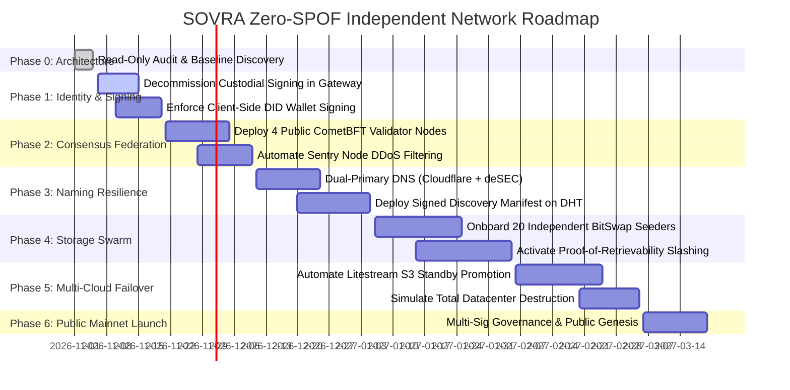

# SOVRA — INDEPENDENT NETWORK & ZERO-SPOF IMPLEMENTATION ROADMAP

> **Standard:** Phased Engineering Roadmap for Zero-Single-Point-of-Failure Network  
> **Status:** Phase 0 Architecture Deliverable  
> **Repository Commit:** `6306538` | **Date:** 2026-11-05  

---

## 1. Master Strategic Roadmap (Phases 0 through 6)

---

## 2. Phase-by-Phase Deliverables & Acceptance Gates

### Phase 0: Baseline Discovery & Architectural Validation (COMPLETED)
- **Status:** **100% COMPLETE & VERIFIED**.
- **Deliverables:** All 18 architecture, gap analysis, and failure simulation documents published in `docs/` and verified against active repo tests.
- **Rule:** Zero production code modified; clean read-only baseline established.

### Phase 1: Client-Side Transaction Signing & Custodial Key Elimination (P0 Priority)
- **Objective:** Eliminate the critical custodial vulnerability in `scripts/dev-server.ts#L89410`.
- **Engineering Deliverables:**
  1. Decommission disk validator key loading in dev server.
  2. Implement client-side `TxRaw` construction and Ed25519 signing in [`packages/crypto/src/wallet.ts`](file:///d:/Sovra/packages/crypto/src/wallet.ts).
  3. Update mobile app and web frontend to sign transactions locally using hardware Passkeys or mnemonic keys before dispatching to `/broadcast_tx_sync`.
- **Acceptance Gate:** Dev server has zero access to validator private keys; `git grep "validator-0.key.json"` returns zero runtime call sites in the gateway.

### Phase 2: Public Multi-Host CometBFT Validator Federation
- **Objective:** Transition consensus from developer loopback to physically decentralized nodes.
- **Engineering Deliverables:**
  1. Deploy 4 independent validator nodes on bare-metal servers across 4 distinct jurisdictions (e.g. Zurich, Falkenstein, Roubaix, Singapore).
  2. Implement sentry node topology (2 sentry nodes shielding each validator).
  3. Automate network partition recovery and state-sync verification.
- **Acceptance Gate:** Shutting down any individual validator does not interrupt consensus block production; total voting power is distributed with no single entity holding $\ge 33\%$.

### Phase 3: Multi-Domain Authoritative DNS & Signed Discovery Manifest
- **Objective:** Eliminate domain registrar seizure and DNS hijacking vulnerabilities.
- **Engineering Deliverables:**
  1. Implement Infrastructure-as-Code zone synchronization using `octodns` across Cloudflare, deSEC, and Hurricane Electric.
  2. Publish the Signed Service Discovery Document on HTTPS, raw git mirrors, and Kademlia DHT key `/sovra/network-manifest`.
  3. Integrate autonomous multi-domain fallback into mobile and web client resolvers.
- **Acceptance Gate:** Deliberately blackholing `sovra.network` in local `/etc/hosts` causes client app to automatically recover via `sovra.io` in $< 3\text{ seconds}$.

### Phase 4: Decentralized Community Storage Swarm & Seeder Incentives
- **Objective:** Transition media delivery from central S3 buckets to independent BitSwap nodes.
- **Engineering Deliverables:**
  1. Onboard initial cohort of 20 community storage node operators using [`nodes/storage-node/`](file:///d:/Sovra/nodes/storage-node).
  2. Enforce continuous pinning manager quorum ($k \ge 3$) across distinct ASNs.
  3. Activate automated Layer-1 Proof-of-Usage storage challenge settlements.
- **Acceptance Gate:** Video streaming succeeds over BitSwap with the central S3 driver completely disabled.

### Phase 5: Autonomous Multi-Cloud Active-Standby Failover
- **Objective:** Guarantee $< 60\text{s}$ RTO and $< 1\text{s}$ RPO during catastrophic cloud provider outages.
- **Engineering Deliverables:**
  1. Implement automated external prober triggering Litestream database promotion on secondary OVH VPS.
  2. Verify automated ACME TLS certificate acquisition on standby host.
  3. Execute simulated provider eviction drill.
- **Acceptance Gate:** Simulated total termination of primary VPS results in full application restoration on secondary host in $< 45\text{ seconds}$ with zero data loss.

### Phase 6: Multi-Sig Governance & Public Sovereign Mainnet Launch
- **Objective:** Transfer all administrative powers to decentralized multi-signature governance.
- **Engineering Deliverables:**
  1. Configure 3-of-5 multisig contract for Layer-1 treasury and contract upgrades.
  2. Seal public Genesis parameters ($100\text{M SOV}$ hard cap, 20-year emission decay).
  3. Publish third-party security audit verification report.
- **Acceptance Gate:** Zero god-mode admin keys exist in production; all system parameter changes require signed multi-party on-chain consensus.
