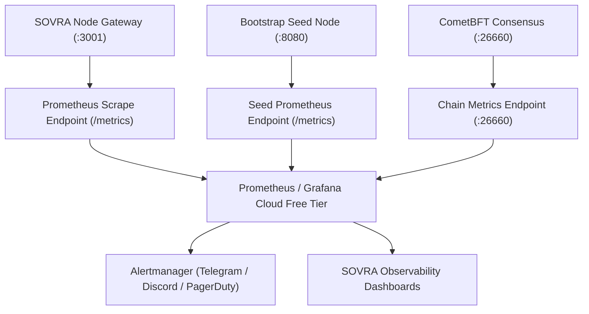

# SOVRA — INFRASTRUCTURE OBSERVABILITY, TELEMETRY & SELF-HEALING

> **Standard:** Prometheus-Native Observability & Guarded Autonomous Recovery  
> **Status:** Phase 0 Architecture Deliverable  
> **Repository Commit:** `6306538` | **Date:** 2026-11-05  

---

## 1. Observability Architecture

SOVRA embeds comprehensive, zero-dependency telemetry directly into its node daemons. Health metrics, peer RTT diagnostics, and database states are scraped natively via Prometheus without requiring proprietary agent software (such as Datadog or New Relic).

---

## 2. Standardized Health Probes & Endpoints

Every SOVRA container exposes four deterministic HTTP diagnostic probes:

| Endpoint | Standard Port | Protocol | Failure Threshold | Intended Consumer | Verification Test |
|:---|:---:|:---:|:---|:---|:---|
| **`/livez`** | `3001` | HTTP GET | HTTP status $\neq 200$ | Docker / K8s Liveness Probe | Responds `{"status":"live"}` immediately. |
| **`/readyz`** | `3001` | HTTP GET | Database locked or storage disk read-only | Ingress / Caddy Reverse Proxy | Validates DB connection & CAS writable. |
| **`/healthz`** | `3001` | HTTP GET | RSS memory $> 1.8\text{ GB}$ | Systemd watchdog / Ops alerts | Returns heap usage, DB state, uptime. |
| **`/metrics`** | `3001`, `8080` | HTTP GET | Prometheus scrape timeout ($> 5\text{s}$) | Prometheus server / Grafana | Standard text/plain Prometheus exposition. |
| **`/api/status`** | `3001` | HTTP GET | Process crash | Public status pages / mobile apps | JSON node capabilities, version, P2P peers. |

---

## 3. Seven Operational Dashboards

1. **SOVRA Infrastructure Dashboard:** CPU, RAM, disk I/O, open file descriptors, network bandwidth per container.
2. **Node Health Dashboard:** Active peer count, multiaddr listen states, circuit reservations, Kademlia routing bucket fullness.
3. **Provider Dependency Dashboard:** Health of external fallback STUN servers, object storage API response latency, Cloudflare Pages build status.
4. **Backup Status Dashboard:** Timestamp of latest Litestream WAL frame sync, replication lag (target $< 1.0\text{s}$), status of latest `VACUUM INTO` snapshot.
5. **Domain Health Dashboard:** Multi-resolver query latency across `1.1.1.1`, `8.8.8.8`, `9.9.9.9`, DNSSEC validation flags, ACME TLS expiration countdown.
6. **Blockchain Health Dashboard:** Current block height, block production interval (target $1.0\text{s}$), voting power distribution, mempool unconfirmed tx count.
7. **Incident Management & Solvency Dashboard:** Real-time Solvency Assertion tracking ($\Delta = \text{Total Supply} - \sum \text{Balances} \equiv 0.00$), and circuit breaker status.

---

## 4. Guarded Autonomous Self-Healing ([`scripts/self-healing-daemon.ts`](file:///d:/Sovra/scripts/self-healing-daemon.ts))

To ensure 24/7 reliability without requiring human intervention for minor operational glitches, SOVRA operates a background self-healing daemon.

### 4.1 Permitted Autonomous Actions (SAFE)
- **Automated WAL Checkpoints:** Runs `PRAGMA wal_checkpoint(TRUNCATE)` every 15 minutes to prevent WAL file runaway growth.
- **Cache Quota Pruning:** Automatically evicts unpinned UnixFS media chunks when disk cache exceeds $500\text{ MB}$.
- **Peer RTT Diagnostics & Blacklisting:** Detects misbehaving P2P peers (high latency $> 2,000\text{ms}$ or malformed gossip packets) and isolates them for 24 hours.
- **Ephemeral Process Restarts:** Systemd unit automatically restarts crashed gateway processes in $< 5\text{s}$.

### 4.2 Strictly Prohibited Self-Healing Actions (GUARDED)
> [!CAUTION]
> **Absolute Security Boundary:** Automated self-healing daemons are **strictly forbidden** from:
> 1. Altering financial balances, ledger state, or issuance schedules.
> 2. Minting, burning, or transferring tokens.
> 3. Modifying validator consensus keys, voting power, or validator sets.
> 4. Changing user access roles, admin privileges, or RBAC tables.
> 
> Any financial or consensus anomaly triggers the **Sovereign Circuit Breaker**, halting transactions and requiring multi-party cryptographic signature authorization to resume.
