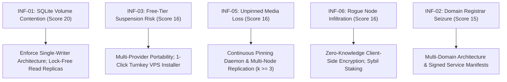

# SOVRA — INFRASTRUCTURE RISK REGISTER & MITIGATION MATRIX

> **Standard:** ISO 27005 / NIST SP 800-30 Infrastructure Risk Assessment  
> **Status:** Phase 0 Architecture Deliverable  
> **Repository Commit:** `6306538` | **Date:** 2026-11-05  

---

## 1. Risk Assessment Methodology & Scoring Matrix

Risks are evaluated using a standard quantitative matrix:
$$\text{Risk Score} = \text{Likelihood (1–5)} \times \text{Impact (1–5)}$$

- **Critical Risk (Score 16–25):** Immediate blocker; threatens network availability, user funds, or data integrity.
- **High Risk (Score 10–15):** Substantial vulnerability requiring architectural remediation prior to public launch.
- **Medium Risk (Score 5–9):** Operational hazard manageable through redundancy and monitoring.
- **Low Risk (Score 1–4):** Minor deviation with negligible impact on overall system continuity.

---

## 2. Infrastructure Risk Register

| Risk ID | Risk Title & Description | Domain | Likelihood (1-5) | Impact (1-5) | Score (1-25) | Severity | In-Repo Root Cause & Concrete Mitigation | Responsible Role |
|:---:|:---|:---|:---:|:---:|:---:|:---:|:---|:---:|
| **INF-01** | **Shared Disk Lock Contention on SQLite Volume** | Database | 4 | 5 | **20** | **CRITICAL** | `docker-compose.prod.yml` mounts single SQLite volume across multiple potential container replicas. *Mitigation:* Enforce Single-Writer Architecture: only `sovra-node` gateway mounts DB in read-write mode; satellite workers communicate over internal IPC or unix sockets. | Database Engineer |
| **INF-02** | **Primary Domain Registrar Seizure or DNS Outage** | Network | 3 | 5 | **15** | **HIGH** | `*.sovra.network` is hardcoded across client configs and certificates. *Mitigation:* Multi-domain registrar separation (`.network`, `.io`, `.app`), multi-provider authoritative DNS (Cloudflare + deSEC), and signed JSON discovery manifests. | Network Architect |
| **INF-03** | **Free-Tier Cloud Provider Account Suspension** | Hosting | 4 | 4 | **16** | **CRITICAL** | Treating free-tier hosting (e.g. Oracle Free, Render, Fly.io, Vercel) as permanent infra leads to sudden de-platforming. *Mitigation:* 100% containerized Docker portability; deploy across independent self-hosted VPS and community nodes. | Cloud Architect |
| **INF-04** | **Third-Party Google STUN Failure / Rate Limiting** | WebRTC | 4 | 3 | **12** | **HIGH** | `.env.example` points to `stun.l.google.com:19302`. If blocked, NAT hole-punching fails. *Mitigation:* Deploy decentralized Coturn relays across community nodes with dynamic DNS / DHT discovery. | DevOps Engineer |
| **INF-05** | **Decentralized Storage Block Eviction / Unpinned Media Loss** | Storage | 4 | 4 | **16** | **CRITICAL** | IPFS/BitSwap blocks are not guaranteed permanent without active seeders. *Mitigation:* Run autonomous Continuous Pinning Manager (`nodes/storage-node/src/pinning.ts`) maintaining $k \ge 3$ replica quorum across distinct ASNs. | Storage Architect |
| **INF-06** | **Rogue / Malicious Community Node Infiltration** | Security | 4 | 4 | **16** | **CRITICAL** | Open community node onboarding risks malicious nodes snooping or injecting poisoned routing. *Mitigation:* Zero-Knowledge server design: all data is client-side encrypted before transit; peer scoring and Sybil staking penalties. | Security Architect |
| **INF-07** | **Validator Private Key Exposure on Gateway Host** | Blockchain | 2 | 5 | **10** | **HIGH** | `dev-server.ts#L89410` loads validator key from disk for custodial signing. *Mitigation:* Decommission server-side signing; mandate client-side DID signing in `packages/crypto/src/wallet.ts`. | Blockchain Engineer |
| **INF-08** | **Litestream WAL S3 Replication Desynchronization** | Backup | 3 | 4 | **12** | **HIGH** | If S3 API credentials expire or bucket permissions fail, WAL replication silently halts. *Mitigation:* Automated health probe alerting on replication lag ($> 5\text{s}$) and local offline atomic `VACUUM INTO` snapshots. | DevOps Engineer |
| **INF-09** | **Mobile BLE Mesh Background Execution Termination** | Mobile/Mesh | 5 | 2 | **10** | **HIGH** | iOS suspends GATT peripherals after 15–30 seconds; Android Doze throttles BLE advertising. *Mitigation:* Silent APNs wakeups, foreground rendezvous, and ChaCha20-Poly1305 store-and-forward caching. | Mobile Engineer |
| **INF-10** | **Monolithic Dev Server Single-Process Failure** | Application | 4 | 3 | **12** | **HIGH** | `scripts/dev-server.ts` combines HTTP, SSE, WebSocket, and P2P in one 101k-line process. *Mitigation:* Systemd auto-restart in `deploy/sovra-node.service`; migrate incrementally to modular micro-services (`services/api`). | Principal Architect |
| **INF-11** | **Unmetered P2P Gossip Amplification DDoS** | Network | 3 | 4 | **12** | **HIGH** | GossipSub message floods can overwhelm low-bandwidth community nodes. *Mitigation:* Enforce GossipSub v1.2 peer scoring, per-peer bandwidth caps, and strict message size quotas ($< 64\text{ KB}$). | Distributed Systems Eng |
| **INF-12** | **Zero-Day Vulnerability in Base Container Image** | Security | 2 | 4 | **8** | **MEDIUM** | Alpine base image or npm dependencies contain unpatched CVEs. *Mitigation:* Daily Trivy container scans in CI/CD; automated Renovate bot dependency updates; run containers as non-root `node:node`. | DevSecOps Lead |
| **INF-13** | **Unbounded Storage Disk Exhaustion on Video Ingestion** | Storage | 4 | 3 | **12** | **HIGH** | Large video uploads fill host disk, causing SQLite to halt on write failure. *Mitigation:* Hard storage quota manager (`nodes/storage-node/src/quota.ts`) enforcing automated LRU cache pruning at 85% disk utilization. | Infrastructure Eng |
| **INF-14** | **DNSSEC Validation Failure During Key Rotation** | Network | 2 | 4 | **8** | **MEDIUM** | Misconfigured KSK/ZSK key rollover causes global recursive resolvers to reject domain. *Mitigation:* Dual-signature algorithm rollover; automated DNS health check probes verifying resolver resolution. | Network Architect |

---

## 3. High-Priority Mitigation Roadmap

