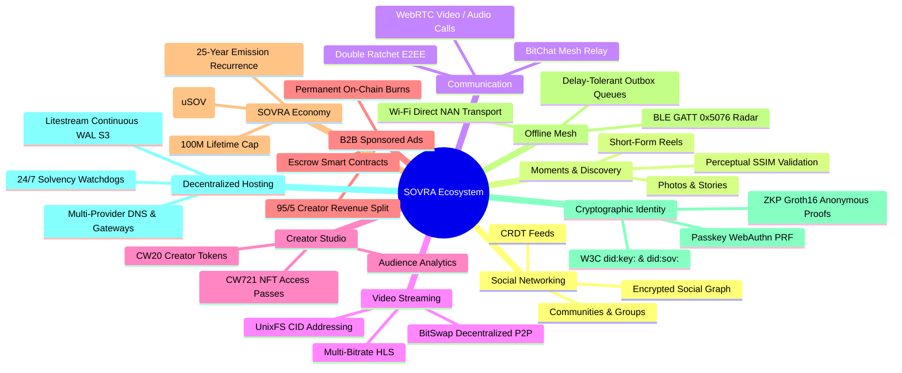

# SOVRA — MASTER TECHNOLOGY BLUEPRINT
## Comprehensive System Engineering & Multi-Ecosystem Integration Architecture

**Principal Architect:** Principal Software Architect, Distributed Systems Engineer & Cryptographer  
**Date:** 2026-11-05  
**Version:** 2.0.0-PROPOSAL  
**Standard:** Sovereign, Privacy-First, Cryptographically Attested Ecosystem  

---

### 1. Unified Ecosystem Vision

SOVRA integrates ten product capabilities into one seamless, privacy-preserving, decentralized technological stack:

---

### 2. Multi-Tier Technological Integration

1. **Client Tier (Web, iOS, Android, Desktop):**
   - Single sovereign private key pair generated on-device at genesis.
   - Transparent, client-side feed ranking (`PersonalFeedRanker`) with zero hidden central weights.
   - Encrypted local vault using ChaCha20-Poly1305 with OS biometrics binding.

2. **Decentralized Network Tier (P2P Swarm & Mesh):**
   - Transport independence over TCP, WebSockets, WebRTC DataChannels, and BLE.
   - Noise_XX mutual handshake establishing end-to-end forward secrecy across all nodes.
   - Kademlia DHT XOR distance lookup (< 1ms) and GossipSub v1.1 mesh broadcasting (> 120k msgs/sec).

3. **Authoritative Ledger Tier (Go Blockchain):**
   - CometBFT consensus engine running independent validator nodes with Pebble persistent storage.
   - Mathematical enforcement of the 100,000,000 SOV hard cap down to 1 uSOV.
   - CosmWasm smart contracts (CW20 tokens, CW721 collections, and AMM swaps) executed inside Wazero WASM sandbox.

4. **Distributed Storage & Media Tier:**
   - Multi-tier continuous pinning registry with BitSwap block exchange.
   - Lossless and adaptive-bitrate video transcoding to HLS playlists chunked into content-addressed UnixFS DAGs.

---

### 3. Cross-Ecosystem Invariants & Zero-Trust Policies

- **Never Trust Raw Headers:** Caller-supplied `X-Sovra-DID` or `x-admin-did` headers are strictly rejected without verified session tokens, cookie credentials, or signed Ed25519 request payloads.
- **Strict Monetary Invariance:** No deposit grants, referral bonuses, or application fees can mint coins outside the Go blockchain's strict 100M cap and 25-year emission schedule.
- **Zero Central Algorithmic Bias:** Recommendation models operate on-device via `PrivateKnowledgeTwin` and user-controlled parameters.
- **Anti-Fragile Hosting:** All state streams continuously to decentralized object storage; any node can be terminated without risking data loss.
