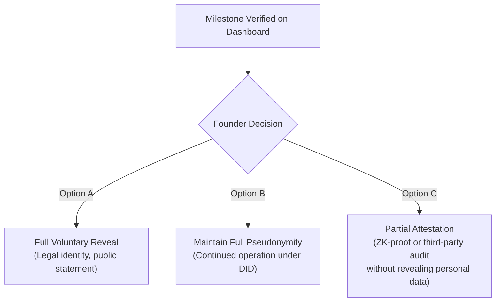

# SOVRA — MILESTONE-BASED FOUNDER REVEAL FRAMEWORK

> **Framework Identifier:** GOV-REV-001  
> **Status:** Voluntary Disclosure Protocol  
> **Applicability:** Founder, Core Architects  
> **Version:** 1.0.0 | **Effective Date:** 2026-11-05  

---

## 1. Executive Summary & Core Intent

The SOVRA Milestone-Based Reveal Framework provides an orderly, consensual, and transparent roadmap for optional founder identity disclosure as the ecosystem matures. 

```
+-------------------------------------------------------------------------+
|                        THE VOLUNTARY COVENANT                           |
|                                                                         |
|  "Milestones create opportunities for voluntary disclosure,             |
|   not deadlines, mandates, or compulsory identity requirements.         |
|   Under no circumstances can an ordinary governance vote or             |
|   majority resolution force the unmasking of the founder."             |
+-------------------------------------------------------------------------+
```

This model mirrors the progression of decentralized networks where initial technical guidance transitions into completely autonomous, community-operated infrastructure.

---

## 2. The Five Evolutionary Milestones

```mermaid
journey
    title SOVRA Decentralization & Voluntary Reveal Milestones
    section M1: Foundation
      Architecture Published: 5: Founder
      Pseudonym Established: 5: Founder
      Genesis Ready: 5: Founder
    section M2: Verification
      Security Audit Done: 4: Independent
      Protocol Verified: 5: Independent
      Open Contributors: 4: Community
    section M3: Governance
      Assembly Operational: 4: Community
      Treasury Multi-Sig: 5: Community
      Founder Limits Active: 5: Founder, Community
    section M4: Independence
      External Validators: 5: Independent
      No Single-Host SPOF: 5: Independent
      Succession Drill Passed: 4: Community
    section M5: Maturity
      Full Ecosystem Autonomy: 5: Community
      Multi-Year Stability: 5: Community
      Self-Sustaining Economy: 5: Community
```

---

### Milestone 1: Public Foundation
- **Prerequisites:**
  1. Full SOVRA master blueprint and technical specifications published.
  2. Cryptographic Founder DID registered and linked to public pseudonym.
  3. Foundational governance documents, tokenomics cap ($100,000,000\text{ SOV}$), and initial roadmaps released.
  4. Core open-source repositories made accessible for peer review.
- **Reveal Status:** *Default Pseudonymous*. Zero disclosure required. Focus is entirely on technical merit.

---

### Milestone 2: Independent Technical Verification
- **Prerequisites:**
  1. Comprehensive third-party security audits completed by independent cybersecurity firms.
  2. Core protocol claims (CometBFT L1 consensus, P2P BitSwap storage, Double Ratchet E2EE) empirically validated.
  3. Automated reproducible test pipelines operational across external environments.
  4. At least 5 independent, non-affiliated developers contributing pull requests.
- **Reveal Status:** *Voluntary Reflection Window 1*. The founder evaluates whether pseudonymous identity remains advantageous or if partial cryptographic attestations (e.g., proof of legal entity backing) are beneficial.

---

### Milestone 3: Community Governance Established
- **Prerequisites:**
  1. Community Assembly operational with quadratic voting on testnet/mainnet.
  2. Multi-party treasury vaults configured with independent community key holders.
  3. Administrative permissions strictly bounded; founder unilateral overrides eliminated.
  4. Conflict-of-interest registry and public audit logs fully active.
- **Reveal Status:** *Voluntary Reflection Window 2*. The community may hold a structured forum to discuss the merits of disclosure. The founder holds absolute personal discretion to remain pseudonymous.

---

### Milestone 4: Independent Ecosystem Operation
- **Prerequisites:**
  1. Multi-provider validator federation running across independent bare-metal and cloud providers (Zurich, Falkenstein, Roubaix, Singapore).
  2. BitSwap P2P storage swarm maintained by independent community seeders.
  3. Disaster recovery and founder absence drills successfully executed with zero downtime.
  4. The network can continue indefinitely without the founder’s presence or contribution.
- **Reveal Status:** *Voluntary Reflection Window 3*. The network is resilient against personal targeting; voluntary identity disclosure presents minimal systemic centralization risk.

---

### Milestone 5: Mature Community Ecosystem
- **Prerequisites:**
  1. Multi-year operational track record under community governance.
  2. Developer succession and emergency stewardship mechanisms fully tested in live drills.
  3. Economic self-sustainability demonstrated through organic ad settlement, creator payouts, and proof-of-usage.
  4. Proven ability of the community to resolve contentious hard forks and policy disputes peacefully.
- **Reveal Status:** *Voluntary Reflection Window 4*. Full maturity reached. Disclosure or continued lifetime pseudonymity (Satoshi model) are both recognized as fully legitimate postures.

---

## 3. Permissible Options at Any Milestone

Upon reaching any milestone, the founder may choose one of three formal paths:



1. **Option A: Full Voluntary Reveal**  
   The founder chooses to publicly associate their legal identity with the project via a digitally signed attestation containing their legal name, photographic verification, and personal statement.
2. **Option B: Continued Pseudonymity (Default)**  
   The founder continues to contribute and interact exclusively under their cryptographic Founder DID and public pseudonym.
3. **Option C: Partial Cryptographic Attestation**  
   The founder provides a zero-knowledge proof or a verified auditor attestation (e.g., confirmation of jurisdictional residency, compliance standing, or lack of felony record) without releasing personal identifying details.

---

## 4. Anti-Coercion Safeguards

To prevent governance weaponization or hostile takeovers:
- **Constitutional Bar on Forced Reveal:** Any governance proposal whose intent or effect is to force the founder to disclose personal identifying information is classified as `UNCONSTITUTIONAL` and rejected by the [`GovernanceQuorumValidator`](file:///d:/Sovra/packages/identity/src/governance/quorum-validator.ts).
- **No Economic Blackmail:** Governance cannot withhold earned or protocol-allocated founder tokens based on whether an identity reveal occurs.
- **Protection of All Contributors:** This anti-coercion rule applies equally to all core developers, moderators, and community node operators.
